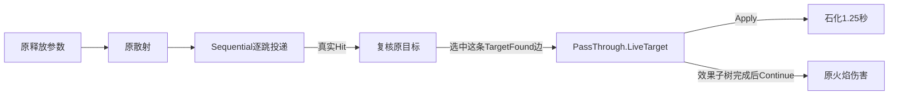

# 元素球与技能图组装：需求、示例和测试版边界

用户确定的正式规则是：精英掉落元素球，球代表一个GA已经拆出的行为片段；安装成功消耗球，移除不返还。随后用户要求先开发**不消耗资源的完整组装测试版**。因此当前实施先打通实际图GUI、草稿、应用、继续编辑和原技能施法，精英掉落、背包消耗及局内保存留作后续接入；不把免费模块库称为已经完成的正式掉落系统。

## 同类游戏能借鉴的部分

[Noita官方商店说明](https://store.steampowered.com/app/881100/Noita/)强调在探索中组合自己的魔法；[Magicraft官方说明](https://store.steampowered.com/app/2103140/Magicraft/)强调法术组合产生不同构筑；[Spell Disk官方说明](https://store.steampowered.com/app/2292060/Spell_Disk/)描述局内制作法术、磁盘和遗物并建立协同。这里借鉴的是“获得组件→作出构筑选择→从实际战斗验证”的循环，而不是照搬其具体数值、操作界面或宣称本项目拥有它们的全部排列自由。

本项目的特点是玩家能看见真实行为关系。因此可读性和因果比节点数量更重要：节点说明“做什么”，端口说明“何时继续”，连线说明“哪一个后继会收到什么数据”。显示默认配置、未提交草稿或一张说明性假图，均不能冒充下一次施法的有效图。

## 首个完整闭环

正式版预期：服务器确认精英的某一次生命被击杀→生成一次奖励票据→掉落球→服务器拾取入包→选择已有技能和准确节点/边→预览差异与消耗→确认安装→同次提交配方与扣球→下一次施法使用新图。

免费测试版用模块库替代掉落和扣球，其余编辑与施法逻辑仍是真实路径。入口沿用法师的 `RuntimeRecipe` 面板和独立临时测试Spec，隐藏后使用原T输入。该测试Spec的零修正本来就会运行导出的细图，所以无需为了演示改变所有正式无修正技能的兼容路径。正式技能栏、学习状态和存档不因测试预览被覆盖。

## 一个球的定义应是什么

球对应已审核的片段定义，不是在死亡时随意截取几个节点，也不携带另一整个GA的ActivateAbility流程。定义至少包含：稳定模块ID/版本、来源技能说明、图工厂、允许的操作、输入输出类型、所需Prepare/Scope/参数帧、生命周期与预算、固定参数或服务器认可的取值范围、图标及说明。

片段在画面上可以被折叠成一个能力模块，展开时必须对应实际节点及真实连接。例如“伤害后石化”通常包括伤害事实到原目标的解析和状态应用；不能让DamageResult凭空变成LiveTarget。

正式球实例与安装记录需分离：物品有OrbInstanceId，安装成功后留下InstallId/SourceId、模块版本、参数和目标定位。物品消失不等于丢失配方来源。拆除删除准确来源及其影响，不返球。后代模块若依赖被拆模块，先列出影响；首版可明确拒绝拆父模块，要求先拆后代，不能悄悄删除其它构筑。

## 示例：火球逐跳，再在伤害前插入石化



原边为 `ResolveImpact.TargetFound → InputDamage`，精准插入只重定向这一条边。适配器等待石化子树结束，再把保留的原载荷交给原伤害节点；其它同口兄弟边及共享尾部不变。若希望“伤害后石化”，应改在 `InputDamage.DamageResolved` 口追加 `ResolveDamageTarget → Petrify`，两者是不同的战斗时点。

Sequential并不是图中画回环：传播状态保存在该节点执行实例中。火球真实命中A→记录历史落点→等待→选择B→从上一落点生成新火球→等待B真实命中。只有角色第一次施法经过原起手动画和费用，不会每一跳重新激活完整雷链GA。

## GUI需要表达的状态

技能列表选择具体类版本；主画布展示服务器当前已接受的真实节点、端口和边；选择节点、输出口或一条准确连线后，只列相应配置支持的操作。右侧显示实际TypeId、参数含义和拒绝原因。候选修改以只读草稿显示新增、替换及断开的部分，明确标注尚未应用。

节点替换、输出口并行追加、精确边串接必须有不同操作。当前已接受图中的新节点可以被下一次操作选中；只从CDO基础图填一个下拉列表不满足此需求。草稿不能继续作为已接受目标编辑，必须先应用或放弃。日志刷新不能把用户的缩放、平移或选择重置。

测试库复用现有可信参数、Sequential/Forked、Petrify/Slow和Emitter→Beam模板，再增加有限域的精确边插入。不是任意节点都能编辑任意参数；库存载荷、原图证明和无限输出资格等限制继续保留，失败应有可读解释。

## 免费测试版的伪代码

以下是流程说明，具体接口以实现源码为准：

```text
OpenWorkshop():
    nonce = NewGuid()
    Server.BeginGraphPreview(actualDefinitionId, nonce)
    show(ownerAcceptedGraph)

ClickNodeOrEdge(selection):
    require selection belongs to acceptedGraph
    show(actualSupportedTemplates(selection))

Preview(selection, template, parameters):
    server validates owner, nonce, definition, revision, baseHash, acceptedHash
    patch = TrustedTemplate.Build(selection, parameters)
    contribution = FreezeWithServerSourceIdAndNextPriority(patch)
    candidate = Compile(base, allAcceptedContributions + contribution)
    if invalid: keep acceptedGraph; show reason
    else: retain exact contribution acrossGC; publish readOnlyDraft + token

Apply(token):
    require same preview session, revision and exact pending token
    SetContribution(retainedContribution)  // 免费测试，不扣资源
    publish accepted nodes/edges/history; clear draft

Cast():
    originalASC activates exact temporarySpec
    PreActivate freezes accepted recipe
    original target/animation/Notify starts same GraphInstance

Undo(source):
    rebuild from base + remaining contributions
    reject if another accepted rule still depends on removed nodes
    otherwise publish next revision; old in-flight casts keep old snapshots
```

正式消耗版不能简单在SetContribution之后删球。现有SetContribution成功会立即广播；背包变化也可能立即触发保存。后续必须增加联合Prepare/Commit：编译无副作用候选→预留并复核物品/配方版本→安静提交安装记录、配方和扣球→统一发布回执及一致快照；失败均保持旧状态，重复RequestId不得重复消耗。

## 首版安全边界和验收

- 免费测试通过临时Spec执行；同标签正式Spec按自身基础与外部来源执行。测试来源不得泄漏到正式施法。
- 当前配方底层按AbilityTag保存基础，测试期间外部规则必须同时适用于正式和当前测试版本。无法同时应用的类专属修改明确拒绝，要求先关闭测试，不静默改写正式技能。
- 没有正式基础或正式同标签技能的新工坊，不应把临时测试图当成外部生产规则的基础；正式规则接入等待明确基础。
- 编译后快照只读。应用/撤回只改变下一次施法；隐藏面板保留测试，关闭则回收准确会话的临时授予和在途图。
- 重复预览同样参数也可能产生不同节点身份，不能仅靠语义hash缓存画布；必须比较实际GUID/边或准确快照身份。
- 初始不包含精英奖励、物品资源和局内配方保存，正式消耗规则并未被免费模式推翻。

验收顺序是：真实图显示→节点替换→只插一条扇出边→新增节点继续编辑→草稿不生效/应用生效→旧版本在途冻结→依赖撤销拒绝/正确顺序撤销→原输入、动画、伤害与状态→双人归属→准确关闭与资源清理。用户最后确认可读性、动画表现和操作手感。实际测试状态见实施计划与Saved证据，本文不把源码存在标为测试通过。
