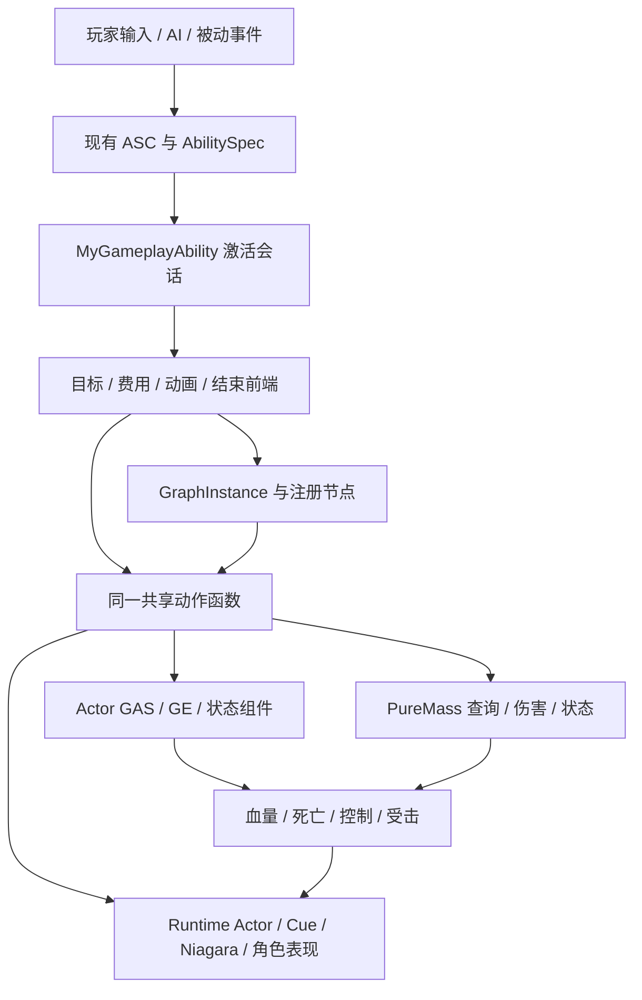
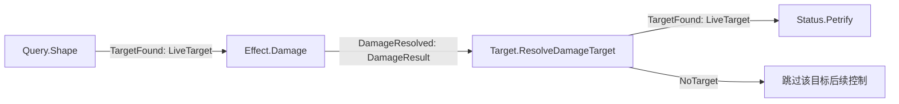

# 现有 GA 的组合、制作与游戏运行全流程

本文按 2026-11-09 的 `main` 实现编写，面向需要制作、调试或继续扩展技能的开发者。阅读顺序为：先理解资产与执行对象，再看一次实际施法，最后按具体技能追踪到动画、特效、伤害与清理。

核对基线是实现提交 `ed93126`、迁移收口提交 `f1d7252`，以及当前源码和 [迁移矩阵](ga-unified-migration-matrix.json) 中的实际配置。矩阵包含 302 个 GA 蓝图、54 个原生 GA 类、303 个配置；这些数量不是未来开发的上限。本文引用的资产数值是该次读回值，后续调参以 UE 资产为准。

本文说明已有实现，不创建新技能。已有资产、说明用的配置示意和仍待验收的行为会分别标明。函数箭头表示控制流；TargetData、Notify、Tick、RepNotify、RPC 回调会跨帧或跨机器，不应理解为一次同步 C++ 调用栈。

相关入口：[统一制作指南](ga-unified-authoring-guide.md) · [框架合同](ga-framework-reference.md) · [源码地图](ga-composition-code-map.md) · [迁移验证记录](2026-11-09-all-ga-migration-verification.md) · [build-ga](../skills/build-ga/SKILL.md)。

## 阅读导航

- [1. 一个完整技能由什么组成](#组成)
- [2. 原型与组合图怎样表达逻辑](#组合)
- [3. 图在运行时怎样执行](#执行)
- [4. 从角色和输入到实际激活](#接入)
- [5. 实例：火种与三重焰印](#旧组合实例)
- [6. 实例：范围石化与延迟石化](#石化实例)
- [7. 实例：Stander、时间轴与怪物攻击](#动画实例)
- [8. 从伤害逻辑到表现与网络](#表现)
- [9. 如何制作和接入下一个技能](#制作)
- [10. 生命周期与取消规则](#生命周期)
- [11. 调试顺序、源码索引与验证边界](#调试)

<a id="组成"></a>
## 1. 一个完整技能由什么组成

### 1.1 GA、节点、配置和表现的职责

| 对象 | 在本项目中的职责 | 不承担的职责 |
|---|---|---|
| GA 类 / GA 蓝图 | 技能身份、激活条件、目标请求、费用、动画前端、结束规则；被 ASC 授予并激活 | 不等于一个可任意接线的子效果 |
| `FGameplayAbilitySpec` | 某个 ASC 实际拥有的能力、等级、输入/状态标签和句柄 | 不是内容浏览器里的 GA 资产 |
| GA CDO | 类默认值，例如 Graph、Prototype、伤害 GE、蒙太奇引用 | 不应保存本次施法的计时器或目标 |
| 原型/动作 DA | 设计参数、旧子节点引用、武器动作事件、特效资源 | 不主动 Tick，不自行施法 |
| `UAbilityGraphDefinition` | 节点定义、边、入口、兼容配置、预算 | 不持有一场战斗的可变状态 |
| `UAbilityNodeConfig` | 一个节点的专用参数，可内嵌于图资产 | 不负责播放或结算 |
| `UAbilityNodeExecution` | 某次节点调用的真实执行对象，负责 Start/Advance/Stop | 不负责学习技能或占据输入槽 |
| 共享动作服务 | 原 GA 前端和图节点复用同一查询、伤害、投射、位移、状态实现 | 不重新激活完整旧 GA |
| GE / AttributeSet / Mass 服务 | 属性变化、伤害、控制等游戏结果 | 不由 Niagara 外观决定命中 |
| Montage / Timeline / Cue / Niagara / Runtime Actor | 动作时序或可见表现，按各自所有权播放和清理 | 不是同一种对象，也不统一由一条 Cue 通路负责 |

同一个技能还需要目录、图标、输入槽、角色授予和保存恢复接入。仅创建 `GA_XXX` 蓝图，玩家不会自动拥有它；仅创建 Niagara，技能也不会自动获得碰撞或伤害。

### 1.2 当前实际存在的接入方式



实际路由分为以下几类，但共享会话、动作和目标生命校验：

| 路由 | 典型实例 | 动作由谁安排 |
|---|---|---|
| 旧 DA 编译为统一图 | FireSeed、前四批原型、第五批 EmberBrand | 编译器把引用转为边，GraphInstance 调度 Driver |
| 显式图资产 | `GA_DelayedPetrify` | GA 的 Graph 属性指定定义，由任务/世界持有实例 |
| 原生前端临时构造图 | 第六批 PetrifyingGaze、传统 ArcaneNova 等 | C++ 根据真实专属参数构造节点，仍由注册策略执行 |
| 动画前端调用共享动作 | Stander、武器、StoneGolem 等 | 原 Montage/Timeline/攻击宿主决定何时调用动作 |
| 管理型入口 | 基类、攻击选择器、被动激活监听 | 管理能力选择或事件；不应描述为通用攻击节点 |

迁移后的“统一”是同一扩展协议和实际动作复用。它不表示所有 GA 都改用同一种动画任务，也不表示所有 GA 都拥有一个持久化的 Graph DA。蓝图中保留的旧图可能仅用于审计；若原生 `ActivateAbility` 不再调用旧 K2 激活链，修改旧图不会改变实际行为。

<a id="组合"></a>
## 2. 原型与组合图怎样表达逻辑

### 2.1 旧原型：用 DataAsset 引用连接行为

前四批 `UAbilityPrototype` 使用 `Kind` 和 `OnHit` / `OnPeriod` / `OnExpire`。同一份参数可以由 Actor 前端或 Mixed 前端引用，但其兼容 profile 和目标处理不同。

| 行为组 | 已有 Kind |
|---|---|
| 投射与追踪 | Projectile、Multishot、Homing、Piercing、Returning |
| 即时空间与连续传播 | Burst、Cone、Ring、Line、Wave、Chain |
| 持续/定时/宿主 | Beam、Surface、Orbit、Field、Trap、Emitter、Delay |

第五批 `UExtensionNode` 派生自原型类型，但实际行为由 **Behavior** 决定：Attach、Stack、Displace、Projectile、Chain、Burst、Delay、Surface。连接使用 `HitChild`、`PeriodChild`、`CompleteChild`。不能因为继承里还存在 `Kind` 或 `OnHit` 就把它们当成扩展节点实际执行字段。

例如根投射物命中后生成范围效果，表达的是“投射物行为产生事件 → 执行范围子行为”，不是“先完整激活 GA_A，再完整激活 GA_B”。所有子行为沿用本次来源、等级、伤害上下文与预算，通常不再单独提交子 GA 的费用。

### 2.2 旧引用怎样进入新执行框架

实际入口是 [AbilityLegacyGraphCompiler.cpp](../Source/test_25d/Private/AbilitySystem/Unified/AbilityLegacyGraphCompiler.cpp)：

1. 原 GA 完成目标准备，选择 `LegacyActor.v1`、`LegacyMixed.v1` 或 `LegacyExtension.v1`。
2. `Compile` 创建临时 `UAbilityGraphDefinition`，设置 **SchemaVersion=2** 和明确的兼容 profile。
3. `FreezeParameters` 复制可达参数和子引用。共享原始 DA 保持只读；本次施法使用快照。
4. `AddNode` 按原资产、深度和是否单弹生成稳定 NodeId，给每个节点配置实际 TypeId。
5. 旧 `OnHit/OnPeriod/OnExpire` 映射为同名图端口；扩展 `CompleteChild` 映射到 **OnExpire**。Multishot 容器通过 `Multishot` 边调度单弹实例。
6. `ValidateForAuthoring` 校验定义。`Execute` 启动 GraphInstance，再交给当前世界的 `UAbilityGraphWorldSubsystem`。
7. `UAbilityLegacyNodeExecution::Start/Advance` 驱动 Actor、Mixed 或 Extension Driver。旧 Runtime Actor 保留复制与表现职责。

TypeId 形式为 `Legacy.Actor.Projectile`、`Legacy.Mixed.Projectile`、`Legacy.Extension.Stack` 等。`Parameters` 是逻辑参数快照，`PresentationParameters` 是可供复制解析的稳定原资产引用；不要将运行时临时 UObject 当成可复制资产。

编译器按旧深度 0…3 有限展开，并限制配置遍历和定义规模。它不是允许任意无限循环的新图编辑器；扩展 DA 仍须通过自身 `ValidateGraph`。新显式图要求 DAG，取消范围当前仅支持整次 Cast，枚举存在 Node/Subtree 不表示已经实现。

### 2.3 新图：明确节点、端口与载荷

图的真实字段见 [AbilityGraphDefinition.h](../Source/test_25d/Public/AbilitySystem/Unified/AbilityGraphDefinition.h) 和 [AbilityGraphTypes.h](../Source/test_25d/Public/AbilitySystem/Unified/AbilityGraphTypes.h)：

```text
UAbilityGraphDefinition
  SchemaVersion = 2
  CompatibilityProfile = UnifiedV2
  EntryNodeId = 某一个稳定节点 GUID
  Nodes[] = { NodeId, TypeId, Config }
  Edges[] = { From, OutputPort, To }
  Budget / BudgetPolicy / CancelScope
```

**默认构造值仍是 Schema 1 / UnifiedV1。新建图必须显式设置 Schema 2 / UnifiedV2。** 既有延迟石化样例仍保留 Schema 1，不能因为框架升级就认定它的资产版本也自动改变。

节点类型由 `FAbilityNodeRegistry` 注册的 `ConfigClass`、`ExecutionClass`、输入类型和端口决定。图资产保存参数；真实 C++ 执行类负责行为。当前操作依据 DataAsset 属性、作者脚本和 C++，不应假定已经提供类似蓝图 EventGraph 的专用拖拽节点编辑器。

| 载荷 | 能提供什么 | 不能假定什么 |
|---|---|---|
| Origin | 位置、方向与来源上下文 | 不保证有活敌人 |
| LiveTarget | 服务器捕获的同一目标生命令牌 | 不能在延迟后不复核就直接伤害 |
| ConfirmedImpact | 已确认命中的位置、方向和原目标身份 | 目标可能已经死亡或被对象池复用 |
| DamageResult | 伤害尝试/已知结果与历史命中快照 | 不代表目标仍活着，也不保证 Actor 路径能给出净伤害 |

典型端口连接：

| 来源节点 / 端口 | 输出 | 可接的典型后继 |
|---|---|---|
| `Query.Shape.TargetFound` | LiveTarget | `Effect.Damage`、`Status.Petrify` |
| `Effect.Damage.DamageResolved` | DamageResult | `Target.ResolveDamageTarget`，或只需要位置的后继 |
| `Target.ResolveDamageTarget.TargetFound` | LiveTarget | 对原目标继续石化、施加 Actor GE |
| `Legacy.*.OnHit` | ConfirmedImpact | 位置爆炸，或 `Target.ResolveImpact` 后再控制活目标 |
| `Legacy.*.OnPeriod / OnExpire` | Origin | 周期/结束时的位置效果 |
| `Control.Delay.Completed` | LiveTarget | 保留原目标的延迟后续行为 |

`Control.Delay` 目前默认要求 LiveTarget，不是任意载荷的通用延迟转换器。把 Ground/Origin 直接接到这个节点会不匹配。`Cancelled`、`Failed` 用于终止诊断，校验器拒绝用它们继续调度业务效果。

`OnExpire` 与 `Completed` 也不同：前者是旧行为约定的正常到期/结束子效果事件；后者通知图“这次节点调用已终止”。连错端口可能导致不触发、额外触发或时机变化。

### 2.4 一个 Schema 2 组合说明例子

下面是用现有注册策略可以表达的**设计示意，并非本次新增的游戏资产**：



以 Self/Ground 入口给 Query 提供中心，Query 逐个捕获目标。Damage 清除活目标权限并输出历史结果；Resolve 节点复核原生命，只有仍有效才输出 LiveTarget。致死目标不能被重新捕获为池复用后的另一只怪物。

这一图只表达查询、伤害、石化，没有自动加入挥手蒙太奇、范围红圈或爆炸 Niagara。若设计要求这些表现，必须另行配置已有表现策略或由专属动画前端在正确事件调用共享动作。

### 2.5 现有可复用动作的查找入口

以下按注册能力分组，具体参数类、输出端口和实际前端支持范围以 [注册表](../Source/test_25d/Private/AbilitySystem/Unified/AbilityNodeRegistry.cpp)、对应 `Nodes/Ability*` 文件和矩阵为准。不能把某个节点的可选能力当成每一个旧 GA 的默认配置。

| 用途 | 已有 TypeId / 策略族 |
|---|---|
| 旧 18 Kind / 第五批 8 Behavior | `Legacy.Actor.*`、`Legacy.Mixed.*`、`Legacy.Extension.*` |
| 查询、伤害、历史目标复核 | `Query.Shape`、`Effect.Damage`、`Target.ResolveImpact`、`Target.ResolveDamageTarget` |
| 延迟与石化 | `Control.Delay`、`Status.Petrify`、`Status.PetrifyArea` |
| 第六批分叉连锁 | `Delivery.ForkedChain` |
| 传统近战/新星/碎片 | `Melee.Contact`、`Shape.ArcaneNova`、`Shape.ArcaneShards` |
| 传统投射物/召唤 | `Delivery.ActorProjectiles`、`Spawn.Summon` |
| 引导闪电/环绕火球 | `Channel.Electrocute`、`Channel.OrbitingFireBolts` |
| 角色/武器 | `Combat.CharacterStrike`、`Delivery.WeaponProjectile`、`Status.GuardWindow`、`Movement.Character` |
| 怪物接触/弹弓/召唤 | `Combat.TelegraphedContact`、`Delivery.EnemySling`、`Spawn.ShamanMinions` |
| 怪物专属 | `Move.GruxCharge`、`Status.GruxRoarArmor`、`Field.ShroomSpore` |
| 自身 GE / 所属状态 | `Effect.GameplayEffect`、`Status.OwnedEffect` |
| 活 Actor 目标 GE / 所属状态 | `Effect.GameplayEffectTarget`、`Status.OwnedEffectTarget` |

基础 GA 和 AI 选择器没有强行包装成“攻击节点”；它们管理入口或选招。Nova 当前由 `UMyArcaneNova::ActivateAbility` 在服务端即时 Commit 后构造 `Shape.ArcaneNova` 图，不播放蒙太奇。Melee/Shards 等原前端是否有动画、何时提交费用，应逐类阅读，不能把同一行列出的策略理解为相同施法流程。

<a id="执行"></a>
## 3. 图在运行时怎样执行

### 3.1 定义、调用和激活不是同一个身份

| 身份 | 作用 |
|---|---|
| AbilityTag / SpecHandle | 稳定技能身份 / 此 ASC 的授予实例 |
| 激活会话 GUID | 区分本 GA 的两次激活，避免旧回调干扰新一轮 |
| NodeId | 图资产中的节点定义身份 |
| ExecutionId | 一次图执行的身份 |
| NodeInvocationId | 某个节点在此次图中的一次实际调用 |
| EventSequence / 动作 Sequence | 同一调用/动作的事件去重 |
| Source/Target token | 原世界、ASC Avatar、运行批次、Actor 池租约或 Mass 实际实体身份 |

同一个范围查询命中五个目标，可以让同一个 Damage 节点定义被调用五次。它们有不同 InvocationId；不会把五只敌人共用一份可变目标状态。

### 3.2 从启动到清理的函数顺序

```text
GA 前端准备 FAbilityNodeInput
  -> UAbilityTask_RunGraph::RunAbilityGraphWithInput / 世界持有入口
  -> UAbilityGraphInstance::StartWithInput
       Validate 图、profile、输入、来源
       DuplicateObject 冻结本次配置
       InvokeNode(EntryNodeId)
         Registry.Find(TypeId)
         创建 ExecutionClass
         Execution.Start(...)
           Publish / RequestChild
       DrainEvents（Schema 2 首次启动也会有界排空）
后续 Tick
  -> Task.TickTask / WorldSubsystem.Tick
  -> GraphInstance.Advance
       重新校验来源和目标
       Execution.Advance
       DrainEvents -> 按匹配端口 InvokeNode 后继
无活动调用且队列为空
  -> Finish(Completed) -> OnFinished -> GA/世界释放所有权
```

`Publish` 是向受控队列提交事件，不是递归激活另一个完整 GA。默认预算为 64 次调用、256 个累计事件、32 个活动节点、深度 8、每轮最多处理 64 个事件。旧兼容 `LegacyStreaming` 允许长期渠道累计事件持续增长，活动数上限可为 64；队列、深度和总子调用预算仍有界。

旧递归调用已改为 FIFO 调度，因此不能声称所有同步回调先后与旧版本逐条完全相同。预算和失败处理属于玩法合同，不能通过不断新建上下文绕开。

### 3.3 公共会话怎样防止重复命中和重复 Commit

`UMyGameplayAbility::PreActivate` 建立 `FAbilityExecutionSession`，捕获本次来源。`CommitAbility` 经 `TryCommit` 缓存一次完整提交的结果。`DispatchExecutionAction` 经 `ExecuteAction(Action, Sequence)` 在执行前记录序号，拒绝同动作重复或倒退事件。

去重保护不能修复错误设计的两条伤害通路：如果 Notify 与 Timeline 各自使用不同动作名或序号，同一接触仍可能结算两次。制作时必须明确谁是唯一命中入口。

会话还支持 Cleanup 和信号。结束时先关闭会话，随后停止所属任务、计时器和效果；同步伤害回调可能导致取消、死亡、换 Avatar 或再次激活，后续代码必须重新核验来源与当前会话。

<a id="接入"></a>
## 4. 从角色和输入到实际激活

### 4.1 能力在玩家身上的来源

`AMyPlayerState` 构造函数创建 ASC、AttributeSet、Backpack、Equipment；ASC 开启复制、使用 Mixed GE 复制模式。它们不是每次施法新建。`APlayerCharacter::PossessedBy` 在服务端调用 `InitAbilityActorInfo`、`LoadProgress` 和装备 `ReconcileEffects`；`OnRep_PlayerState` 在客户端补建 ActorInfo。`InitAbilityActorInfo(PlayerState, Pawn)` 中 Owner 是 PlayerState，Avatar 是当前 Pawn，因此重生/换角色后同一 ASC 也不能继续代表旧 Pawn。

普通玩家的授予路径：

```text
APlayerCharacter::PossessedBy
  -> InitAbilityActorInfo
  -> LoadProgress
     -> 新存档：InitlizeDefaultAttributes -> ABaseCharacter::AddCharacterAbilities
        -> ASC::AddCharacterAbilities(StartupAbility)
           -> 创建 FGameplayAbilitySpec(Level=1)
           -> DynamicAbilityTags 加 StartupInputTag、Abilities.Status.Equipped
           -> GiveAbility
        -> AddCharacterPassiveAbilities -> GiveAbility -> TryActivateAbility
     -> 旧存档：ASC::AddCharacterAbilitiesFromSaveData
        -> 恢复等级/槽位/状态；装备专属能力不当作永久学习能力恢复
     -> UpdateAbilityStatuses：扫描当前 GameMode::AbilityInfo 中达到等级要求且尚无 Spec 的技能
  -> EquipmentComponent::ReconcileEffects
```

`GetAbilityInfo` 读取当前 `AMyGameModeBase::AbilityInfo`。把 GA 做成资产不等于自动进入技能树或自动授予；需区分默认 StartupAbility、目录可学习能力和装备临时能力。

`APureMassPlayerCharacter` 沙盒路径不同：`PossessedBy` 初始化属性、清旧能力并按沙盒 StartupAbility 重授予，然后对账装备；不走普通角色的正式存档 LoadProgress。不能把沙盒授予流程写成全项目唯一流程。Stander 继承剑盾/地牢角色链，实际入口需跟随当前所选角色与 GameMode。

源码定位：

- [MyPlayerState.cpp:23](../Source/test_25d/Private/Player/MyPlayerState.cpp#L23) 构造；`:57` 复制成长字段。
- [PlayerCharacter.cpp:66](../Source/test_25d/Private/Character/PlayerCharacter.cpp#L66) PossessedBy；`:83` OnRep_PlayerState；`:125` InitAbilityActorInfo；`:156` LoadProgress。
- [BaseCharacter.cpp:267](../Source/test_25d/Private/Character/BaseCharacter.cpp#L267) AddCharacterAbilities（先检查 Authority）。
- [PureMassPlayerCharacter.cpp:24](../Source/test_25d/Private/PureMass/PureMassPlayerCharacter.cpp#L24) ActorInfo；`:86` 沙盒 PossessedBy。
- [MyAbilitySystemComponent.cpp:41](../Source/test_25d/Private/AbilitySystem/MyAbilitySystemComponent.cpp#L41) 默认主动；`:58` 默认被动；`:216` UpdateAbilityStatuses；`:528` 存档授予。
- [MyAbilitySystemLibrary.cpp:163](../Source/test_25d/Private/AbilitySystem/MyAbilitySystemLibrary.cpp#L163) 当前 GameMode 的目录选择。

### 4.2 技能菜单、武器装备与技能栏

技能菜单：`USpellMenuWidgetController::SpendPointButtonPressed -> ServerSpendSpellPoint` 解锁/升级，`EquipButtonPressed -> SpellRowGlobePressed -> ServerEquipAbility` 换槽。服务器按 AbilityTag 找 Spec，验证状态、主动/被动槽匹配与装备槽所有权；替换旧槽，取消需要结束的旧技能，修改 DynamicAbilityTags，`MarkAbilitySpecDirty(*Spec,true)` 后发 `ClientEquipAbility/ClientUpdateAbilityStatus` 刷新所属客户端 UI。RPC 通知不是 Spec 复制本身；`OnRep_ActivateAbilities` 确认能力类引用已映射才广播 AbilitiesGiven。

武器：装备事务调用 `PrepareWeaponSet` 验证配置、当前 Avatar 为 Stander、能力可取消性等，预先 `GiveAbility` 新组；`CommitWeaponSet` 才撤销旧组的精确 SpecHandle、恢复被挤占普通技能槽、接管新组并按配置分配 InputTag。`DiscardWeaponSet` 只清理未提交的新句柄。换武器本质是改变这组 Spec 和槽位，不是让所有 GA 自己查询背包再决定攻击方式。

外观另有链：`OnRep_State -> RefreshWeaponVisuals -> AStanderPlayer::ApplyWeaponSetVisuals`。装备快照、能力 Spec、UI 操作回执的到达顺序不保证一致；客户端不能收到成功回执就自行扣物品或生成 GE。

源码定位：

- [SpellMenuWidgetController.cpp:124](../Source/test_25d/Private/UI/WidgetController/SpellMenuWidgetController.cpp#L124) 加点按钮；`:150` 装备按钮；`:164` 槽位选择；`:178` 装备 UI 回调。
- [MyAbilitySystemComponent.cpp:170](../Source/test_25d/Private/AbilitySystem/MyAbilitySystemComponent.cpp#L170) OnRep_ActivateAbilities；`:239` ServerSpendSpellPoint；`:377` ServerEquipAbility；`:444` 被动表现多播。
- [EquipmentWeaponAbilities.cpp:57](../Source/test_25d/Private/Equipment/EquipmentWeaponAbilities.cpp#L57) PrepareWeaponSet；`:126` CommitWeaponSet；`:210` RefreshWeaponVisuals。
- [EquipmentComponent.cpp:542](../Source/test_25d/Private/Equipment/EquipmentComponent.cpp#L542) OnRep_State。

### 4.3 从键鼠到实际 GA 激活

`UMyInputComponent::BindAbilityActions` 遍历 InputConfig 的 Action/InputTag 对：Started 绑定 Pressed，Completed 绑定 Released，Triggered 绑定 Held。键盘移动是独立 MoveAction，鼠标左键不再驱动自动走路，左键是否施法由该输入资产中对应 InputTag 决定。

普通控制器的 `SetupInputComponent -> AbilityInputTagPressed/Held/Released -> ASC`；Mass 控制器覆盖绑定入口，使用 `MassInputConfig` 与 `Pressed/Held/Released`，但仍送到同一 ASC 的三个函数。背包打开或 Block 标签阻止新 Pressed/Held；Released 始终转发以结束已活动的引导技能。

这里尤其不能写成“Pressed 总是直接 TryActivateAbility”：

| 输入 | 当前 ASC 行为 |
|---|---|
| 普通技能 Held | 精确匹配 Spec.DynamicAbilityTags 的 InputTag，设置 SpecInputPressed；Spec 不活跃时 TryActivateAbility(handle)。所以持续按住可以在一次结束后再次尝试激活。 |
| 普通技能 Pressed | 已活动时才发送 InputPressed 与 InvokeReplicatedEvent；不是首次激活主入口。 |
| 普通技能 Released | 已活动时发送 InputReleased 与对应预测键的通用复制事件。 |
| 开关技能 Pressed | ServerToggleAbility(handle,inputTag)，由服务器验证槽、状态、类型，再取消或激活。客户端不能用本地 Spec.IsActive 判定 ServerOnly 技能开关。 |
| 开关技能 Held/Released | 跳过普通处理，避免一帧内反复开关。 |

源码定位：[MyInputComponent.h:25](../Source/test_25d/Public/Input/MyInputComponent.h#L25)；[MyPlayerController.cpp:299,368,449,457](../Source/test_25d/Private/Player/MyPlayerController.cpp#L299)；[PureMassPlayerController.cpp:97,150,170,179](../Source/test_25d/Private/PureMass/PureMassPlayerController.cpp#L97)；[MyAbilitySystemComponent.cpp:71,459,486,504](../Source/test_25d/Private/AbilitySystem/MyAbilitySystemComponent.cpp#L71)。以上路径前缀均为 `Source/test_25d/`。

### 4.4 UnifiedGraph 的实际目标链

`UUnifiedGraphAbility` 默认 `InstancedPerActor + LocalPredicted`。这是预测输入前端，不代表客户端执行伤害图。

```text
ActivateAbility
  -> 校验 Graph/TargetMode/ExecutionLifetime/输入结束策略
  -> 仅服务端：创建 UPrototypeCastContext，固定来源、CastId、Level、伤害参数
  -> 若 bStopOnInputRelease：两端建立 WaitInputRelease
  -> Self：服务端构造 Origin/Direction，直接 ExecutePreparedInput
  -> Enemy/Ground：3秒超时 + UPureMassTargetData::Create/ReadyForActivation
      -> 本地：鼠标反投影 + PureMassCombat::Sweep -> SingleTargetHit
         -> 客户端 ServerSetReplicatedTargetData（SpecHandle/PredictionKey）
      -> 服务端：Receive -> 复制Handle -> ConsumeClientReplicatedTargetData -> TargetReady
  -> TargetReady 仅服务端继续，校验包数量、Actor/Entity互斥、坐标、来源生命
  -> Enemy：服务器捕获/解析活目标，鼠标位置容差250、CastRange、可见性
  -> Ground：范围/地面可见性；携带身份仍验证，但不向图提供活目标端口
  -> ExecutePreparedInput：DuplicateObject冻结Graph，校验入口/类型/参数
  -> CommitAbility成功且源身份仍有效
  -> BoundToAbility：UAbilityTask_RunGraph
     IndependentCastEffect：WorldSubsystem::Adopt持有，GA可正常结束
```

Schema 1 的 Enemy 输入 Origin 保留旧样例目标位置；Schema 2 Origin 使用施法者位置，目标身份单独携带。Enemy/Ground 的客户端回调不 Commit、不启动图。等待目标失败/超时在扣费前取消；扣费后取消不自动退款。

`UPureMassTargetData` 只负责请求传输，不证明目标可信。Actor 是 Hit.Actor 且 Item=INDEX_NONE；Mass 是 Actor 为空、Item=实体ID；ID 要在服务器重新绑定真实句柄，不能把客户端 ID 视为池生命令牌。

`EndAbility` 先 `bEnding/CloseExecutionSession`，清超时、目标任务、图任务、输入松开委托和 Context。独立图已成功交给世界且正常结束时保留；取消或移交失败则 Cancel。图 UObject、队列、节点执行对象不网络复制。

源码定位：[UnifiedGraphAbility.cpp:19,28,95,170,249,281](../Source/test_25d/Private/AbilitySystem/Unified/UnifiedGraphAbility.cpp#L19)；[PureMassTargetData.cpp:18,24,80,90](../Source/test_25d/Private/PureMass/PureMassTargetData.cpp#L18)。

### 4.5 被动监听、属性事件与受击能力

这些入口不经过鼠标选点，但仍属于现有 GA 环境：

- `UMyPassiveAbility::ActivateAbility` 绑定 ASC 的 `DeactivatePassiveAbility` 委托，将精确 DelegateHandle 注册到本次会话 Cleanup；`ReceiveDeactivate` 匹配自身 AbilityTag 后结束。重复装备不会继续累积旧监听。
- `UMyAttributeEventAbility::ActivateAbility` 用资产配置的 `ListenTag` 建立 `WaitGameplayEvent`。`ReceiveAttributeEvent` 复核当前会话/来源，用 `BuildEventMagnitudes` 生成 SetByCaller，再调用共享 GE 动作；它不把属性/经验事件改写为敌对伤害，也不额外 Commit 一次攻击费用。两个旧监听蓝图已换成该原生前端，但保留各自事件匹配、Spec 等级和网络策略。
- 常驻属性订阅选择 Avatar 寿命：World、Avatar、ASC、存活状态及池租约仍需匹配，但地图生成完成改变 RunId 不会结束订阅。每条服务器新事件局部捕获当前 Run 的严格来源再施加 GE；普通 GA 和异步伤害仍保持原 Run 隔离。完整经验调用链及回归见 [单人经验与 Mass 伤害数字修复](2026-11-09-solo-xp-and-mass-damage.md)。
- 属性监听的兼容客户端路径保留原 `ASC.MakeOutgoingSpec -> BP_ApplyGameplayEffectSpecToSelf`，没有额外补预测键；是否允许应用仍由原 GAS 权限判断。不能因为建立了客户端 Wait 任务，就宣称客户端可以权威修改属性。
- `UMyHitReactAbility::ActivateAbility` 施加并保存本次受击 GE 句柄，播放角色接口提供的受击蒙太奇。BlendOut、Completed、Interrupted、Cancelled 均进入 `ReactFinished`，`EndAbility` 移除自己持有的 GE。此路径保留原 `ApplyGameplayEffectToOwner` 预测键行为，不能与属性监听的空预测键 API 混写。

这说明“自动启动的 GA”也需要明确任务、委托和 GE 句柄寿命；“没有主动攻击”不代表可以省略迁移与清理。

源码：[MyPassiveAbility.cpp](../Source/test_25d/Private/AbilitySystem/Ability/MyPassiveAbility.cpp)、[MyAttributeEventAbility.cpp](../Source/test_25d/Private/AbilitySystem/Ability/MyAttributeEventAbility.cpp)、[MyHitReactAbility.cpp](../Source/test_25d/Private/AbilitySystem/Ability/MyHitReactAbility.cpp)。

<a id="旧组合实例"></a>
## 5. 实例：火种与三重焰印

### 5.1 FireSeed：现有“弹体命中后生成火场”

#### 实际资产与配置

| 角色 | 实际路径/内容 |
|---|---|
| Actor 前端 | `/Game/BluePrints/AbilitySystem/Player/Ability/Compositions/GA_FireSeed`，父类 `UPrototypeAbility`，LocalPredicted |
| Mixed 前端 | `/Game/PureMass/Abilities/GA_FireSeed`，父类 `UPureMassAbility`，LocalPredicted；支持 Actor 与 Mass |
| 两入口共同根配置 | `/Game/BluePrints/AbilitySystem/Player/Ability/Compositions/DA_FireSeed` |
| 共同子配置 | `/Game/BluePrints/AbilitySystem/Player/Ability/Compositions/DA_FireSeed_Field` |
| 根参数 | Kind=Projectile；ManaCost=18；Cooldown=4；Damage=20；DamagePerLevel=5；Damage.Fire；Speed=900；Range=1200；CollisionRadius=12；Duration=3；OnHit=DA_FireSeed_Field |
| 子参数 | Kind=Field；Damage=8；DamagePerLevel=2；Radius=180；Duration=4；Period=1；ManaCost=15（作为子节点不会再 Commit 扣除）；GroundPresentation=true；无后续子引用 |
| 技能身份 | 两个 GA 都是 `Abilities.Composition.FireSeed`；使用哪一个类由实际目录/模式接入决定，不是因同 Tag 自动同时激活 |
| 表现引用 | 根 LoopVFX=`/Game/Assets/Effects/Projectiles/FireBolt/NS_Fireball`，ImpactVFX=`/Game/Assets/Effects/Projectiles/FireExplosion/NS_FireExplosion`；子 LoopVFX=`/Game/Art/CompositionEffects/NS_FireSeed_Field`、ImpactVFX=null、LoopVFXScale=(1.8,1.8,1) |

上述数值来自当前矩阵行 `evidence.audit.properties`；不是作者脚本默认值的推测。伤害随等级是 `Damage + DamagePerLevel * Clamp(Level-1,0,99)`，还要经过实际目标伤害结算，表中不是承诺最终掉血。

源码：[AbilityPrototype.cpp:72](../Source/test_25d/Private/AbilitySystem/Prototypes/AbilityPrototype.cpp#L72)；两个入口的配置引用可在矩阵按完整路径检索。

#### “组合”发生在哪里

```text
原 DA 引用：
DA_FireSeed (Projectile)
  OnHit -> DA_FireSeed_Field (Field)

运行时编译：
Actor 入口：Legacy.Actor.Projectile --OnHit(ConfirmedImpact)--> Legacy.Actor.Field
Mixed 入口：Legacy.Mixed.Projectile --OnHit(ConfirmedImpact)--> Legacy.Mixed.Field
```

旧 `OnHit` 是一个 DataAsset 引用；真正施法时 `UAbilityLegacyGraphCompiler::Compile` 把引用转换为 Schema 2 的 Nodes/Edges，指定 `LegacyActor.v1` 或 `LegacyMixed.v1`。它复制行为参数，保留原资产 `PresentationParameters` 作复制表现引用。同一 Root DA 可编出两个兼容 profile，但不能因此宣称原 Actor GA 会伤害 Mass。

`UAbilityLegacyNodeExecution` 选择实际 Driver：Actor profile 生成 `APrototypeRuntime::SpawnDriven`，Mixed profile 生成 `APureMassRuntime::SpawnDriven`。Runtime Actor 负责场景位置与复制表现；Driver 是行为执行者，图负责分派组合和推进。根节点命中时并不激活第二个 GA，不再给子技能独立扣蓝、冷却和输入槽。

关键源码（行号对应本次核对版本）：

- [AbilityLegacyGraphCompiler.cpp:77](../Source/test_25d/Private/AbilitySystem/Unified/AbilityLegacyGraphCompiler.cpp#L77) AddNode；`:150` Compile；`:198` Execute。
- [AbilityLegacyNodeExecution.cpp:29](../Source/test_25d/Private/AbilitySystem/Unified/Nodes/AbilityLegacyNodeExecution.cpp#L29) TypeId；`:46` Register；`:86` Start；`:174` AdmitChild。
- [AbilityGraphDefinition.cpp:157](../Source/test_25d/Private/AbilitySystem/Unified/AbilityGraphDefinition.cpp#L157) Schema 2 端口类型校验；Origin 输入允许消费事件位置，不能据此赋予活目标权限。

#### Actor 路径的真实调用顺序

```text
ASC 激活 GA_FireSeed
  UMyGameplayAbility::PreActivate -> 本次会话
  UPrototypeAbility::ActivateAbility
    UTargetDataUnderMouse 目标任务 -> OnTargetData
    服务器检查目标/距离/遮挡
    Execute
      PrepareUnifiedGraph(LegacyActor.v1) -> Compile
      CommitAbility -> 根 ManaCost / 根 CooldownTag
      建立 UPrototypeCastContext（来源、等级、伤害参数）
      StartUnifiedGraph -> AbilityLegacyGraphCompiler::Execute
        UAbilityGraphInstance::StartWithInput
          UAbilityLegacyNodeExecution::Start -> SpawnDriven -> Driver::Start
        UAbilityGraphWorldSubsystem::Adopt
      PrototypeFacing::Apply
      EndAbility(false)：解除 GA 持有引用，世界子系统继续持有图

之后每帧：WorldSubsystem Tick -> GraphInstance::Advance
  -> UAbilityLegacyNodeExecution::Advance -> FActorAbilityDriver::Advance
  -> TickProjectile 扫掠 -> Hit -> ApplyDamageEffect
  -> Emit(OnHit) -> RequestChild -> AdmitChild
  -> GraphInstance::RequestChild 入队
  -> DrainEvents -> InvokeNode(Field) -> 新 Runtime/Driver

子场每周期：Driver::Advance -> Pulse -> GatherTargets -> Hit -> 实际 GE 伤害
  到期 Finish(false) -> 停止循环表现 -> 节点 Completed
  所有节点/队列耗尽 -> 图完成 -> 世界子系统移除
```

关键入口：[PrototypeAbility.cpp:97/128/181/263/280/291](../Source/test_25d/Private/AbilitySystem/Prototypes/PrototypeAbility.cpp#L97)；[LegacyActorAbilityDriver.cpp:70/101/117/436/452/683](../Source/test_25d/Private/AbilitySystem/Unified/LegacyActorAbilityDriver.cpp#L70)；[AbilityGraphInstance.cpp:175/253/388/433](../Source/test_25d/Private/AbilitySystem/Unified/AbilityGraphInstance.cpp#L175)。上列每次异步回调仍受来源身份、世界、Avatar/ASC 与池生命约束。普通弹体遇墙只触发碰撞结束表现，不会凭 ImpactVFX 自动产生 OnHit 子火场；子火场来自真实敌人 Hit 的业务事件。

Mixed 入口对应 [PureMassAbility.cpp:63](../Source/test_25d/Private/PureMass/PureMassAbility.cpp#L63) ActivateAbility -> `:129` TargetReady -> `:157` ExecuteMass -> `PrepareUnifiedGraph(LegacyMixed.v1)`；随后共享相同图协议，转 `FMixedAbilityDriver`。它在 Hit 中将 Actor 路由到 `ApplyDamageEffect`，将 Mass 路由到 `UPureMassSubsystem::ApplyDamage`。

#### 逻辑时间与表现时间

Actor 路径投射物 Runtime 复制位置，`BeginPlay/OnRep_Prototype` 启动根 Niagara。实际命中由服务器球体扫掠决定；Niagara 不参与命中。命中后场的逻辑 Origin 来自命中目标/事件位置，场持续计时；Actor 表现代码将 GroundPresentation 的 Niagara 投影到地面，**没有因此改写 Field 的逻辑中心和半径**。结束状态 `bFinished/bImpactOnFinish` 复制；本地 `OnRep_Finished` 停粒子并避免重复播结束效果。Host 结束后保留约 0.35 秒供复制结束状态，再销毁。专用服务器跳过 Niagara。

此 GA 的当前入口不播放施法蒙太奇，也没有以动画 Notify 决定投射物发射；不能把旧近战/FireBolt 的蒙太奇链套到它上面。

关键源码：[PrototypeRuntime.cpp:25/54/144/152/308/332/388](../Source/test_25d/Private/AbilitySystem/Prototypes/PrototypeRuntime.cpp#L25)；[LegacyActorAbilityDriver.cpp:452](../Source/test_25d/Private/AbilitySystem/Unified/LegacyActorAbilityDriver.cpp#L452)；Mixed 的 [PureMassRuntime.cpp:269/315/388](../Source/test_25d/Private/PureMass/PureMassRuntime.cpp#L269)。

**现有 Actor/Mixed 差异要写清楚，不能用 DA.summary 代替代码：**

- Actor Field 在 `(0,Duration]` 消费周期，4 秒/1 秒配置包含末端第 4 次计划脉冲；卡帧只消费存续部分。
- Mixed 普通 `UAbilityPrototype` Field 在 `Age>=Duration` 时先结束，周期追赶每帧最多 8 次，边界不保证与 Actor 相同；只有 `UBatch6FieldPrototype` 的有限 Field/Wave 专门走末端边界分支。当前 FireSeed_Field 是普通 AbilityPrototype。
- Actor 普通配置的 GroundPresentation 和 LoopVFXScale 在 `OnRep_Prototype` 生效。Mixed 普通 Field 按 `Radius/100` 设置形状缩放；贴地和 authored-scale 逻辑位于仅接受 `UBatch6FieldPrototype` 的分支。不能声称 FireSeed_Field 的两条路线已有完全相同的贴地/缩放表现。

这些是当前实际兼容差异与视觉复核点，本次说明任务不擅自更改游戏行为。

### 5.2 三重焰印：跨多次施法的叠层不是 GA 局部变量

现有目录 `/Game/PrototypeExtensions/Batch5/`：

```text
GA_EmberBrand : UExtensionAbility
  Prototype -> DA_EmberBrand                 Behavior=Projectile
                 HitChild -> DA_EmberBrand_Mark     Behavior=Stack
                               CompleteChild -> DA_EmberBrand_Blast  Behavior=Burst

编译后的实际策略：
Legacy.Extension.Projectile --OnHit--> Legacy.Extension.Stack --OnExpire--> Legacy.Extension.Burst
```

| 配置 | 此次资产读回值 |
|---|---|
| 根弹体 | Mana 8，CD 0.8 秒；Fire 伤害 12、每级 +2；速度 900，最长 3 秒 |
| 印记 | `EffectId=Extension.EmberBrand`，3 层，普通层有效期 4 秒，达到阈值后 0.4 秒引爆 |
| 爆炸 | Fire 伤害 35、每级 +2，半径 180 |
| 弹体表现 | `NS_Fireball` 循环，`NS_FireExplosion` 命中 |
| 目标 | Mixed 路径，Actor/Mass；原生伤害 GE 引用仍为项目 `GE_Damage` |

实际顺序是 `UExtensionAbility::TargetReady -> Execute -> PrepareUnifiedGraph -> CommitAbility -> StartUnifiedGraph`。根弹体使用 `FExtensionAbilityDriver`；命中后经图队列调度 Stack，而不是重新施放一个独立“叠层 GA”。

`UExtensionWorldSubsystem::AddStack` 用来源、EffectId、目标以及捕获的目标生命匹配记录。下一次命中刷新层数并把续接所有权移到新施法，释放旧图中等待的调用。达到阈值后进入 Pending；服务器 Tick 在到期或原目标生命已失效时，先移出该记录，再通过 `ChildAdmission` 的 `OnExpire` 在记录位置安排爆炸，之后释放等待调用。未达到阈值的记录在到期或目标失效时仅释放；来源失效则直接清理，不继续引爆。

这里有三个不同寿命：弹体 GA 可先正常结束；图仍由世界持有；印记由 ExtensionWorldSubsystem 管理。改成“GA End 就清除所有印记”会破坏跨施法叠层。反过来，来源死亡/失效、取消和世界退出仍须回收所属记录。

表现也不是在 Stack DA 中直接保存一个 Niagara 组件：世界子系统把层数、位置和 Pending 状态写入 `AExtensionPresentation` 的表现快照；弹体/爆炸由 `AExtensionRuntime` 的稳定 Node 引用及命中表现通道处理。有关死亡时最后位置引爆等细节以子系统实际分支为准，不将最后位置快照当作仍存活的目标。

源码：[ExtensionAbility.cpp](../Source/test_25d/Private/AbilitySystem/PrototypeExtensions/ExtensionAbility.cpp)、[LegacyExtensionAbilityDriver.cpp](../Source/test_25d/Private/AbilitySystem/Unified/LegacyExtensionAbilityDriver.cpp)、[ExtensionWorldSubsystem.cpp](../Source/test_25d/Private/AbilitySystem/PrototypeExtensions/ExtensionWorldSubsystem.cpp)、[ExtensionRuntime.cpp](../Source/test_25d/Private/AbilitySystem/PrototypeExtensions/ExtensionRuntime.cpp)。

<a id="石化实例"></a>
## 6. 实例：范围石化与延迟石化

### 6.1 石化凝视：GA_PetrifyingGaze 的真实逻辑层到表现层

#### 资产分工

- 真实 GA：`/Game/CompositionBatch6/GA_PetrifyingGaze`，`UBatch6PetrifyAbility`；ServerOnly、InstancedPerActor。
- 真实 DA：`/Game/CompositionBatch6/DA_PetrifyingGaze`，`UBatch6FieldPrototype`；记录费用 15、冷却 5、冷却标签 `Cooldown.Batch6.PetrifyingGaze` 等。
- 当前 GA CDO 自身的 `Radius=650`、`Duration=3`、`StoneMaterial=/Game/CompositionBatch6/M_PetrifiedStone` 是执行范围/状态时长/石化材质的来源。
- DA 也有 Radius/Duration，但这个覆写入口实际把 **GA 属性** 填入 `UAbilityAreaPetrifyNodeConfig`。只改 DA 的这两个同名字段不能推断运行时范围/持续时间已经改变。
- DA Kind 虽为 Burst、Damage=0，GA 覆写入口不会走普通 Burst 伤害 Driver，而是生成只有 `Status.PetrifyArea` 的 Schema 2 图。当前不是一个“先爆炸伤害再石化”的 GA。

#### 精确控制流

```text
ASC 激活 -> UMyGameplayAbility::PreActivate
UBatch6PetrifyAbility::ActivateAbility
  创建瞬时 GraphDefinition(SchemaVersion=2, UnifiedV2)
  创建 AreaPetrifyConfig(读取 GA Radius/Duration/StoneMaterial)
  注册唯一节点 Status.PetrifyArea
  验证 Authority + 来源令牌 + 图配置
  CommitAbility（费用/冷却沿 Prototype 合同）
  Input.Origin = Avatar 当前位置
  GraphInstance::StartWithInput -> UAbilityAreaPetrifyNodeExecution::Start
    PureMassCombat::Gather(Origin,Radius)
    过滤 Actor 必须 AEnemyCharacter；所有目标须 Visible
    先捕获整批目标生命令牌
    逐目标重解原生命 -> AbilityStatusService::ApplyPetrify
  Publish(Completed,Origin) -> 图完成
  GA EndAbility；已施加的目标状态继续存在
```

`Status.PetrifyArea` 输入为 Origin，输出只有终态 Completed/Origin；它不会发出逐目标 TargetFound，也没有伤害输出。要制作“范围查询后分别分支”的图，应选择真实能输出对应端口的节点，不能在此节点上虚构端口。

精确源码：[Batch6Petrify.cpp:159/165/172/216](../Source/test_25d/Private/AbilitySystem/Batch6/Batch6Petrify.cpp#L159)；[AbilityBatch6NodeExecutions.cpp:141/187](../Source/test_25d/Private/AbilitySystem/Unified/Nodes/AbilityBatch6NodeExecutions.cpp#L141)；[AbilityStatusService.cpp:10](../Source/test_25d/Private/AbilitySystem/Unified/AbilityStatusService.cpp#L10)。

#### Actor 目标：控制与视觉是两个同步通路

1. `AbilityStatusService::ApplyPetrify` 验证服务器、世界、来源及目标。首次对该 Enemy 使用时 `NewObject<UBatch6PetrifyComponent>(Enemy)` -> `AddInstanceComponent` -> `RegisterComponent`；之后重用组件。
2. `UBatch6PetrifyComponent::Apply` 施加自身拥有的 Infinite `UBatch6PetrifyEffect`，在 Spec 动态加 `Debuff.Stun`，记录 ControlHandle，取消目标正在执行的 GA，停止移动。
3. 保存池 Lease，并把到期时间延长到 `max(现有到期,当前时间+Duration)`；保存 StoneMaterial，设置 bPetrified=true，服务器主动 OnRep_State 并 ForceNetUpdate。
4. 客户端靠复制到的 `StoneMaterial`、`Lease`、`bPetrified` 调用 `OnRep_State`；缓存原材质和动画暂停值，暂停动画并替换材质。控制 GE/标签沿 ASC 复制通路同步，材质/动画暂停沿此组件状态通路同步；不复制图节点本身。
5. 服务器 Tick 到期、目标死亡、Lease 变化、控制 GE 被移除，或 EndPlay -> Clear。只撤销本组件的 ControlHandle，解绑委托，清状态，恢复仍由本组件占有的材质覆盖；不覆盖其他系统已改过的材质。

源码：[Batch6Petrify.cpp:36](../Source/test_25d/Private/AbilitySystem/Batch6/Batch6Petrify.cpp#L36) Apply；`:66` OnRep_State；`:103` 外部 GE 移除；`:111` Clear；`:130` Tick；`:151` 复制字段。组件不是每次施法都销毁重建；随 Enemy 生命周期存在，状态在每次生命边界清理。

#### Mass 目标：实体状态与 Crowd 表现

1. 服务转 `UPureMassSubsystem::ApplyPetrify(EntityId,Duration,Source)`；服务器校验实体句柄、生命及房间来源。
2. 更新 Fragment.PetrifyRemaining=max(旧值,Duration)，清攻击表现/移动速度，Publish 更新 View。
3. 模拟更新期间清 PendingAttackTarget/AttackWindupRemaining，递减 PetrifyRemaining，跳过攻击与移动，Publish。
4. `APureMassCrowd::Tick` 按 SnapshotInterval 发布快照；NetEntities FastArray 更新 bPetrified，客户端 PostReplicatedReceive -> ApplyReplicatedSnapshot -> ReconcileInstances。
5. Crowd 为 `(MonsterType,bPetrified)` 分渲染批，石化批加载 `/Game/CompositionBatch6/M_PetrifiedStone`（失败有兜底材质），替换身体/武器材质，动画 PlayRate=0。到期 bPetrified=false 后转回普通批。

**Mass 这里不消费传进来的任意 StoneMaterial 参数，也没有每实体 ASC/石化 ActorComponent。** `AbilityStatusService` 转发 Mass 时只传 Id、Duration、Source；当前 Crowd 统一选石化材质。自定义 Actor 石化材质不等于已支持任意 Mass 石化材质。

源码：[PureMassSubsystem.cpp:340](../Source/test_25d/Private/PureMass/PureMassSubsystem.cpp#L340) ApplyPetrify；`:155` Publish；`:675` 模拟石化分支；[PureMassCrowd.cpp:74/110/160/204/219/306/331](../Source/test_25d/Private/PureMass/PureMassCrowd.cpp#L74) 网络和表现。

**现有视觉边界：** 石化凝视入口不播施法蒙太奇、不依赖 Notify，DA LoopVFX/ImpactVFX 都为空；可见效果主要是目标停动作和石化材质。不能凭技能名或早期设计宣称已有凝视光束、范围圈或施法粒子。角色收到状态后立即控制、状态持续三秒，与 GA 自身同步结束不矛盾。

### 6.2 已有统一样例：GA_DelayedPetrify

#### 这是已存在的样例，不是当前技能菜单默认技能

实际四个资产位于 `/Game/UnifiedAbilities/Samples`：GA_DelayedPetrify、DA_DelayedPetrify、GE_DelayedPetrifyCost、GE_DelayedPetrifyCooldown。GA 父类为 UUnifiedGraphAbility，Enemy 目标模式、CastRange=1200、BoundToAbility、LocalPredicted，阻挡 Debuff.Stun/Effects.HitReact，不默认自动授予或占输入槽。

**当前落盘图实际是 SchemaVersion=1、CompatibilityProfile=UnifiedV1**；新开发应使用 Schema 2，但不能把这个现有样例描述成已经改成 Schema 2。框架现在仍支持读取这个 V1 两节点图。

```text
Entry NodeId = 001BE8ED000000010000000100000001
  Control.Delay / AbilityDelayNodeConfig.DelaySeconds=0.25
    Completed -> NodeId 001BE8ED000000010000000100000002
      Status.Petrify / AbilityPetrifyNodeConfig.DurationSeconds=1.0
      StoneMaterial=/Game/CompositionBatch6/M_PetrifiedStone
```

注册表中 Delay 与单目标 Petrify 的输入均为 LiveTarget；V1 名称端口在 Register 中规范化为同类型终态输出。Delay 的 Completed 携带原目标令牌，不会重新搜索一个附近敌人。Petrify 持久状态由目标持有，不因当前图/GA 完成而立即撤销。

默认 Mana=10、Cooldown=2，技能标签 `Abilities.Unified.DelayedPetrify`，冷却标签 `Cooldown.Unified.DelayedPetrify`；可在对应 GE 静态数值调整。来源为作者脚本实际设置及 `Saved/GAAuthoring/UnifiedGA/sample-20261108T162640840623Z.json` 独立读回，而非本次重新启动 UE。当前全量 AuthoredSample 自动化另读取真实资产费用/时长，按实际配置断言结算，不将数值写死为唯一合法值。

#### 运行顺序与时间轴

```text
玩家输入 -> ASC 激活 -> PreActivate 建立会话
UUnifiedGraphAbility::ActivateAbility
  权威端在异步等待前捕获来源和 CastContext
  UPureMassTargetData::Create -> Ready -> TargetReady
  客户端只提交目标；服务器检查阻挡命中、Actor/EntityId互斥、
  原来源、实际目标位置、射程和遮挡，建立 LiveTargetToken
  ExecutePreparedInput -> 复制图/校验 -> Commit一次
  UAbilityTask_RunGraph::ReadyForActivation -> Activate
    GraphInstance::StartWithInput -> InvokeNode(Control.Delay)

t≈0.25（以任务 Tick 的 Delta 推进，不保证某个显示帧精确落点）
  Task::TickTask -> GraphInstance::Advance -> Delay::Advance
  Publish(Completed,原Input) -> DrainEvents -> InvokeNode(Status.Petrify)
  再验证原SourceToken/LiveTargetToken -> AbilityStatusService::ApplyPetrify
  Completed -> 图无活动/队列 -> OnFinished
  Task::GraphFinished -> GA::GraphFinished -> EndAbility

此后约1秒：由目标原石化持有者递减/到期并恢复视觉
```

如果等待期间 Avatar 更换、目标死亡/回池/被复用、世界退出、GA 被取消，旧回调不会作用于新生命。客户端没有权威伤害/状态图；它负责输入和目标任务，实际状态表现由前述组件或 Mass 快照到达。Commit 后取消不会自动退费。0.25 秒 Delay 只是图业务延迟，**不是自动出现的施法前摇蒙太奇，也没有自动红色预警**；如需此类表现，要由动画前端/时间轴/明确表现节点实现。

源码：[UnifiedGraphAbility.cpp:28/95/170/249/281](../Source/test_25d/Private/AbilitySystem/Unified/UnifiedGraphAbility.cpp#L28)；[AbilityTask_RunGraph.cpp:20/34/55/64/91](../Source/test_25d/Private/AbilitySystem/Unified/AbilityTask_RunGraph.cpp#L20)；[AbilityBasicNodeExecutions.cpp:26/34/47](../Source/test_25d/Private/AbilitySystem/Unified/Nodes/AbilityBasicNodeExecutions.cpp#L26)；[AbilityNodeRegistry.h:19](../Source/test_25d/Public/AbilitySystem/Unified/AbilityNodeRegistry.h#L19) 与 [AbilityNodeRegistry.cpp:111](../Source/test_25d/Private/AbilitySystem/Unified/AbilityNodeRegistry.cpp#L111)；样例作者脚本 [author_petrify_sample.py:44/80/105/118](../Scripts/GA/Unified/author_petrify_sample.py#L44)；资产自动化 [AbilityGraphLegacyPetrifyTests.cpp:268](../Source/test_25d/Private/Tests/AbilityGraphLegacyPetrifyTests.cpp#L268)。

<a id="动画实例"></a>
## 7. 实例：Stander、时间轴与怪物攻击

### 7.1 两种 Stander 剑盾左键不是同一个 GA

| 情况 | 入口与配置 | 动画时钟与命中 |
|---|---|---|
| 出生自带剑盾 | `/Game/BluePrints/Characters/Stander/GA_Stander_Combo`，父类 `UStanderComboAbility`；角色 `SwordConfig` 指向 `/Game/BluePrints/Characters/Stander/DA_Stander` | `UStanderAbility::StartStrike` 直接 `ASC.PlayMontage`，使用当前 Combo 项的固定 PlayRate；0.01 秒定时器读取蒙太奇位置，跨过 `Strike.Contact` 才触发一次命中 |
| 从背包装备 Sword_Shield 武器 | `/Game/BluePrints/Characters/Stander/Weapons/Sword_Shield/GA_Attack1`，父类 `UStanderWeaponActionAbility`；`ActionConfig` 指向同目录 `DA_Attack1` | `DA_Attack1.Timeline` 指向 `/Game/AbilityTimelines/Stander/DA_Sword_Shield_Attack1`；RunTimeline 连续播放并按阶段改变倍率；`OnPosition` 驱动动作表 |

出生三段是三次激活之间选取下一段，不是在一次 GA 里自动完整播放三段。`USwordShieldConfig::ResolveComboIndex` 按上次结束时间与 `ComboReset` 选段；`EndAbility` 正常结束时下一段 `(CurrentCombo+1)%3`，取消时归零。当前 ComboReset 为 0.9 秒。

出生三段当前配置：

| 段 | 蒙太奇 | Contact 源秒 | 伤害 | 半径 cm | 扇形角度 | PlayRate | 局部死亡冲量 |
|---|---|---:|---:|---:|---:|---:|---|
| 1 | `Animations/AM_Stander_Combo1` | 0.183333 | 25 | 180 | 100° | 1 | (900,0,250) |
| 2 | `Animations/AM_Stander_Combo2` | 0.2 | 30 | 180 | 110° | 1 | (1000,0,300) |
| 3 | `Animations/AM_Stander_Combo3` | 0.25 | 40 | 180 | 120° | 1 | (1200,0,450) |

它们不读取 `DA_Sword_Shield_Attack1`，所以编辑这份时间轴不能缩短出生自带连击。这一差异仍是当前源码行为，不应因迁移进入统一动作服务而写成“全部已切换时间轴”。

装备替换是服务器事务：`UEquipmentComponent::PrepareWeaponSet` 先核对武器组、原能力可取消、身份不冲突，再预授予新 Spec；`CommitWeaponSet` 取消/移除原武器 Spec，记录被占用的普通技能槽，给新武器 Spec 分配槽位并标脏/通知 HUD。卸下武器时按记录恢复被挤出的普通能力槽。更换外观本身不是更换 GA 的实现。

源码定位（行号对应本次核对版本）：

- [StanderAbility.cpp:89](../Source/test_25d/Private/AbilitySystem/Ability/StanderAbility.cpp#L89) Config；`:173` StartStrike；`:182` ActivateAbility；`:317` Advance；`:391` Hit；`:435` EndAbility。
- [EquipmentWeaponAbilities.cpp:57](../Source/test_25d/Private/Equipment/EquipmentWeaponAbilities.cpp#L57) PrepareWeaponSet；`:126` CommitWeaponSet。
- 出生作者配置证据：[author_assets.py:83](../Scripts/GA/Stander/author_assets.py#L83) Combo→InputTag.LMB，`:103` 角色 SwordConfig/StartupAbility。

### 7.2 装备剑盾 Attack1：真实数据 → 动作 → 伤害 → Niagara

现有 `DA_Attack1`：Montage=`.../Weapons/Sword_Shield/Animations/AM_Attack1`；ManaCost=0；Cooldown=0；一个 Melee 事件：Time=0.1166667 源秒、Damage=28、Radius=180、Angle=110°、DeathImpulse=(1000,0,350)、Effect=`/Game/Assets/Effects/Combat/NS_CombatImpact`。事件 `Duration=0.3` 在这里不是“持续0.3秒反复伤害”；Melee 分支每个事件只执行一次。Duration 对 Guard/Move 窗口才有实际时段含义。

现有时间轴阶段（源蒙太奇总长 1 秒）：

| 阶段 | 源区间 | 实际 Duration | 倍率 `(源终点-源起点)/Duration` |
|---|---|---:|---:|
| Windup | 0 → 0.1166667 | 0.1166667 | 1 |
| Release | 0.1166667 → 0.1666667 | 0.05 | 1 |
| Recovery | 0.1666667 → 1 | **0.1** | 8.333333 |

因此当前理论总动画时间约 0.266667 秒，命中依旧发生在原源位置 0.1166667。分段调整发生在游戏帧边界，有帧量化误差；不得把理论数值声称为本次测得的 PIE 秒数。

真实链：

```text
ASC 激活 UStanderWeaponActionAbility
  -> CanActivateAbility：角色存活/未倒地未眩晕、在地面、存在AnimInstance、武器Family匹配、配置有效
  -> ActivateAbility：权威端 Commit 一次 -> 锁定 Forward/房间 -> 保存并禁用移动
  -> UAbilityTask_RunTimeline::RunAbilityTimeline / Activate
  -> Definition.ResolveMontage -> 冻结 Phases/DataTable 数值
  -> ASC.PlayMontage；每帧读取真实实例位置，仅倍率变化时 CurrentMontageSetPlayRate
  -> OnPosition(SourcePosition)
  -> TimelinePosition -> AdvanceAt
  -> 每个 Events[Index].Time 跨越一次，迟到超过0.15实际秒则取消
  -> DispatchExecutionAction("Weapon.Action", Index, callback)
  -> Execute(Event)
       -> 非Projectile的Effect：ShowSwordImpact(角色Origin + Forward*60)
       -> Melee：构造 UAbilityCharacterStrikeNodeConfig，Profile=WeaponMixed
       -> AbilityCharacterActions::ExecuteStrike
       -> PureMassCombat::Gather Actor+Mass，距离/扇形/高度/遮挡/房间筛选
       -> 预先CaptureTarget，逐个ResolveTarget复核原生命
       -> 世界死亡冲量转换 -> AbilityDamageService::Apply
  -> 时间轴OnFinished -> EndAbility -> 清任务/格挡句柄/自己的蒙太奇/移动锁
```

这里使用 `RunTimeline.OnPosition` 与已有动作表，**不是** `OnEvent` 收 Notify 的路径。`UStanderWeaponActionConfig::Validate` 会拒绝“配置了 Timeline 又在该 Timeline.Events 里写 Notify 命中窗口”，避免同时由两条事件流执行伤害。

当前装备 Attack1 的 Effect 在动作触发时放在角色前方 60 cm，并不逐目标播放；这个能力构造 StrikeNodeConfig 时未填写 HitEffect。出生 Stander 则把 `DA_Stander.HitEffect` 填到共享 Strike 配置，命中后在目标位置播放。不能把两条实际表现路径写成同一种“命中敌人就播放特效”。

`ASwordShieldPlayer::ShowSwordImpact` 是 **NetMulticast, Unreliable**，实现为 `UNiagaraFunctionLibrary::SpawnSystemAtLocation(..., Scale=.35)`。该 RPC 是瞬时表现，丢包/晚加入不能保证重放；伤害结算不依赖 Niagara 是否生成。现有资产 SwingEffect=null、HitEffect=NS_CombatImpact 的出生配置也不等于附着在武器上的常驻火焰组件。

冲量处理：`UStanderCombatConfig::WorldDeathImpulse(Local, Forward)` 将 X/Y/Z 解释为前/右/上，转为世界向量；旋转攻击可改用从圆心指向目标的径向 Forward。赋值进入 `FDamageEffectParams.DeathImpulse`，经统一 Actor GAS / Mass 伤害通路供死亡布娃娃使用。`DeathImpulse` 与存活时 `KnockbackForce` 是不同字段，不能把“有死亡冲量”描述为每次打击都会把活敌人击飞。

源码定位（行号对应本次核对版本）：

- [StanderWeaponActionAbility.cpp:128](../Source/test_25d/Private/AbilitySystem/Ability/StanderWeaponActionAbility.cpp#L128) 激活条件；`:142` 激活；`:196` TimelinePosition；`:239` AdvanceAt；`:300` Execute；`:351` EndAbility。
- [StanderWeaponActionConfig.cpp:6](../Source/test_25d/Private/Player/StanderWeaponActionConfig.cpp#L6) Validate（Timeline.Events禁止双通路）；[StanderCombatConfig.cpp:28](../Source/test_25d/Private/Player/StanderCombatConfig.cpp#L28) WorldDeathImpulse。
- [AbilityCharacterNodeExecutions.cpp:68](../Source/test_25d/Private/AbilitySystem/Unified/Nodes/AbilityCharacterNodeExecutions.cpp#L68) ExecuteStrike；`:194` SpawnWeaponProjectile；`:262` OpenGuardWindow。
- [SwordShieldPlayer.h:23](../Source/test_25d/Public/Character/SwordShieldPlayer.h#L23) 多播声明；[SwordShieldPlayer.cpp:22](../Source/test_25d/Private/Character/SwordShieldPlayer.cpp#L22) Niagara生成。

### 7.3 Notify 仍如何发送，变速为何不必修改原通知时刻

这是框架的另一种真实入口，不要与上述动作表路径混写。

1. Montage 上的 `UAnimNotify_AbilityTimelineEvent` 被动画系统执行。普通 Notify 从 `FAnimNotifyMontageInstanceContext` 获取真实排队实例 ID；BranchingPoint 使用对应 Payload 的实例 ID。
2. `Send` 创建短寿命 `UAbilityTimelineNotifyContext`，填写 Montage、AnimInstance、MontageInstanceId、SourcePosition，作为 `FGameplayEventData.OptionalObject`；调用角色 ASC 的 `HandleGameplayEvent(EventTag,&Event)`。
3. RunTimeline 在播放前为配置 Events 安装 `GenericGameplayEventCallbacks` 监听；事件抵达 `ReceiveEvent` 后检查当前动画拥有者、Montage、AnimInstance、原实例 ID、源时间窗口和本次 CastId，并拒绝已消费 Tag。
4. 会话 `PublishSignal("Notify", EventTag)` 验证当前来源后，任务才广播 `OnEvent`；具体 GA 的业务回调执行实际动作。任务本身不结算伤害。
5. 改 Duration 改的是动画到达源位置的速度，原通知仍放在正确动作接触姿态的源秒位置。无需把 Notify 的源时间改成“压缩后的实际秒数”。

原 `WaitGameplayEvent` API 没有被修改。若某 GA 原本只用旧 Notify 发送 Tag，它可以继续原监听；若改接严格 RunTimeline.OnEvent，就需要专用 Notify 上下文。不能在接收端随手取“当前动画实例ID”伪造来源，这会把旧通知误认成新施法。迁移同一命中时只保留一个业务执行入口。

快照解析支持 Duration 的 DataTable 行覆盖，激活时读取并清除快照内表引用。本次施法后编辑表不会改变已经运行的快照。只有合法正Duration、倍率0.05–10、全长连续覆盖、无根运动/无跳段等支持范围才能运行。`bInterruptible` 与 `CancelInto` 当前只提供查询，没有自动输入缓存或取消后激活下一 GA 的事务。

网络：RunTimeline 当前只在权威端运行，调用 `ASC.PlayMontage`/`CurrentMontageSetPlayRate` 走 GAS 蒙太奇复制；不复制图实例、Notify上下文、CastId、事件队列或每帧游标。专服必须继续 TickPose/Notify；代码没有无动画时“按固定秒补伤害”的第二路径。Stander前端只有当服务端PC为本地控制器时才读取鼠标，否则沿当前Forward；这里没有独立的远端鼠标目标RPC，不能声称已经验证完整远端瞄准同步。

结束：先 `bFinishing`/Snapshot.Close，解绑 GameplayEvent、取消委托和自己实例的动画委托；只停止自己仍拥有的 Montage，不停止后来技能。自然混出保留位置推进，完成前交付最后源位置；取消后不再广播新动作。

源码定位（行号对应本次核对版本）：

- [AbilityTimelineDefinition.cpp:31](../Source/test_25d/Private/AbilitySystem/Timeline/AbilityTimelineDefinition.cpp#L31) ElapsedAt；`:48` RateAt；`:60` AcceptEvent；`:88` Resolve；`:161` ResolveMontage。
- [AnimNotify_AbilityTimelineEvent.cpp:12](../Source/test_25d/Private/AbilitySystem/Timeline/AnimNotify_AbilityTimelineEvent.cpp#L12) Notify；`:25` BranchingPointNotify；`:35` Send。
- [AbilityTask_RunTimeline.cpp:32](../Source/test_25d/Private/AbilitySystem/Timeline/AbilityTask_RunTimeline.cpp#L32) Activate；`:103` OwnsMontage；`:120` TickTask；`:161` ReceiveEvent；`:189` IsPhaseInterruptible；`:201` CanCancelInto；`:219` MontageEnded；`:263` Finish；`:279` OnDestroy。

### 7.4 StoneGolem重锤：AI、预警、接触、伤害、表现

真实资产：`/Game/BluePrints/Characters/StoneGolem/GA_StoneGolem_HeavyHammer` → 原生 `UStoneGolemHeavyHammer` → `UTelegraphedEnemyAbility`。AttackConfig=`DA_SG_HeavyHammer`；角色配置=`DA_StoneGolemElite`。

当前数据：

- BaseDamage=40，重锤 DamageMultiplier=1.5，基础伤害输入60（非最终扣血值）。Cooldown=4秒，SelectionWeight=3，ActivationRange=230cm。
- Montage=`.../Animations/AM_SG_Slam_Contact`，PlayRate=1。
- AnimationDelay=0.2秒，LockTime=0.35秒，ContactTime=0.7源秒，ContactTolerance=0.034源秒，RecoveryEnd=1.6秒（从GA开始计，不是后摇时长）。理论接触约0.2+0.7/1=0.9秒。
- 形状Circle，Radius=180cm，CenterOffset=(27,-6,0)，HeightTolerance=60cm；头顶感叹号与红色范围均开启。
- ImpactSocket=`weapon_rSocket`，ImpactEffect=`NS_SG_HeavyHammer`，Scale=1，ImpactLifetime=2秒；实际组件也会在攻击结束/取消时提前清掉。

调用链：

```text
角色持有原BT_EnemyBehaviorTree（PossessedBy运行；复用Wake时重新运行）
  -> 行为树/蓝图任务发起通用攻击请求
  -> UTelegraphedSelectAttack [Abilities.Attack.ConfiguredMonster]
  -> ATelegraphedEnemyCharacter::TryChooseAttack
       对Attacks里的Spec调用CanActivateAbility，按SelectionWeight在可用集合加权选择
  -> TryAttackIndex -> ASC.TryActivateAbilityByClass
  -> UTelegraphedEnemyAbility::ActivateAbility
       冻结Tuning/伤害/目标/Lease -> Commit -> BeginAttack得到Serial
       暂停移动与AI焦点，启动Advance
  -> BeginAttack设置Presentation.Phase=1 -> OnRep_Presentation/ForceNetUpdate
       感叹号+地面红色ProceduralMesh预警
  -> 锁定前UpdateAim，约0.1秒更新预警；LockTime固定Center/Yaw/地面三角形
  -> AnimationDelay后ASC.PlayMontage
  -> Montage真实源位置到ContactTime，超Tolerance即取消，不补迟到伤害
  -> DispatchExecutionAction("Enemy.Contact", Serial) -> ResolveHit
       投影锤插槽落点 -> ShowImpact(Phase=2)
       GatherTargets -> ApplyHitTargets -> 共享AbilityCharacterActions动作
       Actor生命令牌复核 -> AbilityDamageService::Apply -> 既有GAS伤害
  -> RecoveryEnd与bHit条件 -> EndAbility
       关会话/定时器/自己的Montage -> FinishAttack(Phase=0)
       同一Lease且存活、未休眠、无新攻击时恢复移动
```

范围显示与命中共用 `FStoneGolemAttackTuning` 与 `StoneGolemGeometry::BuildSurface`。服务端命中使用锁定时缓存的地面三角形；客户端从复制的形状/中心/朝向重建显示。不是将红色Niagara的可见粒子范围当作伤害碰撞。目标为 Actor/GAS，不自动覆盖 Mass；`GatherTelegraphedTargets` 要求 CombatInterface、存活、敌对、房间合法、ASC、形状/地表/高度/视线条件。

表现由角色 `Presentation` 属性复制：Phase1预警；Phase2接触；Phase0结束。`OnRep_Presentation` 排除DedicatedServer、死亡/睡眠/不匹配Lease，使用Serial确保命中特效一次；`BuildFootprint` 创建地面ProceduralMesh；命中Niagara组件由 `ImpactComponent` 持有，并有计时器、ClearImpact、EndPlay回收。不是在每客户端重跑GA伤害图。

重要准确性：`UBTTask_Attack::ExecuteTask` 当前仅调用 Super，具体蓝图BT任务连线不能只从这个cpp推断。本文能核实的原生选择入口从 `UTelegraphedSelectAttack` 起，不把空C++ BT任务虚构成直接调用TryChooseAttack。StoneGolem当前不使用RunTimeline；统一迁移是共享动作和激活会话，不代表所有宿主时间机制已改成一份Timeline DA。

源码定位（行号对应本次核对版本）：

- [EnemyCharacter.cpp:148](../Source/test_25d/Private/Character/EnemyCharacter.cpp#L148) PossessedBy。
- [TelegraphedEnemyAbility.cpp:50](../Source/test_25d/Private/AbilitySystem/Ability/TelegraphedEnemyAbility.cpp#L50) CanActivateAbility；`:102` Activate；`:158` UpdateAim；`:185` Advance；`:279` ResolveHit；`:298` ApplyHitTargets；`:329` End；`:361` SelectAttack。
- [TelegraphedEnemyCharacter.cpp:60](../Source/test_25d/Private/Character/TelegraphedEnemyCharacter.cpp#L60) GrantEnemyAbilities；`:80` TryAttackIndex；`:87` TryChooseAttack；`:112` BeginAttack；`:128` IsAttackCurrent；`:156` ShowImpact；`:174` InvalidateEnemyAttack；`:204` OnRep；`:232` BuildFootprint；`:267` 复制登记。
- [AbilityCharacterNodeExecutions.cpp:303](../Source/test_25d/Private/AbilitySystem/Unified/Nodes/AbilityCharacterNodeExecutions.cpp#L303) GatherTelegraphedTargets；`:346` ApplyTelegraphedTargets。

### 7.5 死亡与池复用：按真实实现描述

`AEnemyCharacter::Die` 权威端先置bDead并 `InvalidateEnemyAttack`；角色Generation推进、预警与特效撤销，旧Serial/Lease回调不再有效。池化与非池化分流：池化保留可恢复布娃娃、武器附着和DeathImpulse，不设置短LifeSpan销毁；非池化继续旧死亡/寿命流程。

当前池实现的 `SleepForDungeonPool` **实际执行** `CancelAllAbilities`、`ClearAllAbilities`、`RemoveActiveEffects`、`RemoveAllGameplayCues`，并清Tag、计时器、Latent、目标和战斗状态；`WakeFromDungeonPool` 恢复属性，重新 `GrantEnemyAbilities`，递增池生命Lease，恢复模型/动画/碰撞并重新运行BT。因此不能把现状写成“池内一直保留全部Spec”；规范倡导长期授予/临时状态分开管理，不代表当前代码没有清空再授予。此处仅说明已存在实现，没有修改池策略。

来源会话另绑定世界、ASC、Avatar和生命令牌；攻击宿主还持有Serial/Lease。若旧回调在对象复用后才到达，身份复核拒绝；死亡/池化后的预警取消并不等于销毁Actor本身。

源码：[EnemyCharacter.cpp:110](../Source/test_25d/Private/Character/EnemyCharacter.cpp#L110) Die；`:190` OnRep_DungeonPoolLife；`:275` SleepForDungeonPool；`:313` WakeFromDungeonPool。

<a id="表现"></a>
## 8. 从伤害逻辑到表现与网络

### 8.1 传统 FireBolt 的边界与真实调用

实际资产 `/Game/BluePrints/AbilitySystem/Player/Ability/Fire/FireBolt/GA_FireBolt`，父类 `UMyFireBolt`，既有独立读回中的 CDO 为 InstancedPerExecution/LocalPredicted、阻止 Debuff.Stun；使用 `GE_Cost_FireBolt`、`GE_Cooldown_FIreBolt`、`BP_FireBolt` 与 `/Game/BluePrints/AbilitySystem/Player/Effect/GE_Damage`。注册策略本身是 Actor 投射物；在启用 PureMass 的实际房间中，该指定 `BP_FireBolt` 还会由子系统补装旧火球适配组件，获得 Mass 命中路径，见下文。不能用注册表的基础策略标签代替整个游戏入口的目标支持判断。

本次额外使用只读 UE 进程导出了原蓝图的 16 个节点及真实 Pin 连线，资产磁盘 SHA256 前后相同。原始记录位于 `Saved/GAAuthoring/UnifiedGA/20261109-explanation/firebolt-graph.json`。蓝图仍承担目标、动画/事件及结束前端；迁移没有将它改成完全由 UnifiedGraphAbility 激活。

原蓝图执行线的实际顺序如下：

```text
K2_ActivateAbility
  -> K2_CommitAbility
  -> GetTargetDataUnderMouse
  ... ValidData 回调 ...
  -> GetHitResultFromTargetData / BreakHitResult 的 Location
     写 ProjectileTargetLocation
  -> 对 Avatar 调用 UpdateFacingTarget(ProjectileTargetLocation)
  -> CreatePlayMontageAndWaitProxy(AM_Cast_FireBolt, Rate=1)
  -> then 安装 WaitGameplayEvent(Event.Montage.FireBolt)
  ... EventReceived 回调 ...
  -> SpawnProjectiles(ProjectileTargetLocation, CombatSocket.Weapon,
                      bOverridePitch=true, PitchOverride=25, HomingTarget=HitActor)

蒙太奇 OnBlendOut / OnCompleted / OnInterrupted / OnCancelled
  -> 同一个 K2_EndAbility
```

这里 Commit 在等待目标之前，返回 Bool 当前没有连接失败分支；这与通用图入口“目标确认后再 Commit”的合同不同。`WaitGameplayEvent` 配置为 `OnlyMatchExact=true`、`OnlyTriggerOnce=false`，不能仅凭一个监听节点断言整次激活只会接收一次通知。蒙太奇任务 `bStopWhenAbilityEnds=false`，因此 GA End 也不代表该任务必然立即停止动画。这些是原资产的真实配置，不作为新技能推荐模板，本次未更改其行为。

从 C++ 发射边界起的准确链：

```text
蓝图目标/蒙太奇事件前端
  -> UMyFireBolt::SpawnProjectiles
  -> CaptureProjectileSource（活动会话、源身份且权威）
  -> ReportOffensiveAttack（服务器接受攻击信号）
  -> 再验会话/来源（信号回调可同步取消）
  -> ICombatInterface::GetCombatSocketLocation
  -> 组装 Count/Spread/Homing/Pitch 参数
  -> AbilityTraditionalActions::SpawnProjectiles
      -> 数量=min(配置数量,floor(Level))
      -> EvenlySpacedRotators
      -> CreateProjectileDeferred：写 DamageEffectParams 和 ExecutionSource
      -> 设置追踪目标组件或投射物自有目标位置组件
      -> FinishSpawning
  -> AMyProjectile::BeginPlay：移动复制、生命周期、Sphere overlap、循环音效
  ... ProjectileMovement 移动并产生重叠 ...
  -> OnSphereOverlap：合法敌对目标/源生命复核
      -> OnHit：声音+ImpactEffect Niagara，停循环音效
      -> 仅服务器：目标ASC、DeathImpulse、概率KnockbackForce
      -> ApplyDamageEffect -> DamageApplied.Broadcast -> Destroy
      -> 客户端等待服务器销毁；未见本地重叠时可在Destroyed补播命中特效
```

共享节点 `Delivery.ActorProjectiles` 复用同一个服务，但保留原 Actor 投射物语义。它不会因为进入注册表就突然命中没有独立碰撞 Actor 的 Mass 实体。要混合目标投射物应使用已支持混合目标的实际策略，而不是仅换 GA 父类或写一个 Mass 标签。

原 `BP_FireBolt` 的既有环境适配是一个明确例外：`UPureMassSubsystem::Enable -> AdaptLegacyProjectile` 通过生成委托只为该精确蓝图类增加 `UPureMassLegacyProjectile`。组件在 `Sphere.TransformUpdated -> Moved` 中同时扫掠墙体、Actor 和 Mass；遇 Actor 时交还原重叠通路，命中 Mass 时取投射物同一份 `DamageEffectParams.BaseDamage/ DamageType`，交给 `PureMassSubsystem::ApplyDamage`，随后播放命中特效并销毁。该组件随投射物销毁并在 `OnUnregister` 解绑，不会把任意 Actor 投射物自动变成混合策略。相关源码：[PureMassSubsystem.cpp](../Source/test_25d/Private/PureMass/PureMassSubsystem.cpp)、[PureMassLegacyProjectile.cpp](../Source/test_25d/Private/PureMass/PureMassLegacyProjectile.cpp)。

源码定位：[MyFireBolt.cpp:106](../Source/test_25d/Private/AbilitySystem/Ability/MyFireBolt.cpp#L106)；[MyProjectileSpell.cpp:7,18,33](../Source/test_25d/Private/AbilitySystem/Ability/MyProjectileSpell.cpp#L7)；[AbilityTraditionalNodeExecutions.cpp:45,66](../Source/test_25d/Private/AbilitySystem/Unified/Nodes/AbilityTraditionalNodeExecutions.cpp#L45)；[MyProjectile.cpp:33,42,55,69,110,115](../Source/test_25d/Private/Actor/MyProjectile.cpp#L33)。

### 8.2 伤害值到血量、受击和布娃娃

通用统一伤害入口 `AbilityDamageService::Apply` 先重验 Source/Target 生命、缩放与来源 ASC，再按目标类型分流。

| 目标 | 实际结算链 | 结果与表现 |
|---|---|---|
| Actor | ApplyDamageEffect -> MakeEffectContext/SetByCaller -> TargetASC.ApplyGameplayEffectSpecToSelf -> GE_Damage 的 UExecCalc_Damage -> IncomingDamage -> AttributeSet.PostGameplayEffectExecute -> HandleIncomingDamage | Health扣除；非致死触发 Effects.HitReact、LaunchCharacter；致死 ICombatInterface.Die、经验事件；伤害数字、Debuff另行处理。 |
| Mass | FPureMassDamage -> UPureMassSubsystem.ApplyDamage -> EvaluateDamage -> DamageFragment | 实体Fragment.Health扣除，活体Publish快照；致死RemoveMonsterInternal(Killed,DeathImpulse)先作废查询身份，然后经验；Crowd另排死亡表现。 |

Actor 的 ExecCalc 使用原有抗性、格挡、护甲/穿透、暴击与 Debuff 规则；Mass 没有每只一个 ASC，走自己的状态/数值数据。二者共享动作入口不等于公式或网络载体完全相同。

`FAbilityDamageResult` 的 Actor 路径只可靠记录施加尝试及可观测死亡，不虚构最终净伤害；Mass 的 ApplyDamage 返回真实 Removed 值。Mass 击杀只认本次 OnMonsterRemoved 的 Killed 原因，不能用“Resolve失败”冒充击杀。DamageResult 是历史命中快照；后续控制节点必须经 ResolveDamageTarget 重验同一生命，不能重新捕获已复用对象的新生命。

`DeathImpulse` 与 `KnockbackForce` 不相同：前者用于死亡物理冲量，后者用于活体击退。Actor `ABaseCharacter::MulticastHandleDeath` 开启骨骼物理、重力、施加冲量及溶解，怪物派生死亡/池回收还需看其专门实现；不能将基础角色 Destroy 当作所有怪物的完整死亡流程。

源码定位：[AbilityDamageService.cpp:10](../Source/test_25d/Private/AbilitySystem/Unified/AbilityDamageService.cpp#L10)；[MyAbilitySystemLibrary.cpp:264](../Source/test_25d/Private/AbilitySystem/MyAbilitySystemLibrary.cpp#L264)；[ExecCalc_Damage.cpp:139,301](../Source/test_25d/Private/AbilitySystem/ExecCalc/ExecCalc_Damage.cpp#L139)；[MyAttributeSet.cpp:339](../Source/test_25d/Private/AbilitySystem/MyAttributeSet.cpp#L339)；[PureMassSubsystem.cpp:303,383,895](../Source/test_25d/Private/PureMass/PureMassSubsystem.cpp#L303)；[BaseCharacter.cpp:138,147](../Source/test_25d/Private/Character/BaseCharacter.cpp#L138)。

### 8.3 表现不是第二次伤害，复制也不是复制整个图

| 内容 | 权威数据与同步时点 | 客户端职责/寿命 |
|---|---|---|
| 玩家技能Spec/槽位 | 服务器GiveAbility、等级/槽变更后MarkAbilitySpecDirty；GAS复制；UI RPC通知 | UI只刷新显示，不直接扣费/伤害；允许的费用预测由具体GA及GAS预测键处理，权威结果由服务器确认。 |
| Actor属性/GE | PlayerState ASC使用Mixed；AttributeSet属性RepNotify | 血条等依赖属性变化；Mixed不保证所有远端客户端能遍历完整Active GE。 |
| FireBolt | 服务器生成复制投射物、复制移动；服务器最终销毁 | 本地组件显示飞行，OnHit/Destroyed补播命中特效，不能再ApplyDamage。 |
| 旧Actor/Mixed原型表现 | Runtime Actor复制稳定原DA引用、位置、BeamEnd/完成等状态，服务器Driver执行实际行为 | APrototypeRuntime::OnRep_Prototype或APureMassRuntime::RefreshVisual读取LoopVFX/ImpactVFX/Scale；专用服务器跳过渲染。 |
| Mass活体 | Crowd按SnapshotInterval发布NetEntities FastArray，变化项MarkItemDirty/移除MarkArrayDirty并ForceNetUpdate | ApplyReplicatedSnapshot -> SetClientSnapshots -> ReconcileInstances/UpdateTransforms；客户端查询镜像不是权威实体。 |
| Mass死亡 | RemoveMonsterInternal置死亡并排队NotifyKilled，移除查询身份后广播移除事件；Crowd后续Tick批量MulticastDeaths | PresentDeath使用本地池化骨骼组件、DeathImpulse；不是每只Mass创建永久网络Actor。 |
| 伤害数字 | Actor通过所属控制器ShowDamageNumber(Client Reliable)；Mass按0.1秒批量ClientShowMassDamageNumbers(Client Unreliable) | 本地DamageNumberPool展示，纯反馈；丢失不影响真实扣血。 |

Mass Crowd 当前 `SnapshotInterval=1/60秒`，但配置频率不保证网络每帧实际送达。不要写成“Mass血量每一帧同步，绝对实时”。

原型运行时的 Niagara 参数只是表现：LoopVFX、ImpactVFX、位置、缩放、光束端点、地面投影等。客户端 RefreshVisual 初始化光束端点后才激活 Niagara；可见红圈、光束和粒子不会自行决定敌人是否承伤。真实范围取节点/配置几何和服务器查询。专门前端可能用 Cue、Montage、复制Actor或组件状态；不能笼统写所有技能都通过 GameplayCue 表现。

源码定位：[PrototypeRuntime.cpp:152,308,332](../Source/test_25d/Private/AbilitySystem/Prototypes/PrototypeRuntime.cpp#L152)；[PureMassRuntime.cpp:269,315](../Source/test_25d/Private/PureMass/PureMassRuntime.cpp#L269)；[PureMassCrowd.cpp:110,160,204,547,559,565](../Source/test_25d/Private/PureMass/PureMassCrowd.cpp#L110)；[PureMassCrowd.h:190](../Source/test_25d/Public/PureMass/PureMassCrowd.h#L190)；[PureMassPlayerController.cpp:27,54,62](../Source/test_25d/Private/PureMass/PureMassPlayerController.cpp#L27)；[MyPlayerController.cpp:79](../Source/test_25d/Private/Player/MyPlayerController.cpp#L79)。

<a id="制作"></a>
## 9. 如何制作和接入下一个技能

### 9.1 先决定复用层级

| 要改变的内容 | 应修改的层 | 必须核对 |
|---|---|---|
| 相同技能改伤害、范围、MP/CD | 实际前端读取的 DA/CDO/GE/曲线 | 该角色此时调用哪一个 GA，是否共享配置 |
| 相同行为换武器或表现 | 独立动作配置、蒙太奇/Socket/VFX 引用 | 骨骼、Slot、接触帧、挂点、取消清理 |
| 把已有动作顺序/条件重新组合 | Schema 2 节点、边和配置 | 输入/端口类型、目标生命、预算、寿命 |
| 新动画前端 | `UMyGameplayAbility` 派生类 | 前端只组织输入/时序，命中复用实际共享动作 |
| 全新玩法行为 | `UAbilityNodeConfig` + `UAbilityNodeExecution` + 注册项 | 参数验证、Start/Advance/Stop、权限、目标支持、失败与测试 |
| 新技能可学习/初始授予/武器授予 | 目录、角色配置、装备授予通路 | 身份、输入槽、等级、图标、存档、服务器事务 |

### 9.2 完整制作步骤

1. **定义技能卡。** 指明 AbilityTag、目标模式、Actor/Mass 支持、伤害、费用/冷却、预警、源动画命中位置、实际前后摇时长、取消条件、表现资源和授予方式。
2. **追踪最近似的真实入口。** 读 GA 的原生覆写、CDO、目录选择、Avatar 配置。不能只按资产名字或父类 Kind 推断。
3. **选现有策略。** 相同行为复用配置与共享服务。新的跨族组合写 Schema 2；保留旧 DA 时使用对应兼容编译，不向旧指针字段混填不同族资产。
4. **需要新行为时实现注册项。** Config 校验有限数值和必要资源；Execution 实现 Start/Advance/Stop；注册准确 TypeId、ConfigClass、ExecutionClass、输入/端口和目标能力。在统一工厂注册，不给 GraphInstance 增加新的玩法 switch。
5. **决定所有权。** 图绑定 GA 还是正常结束后交给世界；目标状态是否独立到期；每个任务、Actor、组件、委托、GE 句柄由谁清理。注册描述中的 Lifetime 不能代替真正的宿主实现。
6. **准备动作与表现。** 指定唯一命中事件、准确 Socket、地面投影、Loop/Impact/End 资源和释放条件。Niagara 不是伤害范围的权威来源；先确定判定几何，再匹配表现。
7. **构建后创建资产。** 新 UCLASS/USTRUCT/属性/原生标签须完整编译并重新加载编辑器。创建独立 Graph/Config、GA、需要的 Cost/Cooldown GE、图标和表现引用；旧共享资产只读或按授权范围调整。
8. **校验图和前端。** 新图显式 Schema 2/UnifiedV2，调用原生 `ValidateForAuthoring`。确认目标模式满足入口载荷；新能力完整 Commit 一次，不复制旧技能的分阶段费用例外。
9. **接入游戏。** 登记正确目录、授予/学习条件、输入槽与保存恢复。玩家、Mass 模式、装备武器和 AI 可能走不同入口，逐一核对；未明确要求时不抢占初始按键。
10. **保存并独立读回。** 先备份受影响资产，编译保存后另起 UE 进程核对父类、引用、标签、参数与磁盘内容。同进程 Reload 不能代替独立读回。
11. **验证行为。** 实际血量、消耗、冷却、命中次数、取消、对象池第二次生命、Actor/Mass 分别检查；不能只断言类或资产存在。
12. **视觉与联机验收。** 在 PIE 看动作/接触/预警/特效，在实际双端看客户端请求、服务端单次结算与远端表现。更新矩阵、源码索引和验收记录。

已有参考作者脚本 [author_petrify_sample.py](../Scripts/GA/Unified/author_petrify_sample.py) 展示了创建内嵌 Config、NodeId、Edge、GA/GE 及独立验证引用的方式。它维护的是明确的既有样例，不能直接改个名字后批量运行并覆盖已有调参。现有旧批次脚本同样不是任意技能的通用生成器。

### 9.3 跨族扩展的限制

“策略已注册”不等于任意连线都成立。例如：

- 对 Mass 不能调用依赖 ASC 的 `Effect.GameplayEffectTarget`；必须使用实际支持 Mass 的伤害/状态服务。
- `DamageResolved` 之后接活目标控制，需要 Resolve 桥接；不能把历史命中强制转型为 LiveTarget。
- `Status.GuardWindow` 的格挡事件直接接伤害，会立即结算，不会自动播放原前端的反击蒙太奇。
- `Shape.ArcaneNova`、`Shape.ArcaneShards` 或 `Melee.Contact` 节点具备可选模式，不意味着原 GA 默认就扩大了 Mass 支持。
- Graph 没有为每个节点统一播放蒙太奇。Timeline 的 Recovery 也不是 Graph 的 Completed，两者必须由具体前端协调。
- 不是每个循环特效都用 GameplayCue。新增装备附加表现时，需要接入实际攻击事件与所属资源清理，不能只给 Cue 表加一行就宣称完成。

<a id="生命周期"></a>
## 10. 生命周期与取消规则

| 对象/资源 | 创建或取得时机 | 正常结束 | 取消/死亡/复用/换图 |
|---|---|---|---|
| GA 会话 | `PreActivate` | 关闭动作入口和会话回调 | 旧身份不再允许执行；新激活创建新会话 |
| GraphDefinition / 原始 DA | 资产加载 | 继续作为共享只读配置 | 不因一次施法销毁 |
| 图快照与 Execution | `StartWithInput` / `InvokeNode` | 完成后释放所属引用 | 先封事件入口，再 Stop 执行对象 |
| Bound 图任务 | `RunGraph` 激活 | 通知 GA 后 EndTask | OnDestroy 解绑并取消未完成图 |
| Independent 图 | 权威世界 Adopt | GA 正常结束可继续；图完成后世界移除 | 来源失效或 Deinitialize 关闭；不是跨地图永久单例 |
| 目标石化组件/状态 | 成功 ApplyPetrify | 按目标持有者的到期时间恢复 | 目标死亡/池回收清理原生命；图完成不提前撤销控制 |
| 第五批叠层 | `ExtensionWorldSubsystem::AddStack` | 跨施法存在，超时/阈值引爆后释放 | 来源失效、目标变化和世界退出按原合同处理 |
| 位移占用 | 角色的 MovementOwnershipComponent 授予租约 | 匹配当前执行才恢复运动状态 | 旧生命/旧租约不能恢复新一轮动作的移动模式 |
| Montage/Timeline/Notify 委托 | 动画前端激活 | 完成后解绑、结束任务 | Timeline前端复核蒙太奇实例和会话；旧事件任务按各自宿主及AbilityTask生命周期解绑，阻止结束后的回调继续执行 |
| Owned GE | 本次动作施加后保存句柄 | 依具体状态合同到期或移除 | 单次动作收尾只移除自己持有的句柄；目标池回收会执行角色级全面清理，见7.5 |
| 循环 Niagara/音效 | Runtime/角色表现初始化 | 结束后 Deactivate/Stop/Destroy | 取消和池归还也必须清理；一次性效果按自身生命周期结束 |

注册表是图执行前构造的原生描述集合，不是持有全部战斗状态的全局单例。WorldSubsystem 按 Game/PIE 世界生命周期存在，不能把一个世界的目标、句柄或表现缓存搬到另一个世界使用。

清理必须允许重入和重复调用。伤害委托可能立即触发死亡、回收、下一轮生成；同一个 Actor 指针或数字实体 ID 并不证明还是同一生命。保留旧 token 并重新解析，不能为使旧回调“成功”而重新捕获新生命。

<a id="调试"></a>
## 11. 调试顺序、源码索引与验证边界

### 11.1 按现象追踪

| 现象 | 优先检查 |
|---|---|
| 改 DA 无效果 | 实际 ASC Spec 类、角色/武器模式、该 GA 的配置来源、运行中快照；不要先假定保存失败 |
| 按键不施法 | EnhancedInput 映射、InputTag、Spec DynamicAbilityTags、是否已授予、状态标签和 CanActivate |
| 施法但无伤害 | 是否权威端、目标任务是否返回、Commit、端口输入类型、事件是否到达、目标生命/遮挡 |
| 一次攻击伤害两次 | Notify 与 Timeline 是否双入口、序号去重、查询重复目标、兼容旧行为是否本就有额外命中 |
| 特效播放但不扣血 | 效果可能只有表现；核对逻辑命中、Damage GE、Actor/Mass 实际结算通路 |
| 已扣血但远端无表现 | Runtime/角色/Cue 的复制路径、OnRep 初始化、DedicatedServer 分支、资源引用与相关性 |
| Recovery 改短但仍不能动 | 当前实际 GA/Timeline、移动锁所有者、阶段 Source 区间与 Duration、结束/取消恢复 |
| 怪物复活后被旧技能命中 | 回调是否保留旧租约、实际 EntityHandle、源 Avatar/RunId 和事件代次 |
| GA End 后仍有弹体/状态 | 先确认是否 Independent 或目标持久状态；正常结束不一定要求效果同时消失 |

断点建议按 `Controller 输入 -> ASC TryActivate -> GA Activate -> 目标回调 -> Commit -> 实际动作/节点 Start -> Damage/Status 服务 -> 属性/状态变化 -> 表现入口 -> End/Stop` 设置。跨帧和网络回调使用 AbilityTag、SpecHandle、会话/图/InvocationId、来源和目标 token 串联日志，不能只看函数名字。

### 11.2 关键源码入口

| 关心的问题 | 文件 |
|---|---|
| 会话与动作去重 | [MyGameplayAbility.cpp](../Source/test_25d/Private/AbilitySystem/Ability/MyGameplayAbility.cpp)、[AbilityExecutionSession.cpp](../Source/test_25d/Private/AbilitySystem/Unified/AbilityExecutionSession.cpp) |
| 图资产/类型/注册 | [AbilityGraphDefinition.h](../Source/test_25d/Public/AbilitySystem/Unified/AbilityGraphDefinition.h)、[AbilityGraphTypes.h](../Source/test_25d/Public/AbilitySystem/Unified/AbilityGraphTypes.h)、[AbilityNodeRegistry.cpp](../Source/test_25d/Private/AbilitySystem/Unified/AbilityNodeRegistry.cpp) |
| 校验和调度 | [AbilityGraphDefinition.cpp](../Source/test_25d/Private/AbilitySystem/Unified/AbilityGraphDefinition.cpp)、[AbilityGraphInstance.cpp](../Source/test_25d/Private/AbilitySystem/Unified/AbilityGraphInstance.cpp) |
| 通用图 GA 前端 | [UnifiedGraphAbility.cpp](../Source/test_25d/Private/AbilitySystem/Unified/UnifiedGraphAbility.cpp) |
| 图任务与世界所有权 | [AbilityTask_RunGraph.cpp](../Source/test_25d/Private/AbilitySystem/Unified/AbilityTask_RunGraph.cpp)、[AbilityGraphWorldSubsystem.cpp](../Source/test_25d/Private/AbilitySystem/Unified/AbilityGraphWorldSubsystem.cpp) |
| 旧 DA 编译/真实策略 | [AbilityLegacyGraphCompiler.cpp](../Source/test_25d/Private/AbilitySystem/Unified/AbilityLegacyGraphCompiler.cpp)、[AbilityLegacyNodeExecution.cpp](../Source/test_25d/Private/AbilitySystem/Unified/Nodes/AbilityLegacyNodeExecution.cpp) |
| 查询、伤害、状态、身份 | [AbilityTargetQueryService.cpp](../Source/test_25d/Private/AbilitySystem/Unified/AbilityTargetQueryService.cpp)、[AbilityDamageService.cpp](../Source/test_25d/Private/AbilitySystem/Unified/AbilityDamageService.cpp)、[AbilityStatusService.cpp](../Source/test_25d/Private/AbilitySystem/Unified/AbilityStatusService.cpp)、[AbilityExecutionIdentity.cpp](../Source/test_25d/Private/AbilitySystem/Unified/AbilityExecutionIdentity.cpp) |
| 逐资产路由/支持范围 | [迁移矩阵](ga-unified-migration-matrix.json)：搜索完整 UE 对象路径，再读 `evidence.audit.properties` 和 `evidence.migration.route` |

### 11.3 验证结果应怎样阅读

上一轮迁移的证据是完整构建成功、385 项自动化通过、302 个 GA 蓝图内存编译、303 个配置校验，以及六个必要 GA 资产的独立进程读回。完整路径与输入指纹见 [验证记录](2026-11-09-all-ga-migration-verification.md)。

这些证据覆盖共享动作、生命周期、实际属性/状态和接入回归。它们不等于 302 个技能都已经逐个视觉试玩，也不替代真实双端联机。当前 PIE 视觉与双端验收仍为 Pending。

本次文档工作核对了源码、资产审计快照和引用；并在独立只读 UE 进程导出 FireBolt 原图连线，确认该包磁盘哈希未变。示例中另有 12 个组合/石化 GA 与 DA、8 个动画相关资产的当前包哈希与矩阵相符；该核对不等于逐个验证所有材质、Niagara、GE 依赖。

本次未修改游戏功能或 UE 资产，没有重新运行游戏自动化或 PIE，也不把历史报告标成本轮测试。后续修改行为需重新运行对应测试；仅更新本文不需要重建整个项目。
