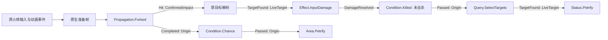

# 技能图玩法扩展：传播、选敌与条件

本轮沿用属性面板第四页和同一 Schema2 执行器，扩展可修改玩法。原 GA 仍负责输入、动画 Notify 和费用；运行时生成的是本次技能的瞬态图配置，不生成新的 C++ 类或磁盘 GA 蓝图。所有注册逻辑与实际可编辑范围见[能力覆盖表](ga-node-capability-coverage.md)。

## 游戏内操作

1. 直接 PIE 的默认法师模型也可测试，不必先通过存档选择职业。打开属性窗口 → 第四页“技能组装”，选择真实 `GA_FireBolt` 并开始测试。
2. 点击 `Delivery.ProjectileAwait` 节点，选择 `Propagation.Forked`，设总投递数3、等待0.3秒、半径700cm、衰减0.8、层数1、分支2，预览并应用。首击为第0层；总数包含首颗弹体，层数1允许首击产生两个子弹体。
3. 再点击同一个 `Propagation.Forked` 节点，即可通过 `Set.MaxTargets`、`Set.JumpDelay`、`Set.JumpRadius`、`Set.PropagationFalloff`、`Set.MaxDepth`、`Set.BranchesPerTarget`、`Set.ForkConcurrency`、`Set.TargetSelection` 修改。每项都需预览/应用。原位修改保留节点ID和连接，已经飞行的旧施法保持自己的冻结配置。
4. 点击 `Effect.InputDamage` 的 `DamageResolved` 口，追加 `Condition.Killed`。值1是击杀后通过，0是未击杀后通过。再从 `Passed` 追加 `Query.SelectTargets`，设置半径和数量；点击查询节点可改选敌规则。
5. 从查询的 `TargetFound` 追加 `Target.Petrify`，或者从 `Completed` 追加 `Condition.Chance`，再从 `Passed` 追加 `Area.Petrify`。隐藏窗口后将鼠标指向敌人，以页面提示的 **T** 使用临时测试技能；原来的正式技能保持原授予路径。
6. 撤销会从原图重放剩余编辑；重置移除本轮修正；关闭属性窗口释放本页面临时 Spec 和贡献。测试版不消耗元素球，也不保存组合。

选敌参数：0原默认、1最近、2最远、3最低生命比例。传播的0保持原选敌次序，独立 Query 的0按最近处理；距离相同保留查询中的稳定顺序。概率值0..1由权威服务器抽取，0必拒绝、1必通过。目标太少、视线遮挡、层数或总数不足，都可能使分裂不足配置上限。

## 实际组成

这是一个根施法内的子逻辑组合。Forked 在每次真实命中后等待独立的 JumpDelay，然后从接触位置同时投递最多 BranchesPerTarget 颗真实弹体；每颗命中继续执行原 Hit 后继。Sequential 同一时刻只维护一颗传播弹体。并发兄弟可以重叠飞行，受同根总投递、层数、物理并发和执行预算限制；不会为每个分支重新 Commit 原 GA。

图的连接深度仍受原 Budget.MaxDepth 约束，和 Forked 自身的传播层数是两个独立限制。本图示把概率范围分支放在传播 Completed 上，以满足原火球基础图的深度8；把更多条件持续串到查询后面可能被预览明确拒绝。本轮没有自动扩大原技能预算。

## 代码与网络调用链

`AbilityRuntimeRecipePanel` 的真实画布选择 → `ServerPreviewGraphEdit` → `PreviewGraphEdit` → `AbilityRuntimeModifierTemplates::BuildPatch` → `AbilityRuntimeRecipes::Compile` → 只读草稿投影 → 精确 DraftToken 提交 → `SetContribution` → 复制所属玩家状态。

原施法输入与真实动画事件 → 原 GA 创建冻结快照 → `GraphInstance` → 注册 `NodeExecution` → 原 `DeliveryInstance/MyProjectile` → 真实命中 → 原伤害服务 → 类型化后继。客户端只提交受限的节点/模板/参数和当前会话、版本、hash；服务器分配来源、顺序和草稿令牌，客户端不能提交任意反射属性、UObject配置或有序来源权限。

`bOrderedWorkshopEdit` 由服务器工作台设置。仅两个明确的顺序编辑来源且后者 Priority 严格更高时，才允许替换后调参、再次设置同一轴或重新替换；普通来源维持原有冲突拒绝。同优先级或同一贡献的竞争赋值仍拒绝。撤销和来源移除从不可变基础图重放，不修改原 DA/CDO，不追改已经施放的快照。

节点会保留普通来源的保护记录：即便后面的工作台编辑修改了另一个轴，也不能让再后面的整节点替换抹除早先普通来源的参数。同轴冲突还会核对该轴的原写入来源；冲突只拒绝候选，不改变已接受图。

选敌和条件只在服务器执行。共享选敌服务从实际 Actor/Mass 查询捕获完整原生命令牌，校验范围、可见性和当前生命；最低血量比例读取 Actor ASC 或 Mass 真实 Health/MaxHealth。查询每次发布后续前再次验证，防止前一个后续已杀死/移动/回收后一个候选。条件输出清除历史目标权限，只保留位置；后续必须重新查询才能获得 LiveTarget。

真实弹体、伤害和状态继续使用项目已有的复制路径；所属玩家接收已接受图、草稿和观察投影，其他玩家不获得编辑会话。客户端不独立抽概率或结算伤害。单机/远端联机验证的实际证据分别记录，不能由注册支持推断所有组合已验收。

## 生命周期与扩展入口

- 配方基础图及配置保持只读，候选和已接受图由原组件 UPROPERTY 持有。施法获得独占冻结图，组件关闭或后来改参数不影响已运行配置。
- Forked 每颗投递具有独立 StepId、DeliveryId 和精确物理 lease。强引用数组保护活投递，回调先移除自己的记录、解绑和释放自己的 lease，再发布可重入的外部后继。取消先封口，随后取消所有兄弟、清理队列和释放租约；累计生成额度不退还。
- 暂时没有物理并发位时保留待发队列；累计预算耗尽时按 BudgetExceeded 终结。原生命失效、关卡结束等继续走原 GraphInstance 取消路径。
- Query 和两个 Condition 是有界同步节点，不自行创建 Timer、Actor、ASC、子系统或完整 GA。新增策略继续按 Config.Validate → Registry → 类型化端口 → 原执行器 → 行为/生命周期测试接入，不增加第二套解释器。

新查询/条件当前只允许并行追加。精确插线的原适配器会无条件 Continue；将它用于条件会绕过分支语义，因此本轮明确不开放这些片段的 Insert.Registered。后续若需要“条件通过才续接原边”，应增加具有该合同的类型化串接能力并单独测试。

本轮构建、自动化、真实界面及待用户验收项见[验证记录](ga-graph-gameplay-expansion-validation.md)。本表只覆盖已实现合同，不代表任意玩法、任意边或无限派生都已经开放。
