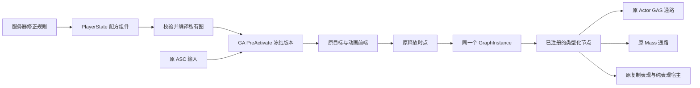

# GA 运行时组合：开发入口与执行合同

状态：本轮实施与自动验证完成，用户PIE表现／手感验收待进行。范围和证据以[批准设计](superpowers/specs/2026-11-19-dynamic-mage-composition-design.md)、[实施计划](superpowers/plans/2026-11-19-dynamic-mage-composition.md)、[逐类台账](ga-dynamic-mage-inventory.json)及[交付记录](ga-dynamic-mage-delivery-evidence.md)为准。82个玩法类默认复原与8个保护项分开记录；代表组合、网络和视觉分别验收，不承诺任意排列均合法。

## 动态生成的对象

运行时生成的是一个新的、瞬态的 `UAbilityGraphDefinition`，并由本次 `UAbilityGraphInstance` 执行。玩家仍激活原 GA 类、原技能身份和原输入前端，不在游戏中编译新的 `UClass`，也不嵌套激活另一个完整 GA。

原前端继续处理目标请求、原动画／Notify、费用和冷却；配置层决定本次连接哪些动作；执行层保存本次目标历史、投递、回执、计时和清理。原来的 Actor/Mixed/Extension 兼容路径仍供正式无修正调用使用，旧资产不因本轮开发被改写。报告 `20261120T050402-48f11c31` 已验证82个实际玩法目录版本的默认导出不再包含完整旧宏；这是结构和对应专项证据，完整面板组合、PIE、联机和视觉状态仍按台账分别验收。



## 配方如何产生

`AbilityRuntimeRecipeCatalog::CollectBaseDefinitions` 读取真实的法师目录，保留具体类版本。`BuildDefaultGraph` 负责从真实前端提取默认定义，派生类覆写的行为不能按其父类原型猜测。

`UAbilityRuntimeRecipeComponent` 保存每个技能身份的基础图、贡献来源、已接受图和版本。`SetContribution` 按来源替换贡献；`RemoveContribution` 撤销该来源。编译失败保留上一份有效结果，不修改输入资产或共享 CDO。

`AbilityRuntimeRecipes::Compile` 在私有副本中按优先级和来源 ID 排序，执行类型化赋值、缩放、节点替换、分支追加和分支替换，每条补丁之后都重新验证。目标节点不存在、类型或端口不匹配、替换冲突、循环、预算超限均拒绝提交。`ReplaceBranch` 只替换准确节点的准确输出口，保留其他口和仍被引用的共享尾部；只有旧且已不可达的节点会被裁剪。同口追加与替换冲突，涉及原 authored 序号证明的分支须先有明确的规范化映射，不能删除证明来强行通过。

`CreateCastSnapshot` 复制本次图。`UMyGameplayAbility::PreActivate` 在原目标／动画等待之前取得该快照；在途施法不会因后续修改配方而改线。配置快照与原技能定义的取值时点需要区分：例如火球的原等级限制和装备追加仍在原 Notify 准备阶段执行一次，原 GAS 属性结算仍沿原 GE 路径执行。

服务器已经注册该身份的正确基础图后，绝对参数编辑可直接使用同一贡献协议。例如把一个实际消费 `Period` 的 Scope 改为0.2秒：

```cpp
FAbilityRuntimeRecipePatch Patch;
Patch.Operation = EAbilityRecipePatchOperation::ConfigureParameter;
Patch.TargetNodeId = SelectedScopeNodeId;
Patch.Parameter = EAbilityConfigParameter::Period;
Patch.Scalar = 0.2f; // ConfigureParameter是绝对值；倍率操作仍使用独立Operation。

FAbilityRuntimeRecipeContribution Contribution;
Contribution.SourceId = RuneSourceId; // 调用方持有的准确实例身份。
Contribution.Patches.Add(Patch);
const bool bAccepted = Recipes->SetContribution(AbilityTag, Contribution, Error);
// 丢弃该实例时：Recipes->RemoveContribution(AbilityTag, RuneSourceId, Error);
```

这是配方组件的调用示例，不代表本轮已制作正式符文掉落或局内存档。开发面板通过可信模板把有限值转为上述补丁；客户端不能提交任意属性名、类或图。配置的 `TrySetRecipeParameter` 只在私有副本中修改实际消费字段，未知轴和不支持的前端组合拒绝，不能通过修改一个未被执行器读取的字段返回“成功”。

### 已发布配方的只读性

编译器先验证基础图，再复制私有 Working、应用补丁、完整校验，最后记录内容指纹并发布。`UAbilityGraphDefinition` 私有的 `RuntimeCompilationSeal` 随普通 UE 复制保留，`Validate` 和真实启动入口都会检查内容。复制后直接改节点、参数或预算也不能绕过校验；应修改基础制作数据，或通过新 Contribution 重新编译一版。合法的零编辑重编译和新版本编译会在独立副本中重新记录指纹。

封印字段使用普通私有 `UPROPERTY`，编译结果对象本身为 `RF_Transient`。UE5.8 的普通复制使用持久化归档，不能把这项必须随复制保留的元数据标为 `Transient` 属性。指纹计算排除封印本身和执行实例身份，避免递归或因 RootCast、ExecutionId、OwnerLease 不同而拒绝相同配置。它负责配置只读性；施法权限仍由 Source/Target 原生命令牌和权威端规则判断。

### 散射与追踪目标

原散射默认清除选中目标，维持原来的直线分发行为。把运动改为 Homing 时，须在分发节点上显式选择 `Set.PelletTargetPolicy = 1`，将本次已经选中的原目标生命传给每颗弹体；`0` 保持旧行为。再在单颗弹体节点设置 `Set.Motion = Homing`。该策略不在飞行内部暗选敌，也不会在目标复用后重新捕获其新生命；没有合法原目标时按 NoTarget 合同结束。

作用域与消费者需要分别选择：Multishot 的容器和单颗弹体有不同 Scope；Stack 资产也可能是投射物根接附着叠层孩子。调阈值、周期或命中规则时，应选择实际消费该值的孩子或动作节点，不能一律修改第一行 Scope。

## 示例：火球改为逐跳火球，再附加石化

默认火球的可替换部分是：

```text
Prepare.NativeFireBolt
  → Distribution.Scatter
  → Delivery.ProjectileAwait
  → Target.ResolveImpact
  → Effect.InputDamage
```

准备节点冻结原投射物类、实际数量、散布、追踪和接触参数。它不再次扣费，也不产生另一颗带内部伤害的隐藏投射物。

开发模板 `Propagation.Sequential` 把指定的 `Delivery.ProjectileAwait` 替换为真实逐跳投递，沿用已有发射参数。可调整总目标数、命中后等待、下一目标半径和衰减。原来的 `Hit` 出边仍接原 payload。

一次实际调用顺序如下：

1. 原 ASC 激活 `GA_FireBolt`，冻结当前图、版本、摘要和开发预览租约。
2. 原蓝图处理 Commit、TargetData 和原施法蒙太奇。
3. `Event.Montage.FireBolt` 进入原 `UMyFireBolt::SpawnProjectiles`。
4. `StartFrozenRuntimeRecipe` 从原 Socket／俯仰／目标输入开始执行冻结图。
5. Prepare 和 Scatter 各执行本身的准备或分布，随后 Propagation 发出第一颗真实投射物。
6. 第一颗真实命中 A 后，命中位置和原生命形成 `ConfirmedImpact`。`Target.ResolveImpact` 复核该原生命，`Effect.InputDamage` 沿原 Actor/Mass 通路结算一次。
7. 传播节点等待配置时间，再在历史命中位置附近选下一个未访问目标 B，从该位置发出新火球。B 尚未真实命中时不会发出 C。
8. A 即使被击杀，历史位置仍可用于选 B；历史目标令牌不能用于给池复用后的新生命附加状态。

`Append.Status.Petrify` 建立显式的历史事实到活目标转换分支。若选投递节点，优先接它真正发布的 `ConfirmedImpact`；若选 `Effect.InputDamage`，则接该节点的 `DamageResult`，在伤害之后复核原生命。投递声明的 `DamageResolved` 是可选输出，外部 payload 模式不能把“端口存在”当成“实际会发布”。

载荷类型与端口名字必须分开看。例如 `Effect.PrototypeDamageBatch` 的真实逐目标后伤事实来自 `Contact` 口，类型是 `DamageResult`。可信追加模板连接 `Contact → Target.ResolveDamageTarget → TargetFound → Status.Petrify`，在每个真实GE之后同步处理。该节点的 `DamageResolved` 属于旧OnHit逻辑孩子的批末后继，有相应消费者才收集和发布；默认没有Contact消费者时也不额外发布事实。观察日志里没有这类事件不能推断未伤害，须对照真实HP、费用和执行路径。不能把某个节点的 `DamageResolved` 写成全框架统一命中口。

这两个修改都属于同一个 GA 的图；不存在“火球命中后激活雷电 GA／石化 GA”的调用。

## 数据与权限

| 数据 | 含义与边界 |
|---|---|
| `FAbilitySourceToken` | 原世界、Avatar、ASC、Run 和适用的池租约；每次行动重新验证 |
| `FAbilityTargetToken` | 某一个原目标生命；延迟、池复用后不能重新认领 |
| `ConfirmedImpact` | 已发生命中的历史位置、方向与原目标；不自动授予活目标权限 |
| `DamageResult` | 实际伤害尝试及可观测结果；不能用零伤害伪造状态已命中 |
| `TargetSet` | 完整原生命集合；不静默取命中前缀，效果逐个复核 |
| `ParameterFrame` | 根与来源绑定的只读参数，由队列和节点保活；不能跨施法借用 |
| Selection receipt | 某一步空间筛选事实；不可变几何与独立准入账本绑定准确根与来源 |
| `PreparedInventory` | 必须由库存消费者明确接收；普通 Origin 节点不能丢弃其归还义务 |

空间筛选和实际效果之间可能发生同步 GE 回调。Wave 的 receipt 在实际批效果前重新检查尚未准入目标的原生命、当前几何和 LOS；同一步已经成立的接触不会因为该接触自己的 GE 移动了目标而失去后续状态权限。后一步不能再次命中已准入生命。

## 执行顺序与生命周期

所有后继由同一个有界、迭代式 drainer 调度，节点不递归执行另一张完整图。`PublishWithContinuation` 等待所属后继子树完成；独立 OnHit 子片段不能被错误地纳入原渠道下一跳或冷却的等待条件。

`FlushImmediatePayloads` 用于原型的实际接触边界：本体伤害、接触减速和表现及时结算，逻辑子 Scope 延后到本轮接触结束。延后的调用仍预留额度、保活参数，并计入同一实际帧预算；重复 Flush 不刷新额度。

| 所有者 | 管理内容与结束方式 |
|---|---|
| PlayerState 配方组件 | 已接受配方与版本；组件 EndPlay 清理引用，运行图不作为组件属性复制 |
| GA／`UAbilityTask_RunGraph` | 绑定施法的图；GA 取消时先封口再停止任务，默认同步动作可在启动帧结束 |
| `UAbilityGraphWorldSubsystem` | 明确移交的独立效果；GA 正常结束可保留，来源失效、准确租约关闭、旅行和世界退出时清理 |
| 节点执行实例 | 自己的投递、库存、委托、资源租约和纯表现宿主；Stop 幂等，仅归还自己持有的资源 |
| 原目标组件／世界状态服务 | 已落地的石化、Slow、叠层、位移和地表接触状态；按原到期、死亡、替换和池复用规则收尾 |

取消不是正常到期，不补发业务 OnExpire。已经结算的属性变化不作为图取消的事务回滚。跨施法叠层和位移继续使用原服务的准确租约，不能按可复用数字 ID 清理别人创建的状态。

普通新图继续使用原 64 次调用、256 事件、32 活动节点、8 层和每帧 64 事件的预算。长渠道、兼容原型和经验证的有限传导宿主必须通过各自显式根合同，不因字符串 profile 或节点改名绕过预算。

authored 图细化时还保留原节点序号、原边顺序、输出映射和主寿命。原调用/事件/实际帧额度与新增 helper 分开计算；纯同步端点终态可以释放 helper 活动位，但事件、参数强引用和元数据继续保留至消费完毕。追加的新有限片段使用聚合有限账本，不能继承原节点豁免。物理创建策略还需明确资源合同：一次节点调用不等于一次 Actor 创建；旧批量投射物/召唤入口在完成额度和租约适配前，不应直接作为可追加的有限片段。

无限重复端口另有明确合同。注册表只登记真实可能无限输出的端口，`AbilityRuntimePayloadPolicy` 沿同一 DAG 推导到修改点。新增后继必须具有已审核的同步动作资格，并由配置对实际 TypeId 和每个输入类型证明适用；原载荷替换还需原插槽资格。合法纯载荷沿用原宿主的速率、活动与保留资源限制，不会因为新增石化叶节点而在第64次后截断原渠道。新的延迟、调度或物理生成不能借用该权限。固定次数 Emitter 和有限 Lightning 不因“会重复”就被当作无限根。

这里的同步动作指没有执行器自行创建的异步时钟或物理投递。原目标组件管理的石化 GE、到期计时和池生命清理仍由原服务负责。图校验会重算输入与资格，编译后的只读指纹还会检查复制后内容。Node 的普通注册、`bSustainedSafe`、`bIsAsync == false` 或自行填写一个标记，都不能替代这些证明。新增物理策略同时使用准确 InvocationId 的额度预留和释放，有限域累计最多64次物理开始、同时最多32份租约。

## 同步与开发面板

服务器编译配方、确定目标、扣费并结算。图 UObject、队列、回调和参数帧不复制给客户端。原 ASC 的 GE／属性、蒙太奇、Cue、投射物、地表与纯表现快照通路同步可见结果。

开发组件只向所属玩家同步值状态、版本、摘要、错误和有界观察日志。客户端编辑请求只能提交已登记的 ID、节点索引、所见版本／基础摘要及有界参数，不能上传任意类、图或反射属性名。失败回执不能覆盖上一有效配方。

开发入口为控制台 `RuntimeRecipe`，要求本地法师玩家。选择具体类版本后开始临时预览，隐藏面板后使用 `T` 发起原技能；引导技能松键、开关技能再次按键，遵循原来的输入语义。关闭面板通过准确请求回执回收自身贡献、临时 Spec 和租约，不改变原技能槽、等级或存档。存在外部基础变更时需使用保留外部变更的退出路径。

2026-11-21的免费图工作台沿用此入口，新增服务器`AcceptedGraph/DraftGraph`纯值投影及准确节点/边选择、令牌化预览应用、历史撤销。可继续选择插入的真实节点，不再只依赖本地基础节点索引。新增`InsertOnEdge`和有限续接适配器保留同口兄弟次序与共享尾部；普通并行追加仍用原操作。UI、正式同标签技能隔离及旧工具会话兼容见[专门指南](runtime-graph-workshop-guide.md)。

NullRHI 中的 `ServerTransport` 测试使用显式客户端激活包夹具验证实际服务器前端、TargetData、Notify 和真实物理结果；它不证明本地鼠标视口、UMG 画面或两玩家网络。Standalone、Listen Server 与用户视觉验收分别记录，不能由服务器整合测试替代。

开发测试命令 `RuntimeRecipe.Probe` 只在自动化开发构建注册：`Begin <技能Tag>`、`Edit <模板ID> <节点索引> <值> [数量 间隔 半径 衰减]`、`Press`、`Release`、`Close`。它将面板原RPC或原T键输入排到下一次原生Tick，避免编辑器Python保护把远端RPC改为本地调用。它不构造目标数据、不发送动画通知、不直接伤害目标。`Scripts/GA/DynamicMage/verify_real_casting_pie.py` 使用此桥接和真实本地鼠标任务；脚本是否实际通过必须读取对应新报告，不能用语法编译成功代替。

纯表现宿主的命中通知使用不可靠Multicast。长期宿主的去重记录和待资源队列采用最近256个序列位置的窗口，接受窗口内乱序与自然回绕；资源非常晚到时不会重播已经过期的旧粒子。已就绪的新命中继续逐个表现，游戏伤害、目标状态和技能时钟不受该窗口限制。该机制有独立的持续事件／资源晚到测试，与图的事件预算分开验证。

原生投射物只有被明确修改的碰撞半径才同步新的纯值覆盖；客户端按实际组件比例重建世界半径，并处理 BeginPlay/OnRep 到达顺序。未选中的原类、速度和寿命保持原配置。纯表现宿主的 `GetPresentationRadius`／`GetPresentationKind` 只读本次冻结快照，未就绪返回负值；不能通过公开 `Prototype` 是否存在来推断纯宿主种类。

真实面板的逐项方法与证据边界见[面板验收说明](ga-dynamic-mage-umg-validation.md)。测试桥操作真实 WidgetTree 和原按钮委托；数字输入必须先正确结束旧文本编辑，再设值与获得焦点，并在 Apply 后再次核对数值。仅哈希改变或“至少命中一人”不能证明请求的数量、范围和时序已送达。开发日志为有界窗口，高频动作的费用记录应逐帧收集，不能把观察结束时没有旧记录当成未扣费。

## 扩展与验收入口

新增行为沿[统一制作指南](ga-unified-authoring-guide.md)执行：配置校验和可消费参数 → 注册真实动作 → 类型化端口 → 原前端调用点 → 生命与资源清理 → 真实旧对照／新组合测试。宏的细化必须共享实际动作，不通过节点名字或共享父类宣称已拆分。

已有 authored Graph 的迁移读取实际 `Config.Parameters` 与实际 Edges；不能重新编译表现 DA 来重生已断开的孩子或丢失图中额外分支。旧 Completed 与业务到期的位置语义也需分别验证。

专项证据位于 `Saved/GAAuthoring/DynamicMage/20261119-implementation/ledger.md`；每轮报告绑定当次 Source、Config、DLL 和资源指纹。[最低组合验收集](ga-dynamic-mage-combination-coverage.md)按11类行为列出真实已验范围，[PIE操作](ga-dynamic-mage-acceptance.md)供最终试玩。定义 census 只证明导出结构，真实属性、输入、动画、网络与视觉分别验收。仍未完成的原型、类版本和测试必须保留 Pending。

逐原型类的动作层用例为 `test_25d.DynamicMage.AssetParity.OriginalVersusFine`：从当前三个职业目录动态发现65个具体类，分别运行原默认图与细编译图，保留实际DA和原伤害GE，比较属性、位置、逻辑片段数、地表资源及终态。它不调用原输入壳，因此费用、TargetData、Notify、临时预览和网络仍由各自专项用例负责。[逐类清单](ga-dynamic-mage-inventory.json)中的 `evidenceLayers` 明确记录这些证据的范围和状态。
