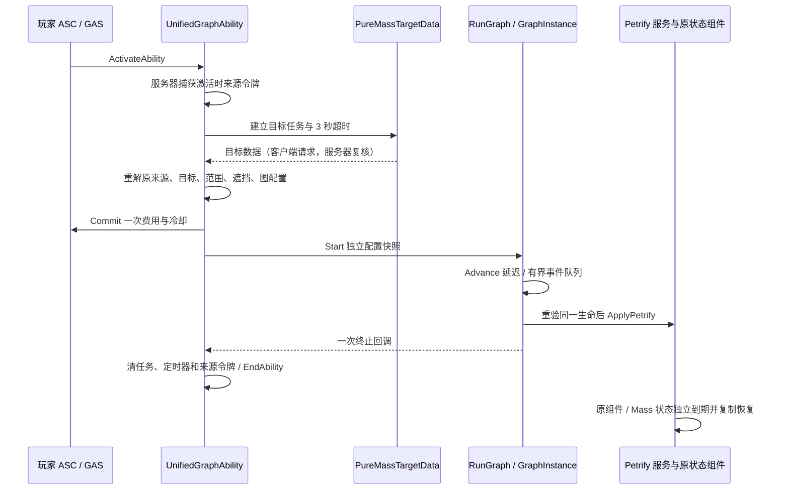

# 统一 GA 制作与迁移指南

从现有技能实例理解“资产如何组合、怎样制作、游戏里如何调用，以及逻辑如何变成动画和特效”，先读 [GA 全流程与实际示例](ga-composition-authoring-runtime-walkthrough.md)。本文件用于执行制作和验证步骤。

本指南是后续 GA 开发入口，对应 [框架与调用链](ga-framework-reference.md) 和 [原设计及演进](superpowers/specs/2026-11-08-unified-ga-environment.md)。新技能使用 Schema 2 的注册策略与类型化端口；专用动画前端可调用相同共享动作。现有玩家/AI 激活、ASC、装备实例、输入槽、技能身份和存档路径继续沿用，旧原型 DA 通过兼容编译接入同一执行协议。

最初 P1 的 656 行清单和 300 项测试只属于当时的最小切片。当前数量和逐资产状态以矩阵及最新独立进程审计为准，不把旧报告沿用为新版本验证。`GraphInstance` 与 `SharedAction` 是两种接入方式，二者必须指向实际注册策略；只有会话继承或目录登记不算动作可组合。

## 后续开发默认步骤

1. 从现有资产读真实配置，明确目标、费用、动画事件、作用范围、生命周期和表现。先查注册表是否已有策略；相同行为只增加独立配置。
2. 新行为实现 `UAbilityNodeConfig::Validate` 与 `UAbilityNodeExecution`，登记稳定 `TypeId`、实际执行类和类型化端口。原 GA 动作需要复用时提取共用服务，原宿主与节点调用同一个实现，禁止复制两套行为。
3. 新图使用 `SchemaVersion=2`、`CompatibilityProfile=UnifiedV2`。普通入口使用 `UUnifiedGraphAbility` 的 Enemy/Ground/Self 模式；需要专属动画、输入或 AI 的入口继承 `UMyGameplayAbility`，在 Notify/Timeline 确定时点执行动作。不要绕过公共会话或新增完整 GA 嵌套激活节点。
4. 默认一次完整 Commit。旧迁移的分阶段费用、无 Commit、长期渠道等例外必须明确记录，不能套用到新技能。所有伤害与控制在服务器执行，输入目标、源生命和异步回调都要验证。
5. 参数属于 DA/CDO，施法状态属于本次实例。指定图由 GA 还是 World 持有，说明取消、死亡、回收、旅行、结束时怎样清理每个任务/句柄/Actor。
6. 有动画时只选择一条实际伤害通路：可信 Notify 或时间轴配置事件。保留源动画位置、真实蒙太奇实例和单调事件序号；图不另外播放相同蒙太奇。
7. 完整构建后再迁移资产。运行 `migrate_catalog.py` 的只读模式审核；仅对明确白名单设置 `UNIFIED_GA_MIGRATION_APPLY=1`。保存后另起 commandlet，以 `UNIFIED_GA_MIGRATION_VERIFY_REPORT` 指向该报告独立读回。不要在同一进程使用 ReloadPackages 充当磁盘验证。
8. 运行对应行为回归与全量 `test_25d` 测试；按行附报告、配置/源码指纹和待用户 PIE 项。用户已要求后续开发在本地 `main` 进行；保留用户未提交资产，不另建默认开发分支或自动推送远端。

`DamageResolved`/`OnHit` 保存历史命中，不自动授予活目标权限。伤害后接控制时使用 `Target.ResolveDamageTarget` 或 `Target.ResolveImpact` 验证原生命，再连接 `TargetFound`。位置效果可直接消费快照；完整例子见 [框架说明](ga-framework-reference.md#一次施法的调用顺序)。

## 目录与状态

[迁移矩阵](ga-unified-migration-matrix.json) 的 `schemaVersion` 为 1，`rows` 中每条 GA 蓝图、项目原生 GA 类和每个原型/动作配置独立建行，`configPaths` 连接实际配置对象。GA 不能因为已登记就被当作可组合子节点。

| 字段 | 含义和维护方式 |
|---|---|
| `assetPath` | 完整 UE 对象路径；原生类使用 `/Script/test_25d.ClassName`，唯一且保持旧身份 |
| `generatedClass` / `parentClass` | GA 的生成类和直接父类；配置行保存配置类及其父类 |
| `family` | ActorPrototype / MixedPrototype / Extension / Batch6Special / TimelineWeapon / Traditional / Unknown；依据完整祖先链分类 |
| `configPaths` | 实际 CDO/配置属性引用；运行时选配置另记具体 Avatar 属性和候选绑定 |
| `targetSupport` / `lifecycle` | 审阅后的 Actor/Mass 支持、绑定 GA/独立施法/目标持久状态；初始 NeedsReview 不猜测支持 |
| `compatibilityProfile` | 需要保留的终止、周期、追赶、取消等语义；初始 LegacyNeedsReview |
| `migrationStatus` | Inventoried / AdapterRequired / Adapting / Verified / Retired |
| `replacementPath` | 实际存在的替代图或配置；未制作时为 null |
| `evidence.manual` | 人工证据数组：测试名称、报告路径、目标配置、兼容策略、PIE/联机验收和未完成项 |
| `evidence.audit` | 本次机器观察：祖先链、实际属性、属性引用、依赖、配置引用者；重跑时可更新 |
| `issues` | 尚未解决的问题；人工问题保留，解决后审阅删除 |

首次发现只能是 Inventoried 或 AdapterRequired。Unknown 不允许 Verified。Verified 表示该行迁移代码、真实资产/配置校验及所列共享行为回归均已通过，必须附完整证据；代码存在、编译成功或资产读回都不能单独证明行为兼容。它不表示该资产已完成逐个视觉或双端试玩，后两项分别记录为 Pending/Passed。共享策略代表测试须明确其覆盖范围，不冒充逐资产完整施法测试。Retired 需要明确退役决定和引用清理证据，不能用来掩盖遗漏资产。

建议人工证据格式如下（示例占位，不能当作实际验证）：

```json
{
  "sourceConfig": "/Game/Existing/DA_Source.DA_Source",
  "targetConfig": "/Game/Unified/DA_Target.DA_Target",
  "compatibilityStrategy": "保留原周期与取消原因；说明已确认的语义差异",
  "testPaths": ["填写实际执行用例名"],
  "reports": ["Saved/.../automation/index.json"],
  "pie": {"status": "Pending", "actor": "Pending", "mass": "Pending", "multiplayer": "Pending"},
  "remainingIssues": ["待用户视觉验收"]
}
```

## 只读审计

[audit_catalog.py](../Scripts/GA/Unified/audit_catalog.py) 扫描 AssetRegistry 的所有项目/插件内容（资产排除 Engine/Script/Temp 内容），枚举 Blueprint 派生类型，再以 `GameplayAbility` 的完整派生集合与祖先链筛选 GA，因此包含间接子类、敌人和装备目录。随后独立登记项目的原生 GA 类（含抽象基类），交叉检查 Source 中的继承声明；无蓝图但被 C++ 直接授予的入口不会遗漏。`Source/.../Tests` 中的测试类明确列入排除台账，不计入游戏内容；外部引擎/插件原生类也保留排除原因。独立配置包括 AbilityPrototype 派生类（含 ExtensionNode）、时间轴、Stander/剑盾动作、敌人攻击及环绕火球等配置；实际属性引用到其他 DataAsset 时继续递归登记。未解析的 GA 命名候选/无父类蓝图进入 Unknown，不被悄悄略过。完整 Blueprint 和原生类台账在 `audit-report.json`。

审计不编译、不保存 UE 资产。加载 CDO 与配置可能触发 UE 自身的加载诊断，应以本次报告与日志为准。Stander 旧 GA 从 Avatar 的 `SwordConfig` 读取参数，敌人选择器/攻击还读取 `CombatConfig` 或石头人的 `MonsterConfig`；矩阵记录具体角色蓝图、属性、Attacks 类列表和可能配置。这不证明具体关卡会生成对应角色或授予该 GA，仍需 PIE 验证。

在已经完成 Editor 构建的工程根目录运行：

```powershell
$ProjectRoot = (Get-Location).Path
$RunName = 'catalog-' + [guid]::NewGuid().ToString('N')
$AuditScript = (Join-Path $ProjectRoot 'Scripts/GA/Unified/audit_catalog.py').Replace('\', '/')
$env:UNIFIED_GA_AUDIT_OUTPUT = Join-Path $ProjectRoot "Saved/GAAuthoring/UnifiedGA/$RunName"
& 'C:/Program Files/Epic Games/UE_5.8/Engine/Binaries/Win64/UnrealEditor-Cmd.exe' `
    (Join-Path $ProjectRoot 'test_25d.uproject') -unattended -NullRHI -nosplash -nop4 `
    -run=pythonscript ("-script=" + $AuditScript) `
    ("-abslog=" + (Join-Path $ProjectRoot "Saved/GAAuthoring/UnifiedGA/$RunName.log"))
Remove-Item Env:UNIFIED_GA_AUDIT_OUTPUT
```

输出目录必须尚不存在。默认读取 `docs/ga-unified-migration-matrix.json`；可用 `UNIFIED_GA_MATRIX` 指向其他已审阅矩阵。每次只创建新的 `observed.json`、`matrix-candidate.json`、`diff.json` 和 `audit-report.json`，不直接覆盖矩阵。检查 `success`、真实统计、Unknown、错误和差异后，再人工/协调任务合并候选文件。

重跑保留迁移状态、替代路径、目标/生命周期/兼容说明、人工 evidence 与 issues。已存在的资产消失时保留原行并报告 missing，不自动删除或退役；既有 Verified 行结构或实际属性变化也会让审计失败，要求重新评估证据。Guid 等不公开字段的结构用稳定 `exportText` 保存，避免把内存地址当节点身份；Cost/Cooldown GE 类与包依赖同时读回。重复行、遗漏候选（包括 Unknown 和原生直接入口）、无效配置或替代引用、人工证据被覆盖、空目录均失败。Unknown 被完整登记本身不表示扫描失败，但始终保留待处理项。

```powershell
python -B Scripts/GA/Unified/audit_catalog.py --self-test
```

此自检只证明审计逻辑约束；资产数量、类名和配置引用必须由 UE 扫描产生，不能从源码名称或历史报告填充。

## 新制作和迁移顺序

1. 先查矩阵和 [GA 现有制作指南](ga-production-and-runtime-guide.md)，明确入口、目标、费用/冷却、取消、寿命和网络职责。敌人遵循 [怪物开发规范](monster-development-standard.md)，装备遵循 [装备模块开发规范](equipment-development-standard.md) 及 [装备接入指南](2026-10-30-equipment-guide.md)。
2. 新图使用 Schema 2、稳定 NodeId/TypeId、节点私有配置和类型明确的端口；共享 DataAsset/CDO 只读。未知 TypeId、错误配置、错误方向/类型、循环和超预算必须失败关闭。旧完整 GA 仍是受管理入口，可组合的是提取出的实际动作。
3. 服务端验证目标、费用和效果；从真实 Avatar/ASC、世界、RunId、Actor 池 Lease 或 Mass EntityHandle 捕获生命令牌。每次延迟执行重新解析；不信任客户端令牌，不把致死位置快照当存活目标。
4. 新技能完整 GAS Commit 仅执行一次；旧费用策略见框架的兼容说明。端口以各策略真实注册为准，不能假定每种动作都有所有通用事件。取消后不补发 Completed；先关闭入口，再释放任务/定时器/句柄，终止只报告一次。
5. 迁移旧原型时写明兼容配置：Actor 与混合版持续耗蓝/周期追赶/尾帧、目标失效终止语义、第五批跨施法叠层和位移、时间轴真实蒙太奇实例与事件去重不能被默认统一。保留原路径、Tag、存档与输入身份。
6. 首个 Delay → Petrify 样例为服务端单目标能力，延迟 0.25 秒后石化同一生命 1 秒，10 Mana、2 秒冷却；取消/死亡/池复用/来源替换/跨世界后拒绝生效。它不替代范围石化、不默认授予、不占用现有输入槽。以实际作者脚本和读回报告确认资产已创建。
7. 更新对应矩阵行和证据。对支持 Actor/Mass 的行为分别测试；代码自动化、真实资产读回、用户 PIE 视觉与双端联机是不同证据。仅当该行完整迁移验收通过才设 Verified。

## 自动化与防止空跑

[test.ps1](../Scripts/GA/Unified/test.ps1) 默认先以 `-NoUBA` 构建 Editor，在 `Saved/Automation/UnifiedGA/<RunId>` 导出报告、`Saved/Logs/UnifiedGA-<RunId>.log` 保存日志。`-SkipBuild` 仅用于协调端已经成功构建准确代码树的情况。默认筛选 `test_25d.UnifiedGA` 与旧石化三个回归用例；预期用例名从源码中的自动化声明推导，或由 `-ExpectedTests` 明确提供。

```powershell
pwsh -NoProfile -File Scripts/GA/Unified/test.ps1 -SelfTest
pwsh -NoProfile -File Scripts/GA/Unified/test.ps1 -SkipBuild
# 必须以非零退出码失败；无报告、零测试、超时均不允许通过。
pwsh -NoProfile -File Scripts/GA/Unified/test.ps1 -SkipBuild -Filter 'test_25d.DoesNotExist.UnifiedGA'
# 已知旧用例，确认真实 UE 报告解析路径。
pwsh -NoProfile -File Scripts/GA/Unified/test.ps1 -SkipBuild `
    -Filter 'test_25d.Batch6.PetrifyLeaseIsolation' `
    -ExpectedTests 'test_25d.Batch6.PetrifyLeaseIsolation'
```

测试进程失败、超时、没有新鲜 `index.json`、报告含 failed/notRun/inProcess、行状态不是 Success、零用例、重复用例或预期用例缺失均失败。目录唯一且比较文件写入时间；不复用旧报告。`validation.json` 保存过滤器、预期/执行用例和结果。`-SelfTest` 使用合成报告，只证明解析器，不代替上述 UE 零过滤器与已知测试实际运行。

当前运行记录为 Schema 2：测试前后对 Source、Config、项目 DLL、uproject 和矩阵中的实际 Content 包计算 SHA256，任一字节或输入集合变化均拒绝。`-SkipBuild` 也拒绝明显早于源码的项目 DLL。`finalize_migration_matrix.py` 只生成 Saved 候选，要求同一 runId 的真实记录、报告指纹、六个写入来源、全部蓝图/配置检查和具体行为用例齐全；不能给旧报告补造 manifest 后声称新代码通过。更新矩阵的证据文字不改变被测输入集合。

主机 Python 的迁移工具自测使用以下明确入口；目录中的 `test_sample_validation.py` 需要 UE Python 环境，不能混入普通 Python 的通配符测试发现。当前目录覆盖按已审阅矩阵与新鲜扫描逐项比对，不能把旧批次的固定数量或待迁移状态写成后续开发的永久条件。

```powershell
python -B Scripts/GA/Unified/migrate_catalog.py --self-test
python -B -m unittest discover -s Scripts/GA/Unified -p test_migration_finalizer.py -v
```

迁移后在独立 UE Python commandlet 运行 `Scripts/GA/Unified/validate_blueprints.py`，按当次发现的全部 GA 蓝图逐个内存编译，核对编译状态、语义图指纹和磁盘包未变。它不保存资产；输出位于 `Saved/GAAuthoring/UnifiedGA/BlueprintValidation/<RunId>/index.json`。蓝图编译通过仍不等于动画或网络表现验收。

全量迁移同时覆盖前四批、第五批/跨施法、第六批、时间轴/传统/敌人和装备授予入口。矩阵分别记录代码与资产迁移、自动化和用户 PIE/联网验收；自动化通过不替代视觉验收。

## 最小组合样例

`/Game/UnifiedAbilities/Samples/GA_DelayedPetrify` 选取一个 Actor 或 Mass 敌人，默认射程 1200、费用 10 Mana、冷却 2 秒。对应 `DA_DelayedPetrify` 的两个节点是 `Control.Delay`（0.25 秒）和 `Status.Petrify`（1 秒）。材质复用 `/Game/CompositionBatch6/M_PetrifiedStone`。它是独立单目标样例，与原范围石化不同；没有自动授予、菜单登记或输入槽占用。



服务器在等待目标前固定来源，避免持久 PlayerState ASC 换 Avatar 后旧请求重新绑定新角色；目标令牌在服务器收到目标时捕获。目标数据到达前失败不 Commit；Commit 后取消不会自动退款。已施加的石化由原状态组件/子系统负责延长和到期，图取消不撤销其它来源的状态。

图实例由 AbilityTask 的 UPROPERTY 保活，不复制。取消先关闭入口，再清业务队列与节点；`Cancelled/Failed` 只输出带调用身份的终态诊断，不能连接后继效果。`Completed` 事件逐帧入队处理；同一节点配置被两条 DAG 路径使用会获得不同调用 ID。共享 DA 在 Start 时复制，运行中的施法不受之后编辑参数影响。

首版 V1 只包含 Delay/Petrify；当前 Schema 2 通过注册表中的 `ExecutionClass` 创建真实策略，不再向 `GraphInstance::InvokeNode` 增加行为分支。旧 DA 编译为兼容图，专用动画前端调用同一共享动作；可用节点与寿命域见 [框架说明](ga-framework-reference.md)。新增节点必须同时补配置校验、执行策略、端口、取消清理和对应目标行为测试。

## 样例资产与验收

通过 UE Python commandlet 执行 `Scripts/GA/Unified/author_petrify_sample.py` 创建缺失的四个样例资产。已有资产保留调参；设置 `UNIFIED_GA_VERIFY_ONLY=1` 时禁止创建和保存。校验同时调用原生 `ValidateForAuthoring`，检查入口/边、配置、独立 GA/GE 引用、静态 Mana 消耗与冷却 Tag。非法配置会失败，不以“资产存在”判为可用。

`Scripts/GA/Unified/test_sample_validation.py` 在独立 commandlet 内临时破坏入口、费用、冷却标签和 DataRegistry 行设置，确认验证器拒绝，并在 finally 恢复内存对象；不保存资产。

用户 PIE 验收可以在独立的空 QA 测试环境准备原玩家、至少 30 Mana 和已启用的 Mass，再执行 `Scripts/GA/Unified/verify_petrify_pie.py` 或控制台 `UnifiedGA.VerifyPetrify`。要求没有 DungeonRunDirector、已有敌人或样例授予/冷却，并保持视口焦点、约 7 秒不操作。探针使用真实鼠标投影和原目标任务，临时授予样例，检查 Actor、Mass、生效/解除、取消、费用与资源回收。`UnifiedGA.CancelProbe` 提前结束并恢复它自己的临时状态。条件不满足会明确拒绝，不会自动切图、替换玩家或保存资产。

探针报告位于 `Saved/GAAuthoring/UnifiedGA/PIE/<唯一ID>/probe.json`。本轮尚未运行实际 PIE 探针，也未进行双端联机/视觉验收；NullRHI 自动化不能代替这些结论。
