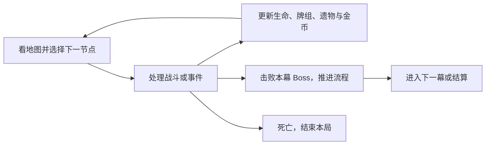
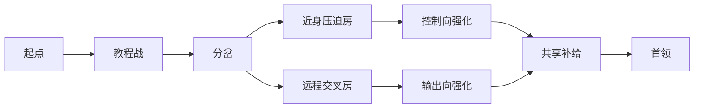

# Roguelike 游戏系统拆解作品集

**从《杀戮尖塔》到《以撒的结合》《死亡细胞》《挺进地牢》**

四款游戏都让玩家带着一套会变化的资源完成一趟高风险流程。区别首先体现在玩家最常判断什么。《杀戮尖塔》让玩家计算这一手牌能否解决眼前威胁。《以撒的结合》让玩家判断还值得为哪种未知奖励多打一间房。《死亡细胞》把判断放进攻击、位移、反击和装备轮换之间。《挺进地牢》则要求玩家在持续射击时，预先选好下一块安全地面。

| 阅读顺序 | 分析内容 |
| --- | --- |
| [《杀戮尖塔》](#杀戮尖塔roguelike-系统拆解) | 从一个回合拆到首手概率、选牌与精英路线 |
| [《以撒的结合》](#以撒的结合) | 房间探索、钥匙与炸弹的替代用途、血量交易与道具协同 |
| [《死亡细胞》](#死亡细胞) | 动作窗口、装备循环、卷轴与生物群系的混合生成 |
| [《挺进地牢》](#挺进地牢) | 弹幕空间、翻滚与空弹、枪械获取与手工房间 |
| [四作横向对照](#四作横向对照) | 随机性、选择权、可读性、局外成长与制作成本 |
| [动作原型方案](#动作原型方案) | 一层可试玩切片的规则、地图校验与验证计划 |
| [动作案例资料](#动作案例资料) | 官方规则、开发者分享与公开拆解 |

本文用 Roguelike 作为行业常用的类型统称。动作部分对照 PC 单人流程，《以撒的结合》以《重生》及《忏悔》常规模式为口径，《死亡细胞》以第 35 次更新的基础难度常规流程为口径，《挺进地牢》以包含 A Farewell to Arms 更新的初代常规模式为口径。原作规则以对应段落所列资料为据。动机归纳属于策划分析，数值演示使用明示的假设，原型方案尚未实测。

## 《杀戮尖塔》Roguelike 系统拆解

**下一场精英战，怎样改变一张牌的价值？**

**拆解范围**　《杀戮尖塔》初代 PC 版 · 铁甲战士 · 第一幕 · 基础难度（A0）  
**作品方向**　游戏策划实习 · 系统、战斗与关卡设计

### 结论摘要

《杀戮尖塔》把选路、战斗和构筑做成了同一个决策。**地图决定接下来要解决什么问题，牌组决定能用什么方式解决，战斗损失的生命值又决定还有多少选路空间。** 随机发来的牌与分岔路线每局会变，玩家始终可以根据敌方意图、地图节点和当前资源判断下一步。

以铁甲战士的第一幕为例，新增一张未升级的双重打击，在本文的首回合模型中把「可打出至少 20 点伤害」的手牌比例从 **0% 提高到 40.9%**，同时把「抽到至少两张防御」的比例从 **73.8% 降到 65.2%**。直接加牌提升了首手爆发，也降低了同时抽到两张防御的概率。精英的位置和剩余生命值决定了这笔交换是否划算。

| 阅读入口 | 核心问题 |
| --- | --- |
| [核心循环](#核心循环) | 战斗结果怎样影响下一次构筑与选路？ |
| [战斗与构筑](#战斗与构筑) | 同一张牌怎样改变输出上限与防御稳定性？ |
| [第一幕关卡与路线](#第一幕关卡与路线) | 同一个精英节点在什么时候值得走？ |
| [设计实验](#设计实验精英前保留一次改道机会) | 怎样验证玩家能理解并使用风险退出选项？ |

> 游戏规则依据公开资料核对。回合、路线和概率推演使用文中列出的假设，设计实验为待测试的提案。

### 核心循环

| 决策尺度 | 玩家能看到什么 | 玩家付出什么 | 结果传到哪里 |
| --- | --- | --- | --- |
| 回合 | 手牌、可用能量、敌人意图和状态 | 费用与出牌机会 | 斩杀进度、受伤量、下回合状态 |
| 节点 | 当前生命、牌组缺口、奖励选项 | 一次选牌机会、金币，或升级与回血之间的取舍 | 牌组质量、后续战斗能力 |
| 幕 | 地图连线、可达节点类型、当前资源 | 走上一条分支，同时放弃其他分支的可达奖励 | 后续风险、养成速度、Boss 前状态 |

普通战斗通常给出三张候选牌，玩家可以拿一张，也可以跳过。精英胜利通常额外给遗物。休息点基础选项是休息或升级一张牌，商店则可以用金币买资源或移除牌。地图明示节点类型与连线，具体战斗对象、事件结果和奖励要等进入相应流程才知道。由此，路线能做中期规划，也会随实际奖励调整。 [官方 Steam 页面][steam] · [卡牌奖励][rewards] · [地图节点][nodes] · [地图生成研究][maps]

### 战斗与构筑

#### 敌人意图让攻防决策可计算

铁甲战士在基础情况下每回合有 3 点能量、抽 5 张牌。敌人头顶的意图展示即将进行的行动，攻击意图显示伤害信息。出牌的效果会改变敌人的生存、状态或当回合结算，玩家可以在结束回合前重新评估。 [官方宣传片][trailer] · [战斗规则][mechanics]

**回合推演。** 玩家剩 11 HP，面对单个无格挡目标，目标剩 15 HP、意图攻击 12。手牌为痛击、两张打击、两张防御，均未升级。无药水及其他影响伤害或格挡的效果。打击 1 费打 6，防御 1 费挡 5，痛击 2 费打 8 并施加易伤，之后的攻击伤害提高 50%。 [铁甲战士卡牌][cards] · [易伤规则][vulnerable]

| 3 费出法 | 造成伤害 | 得到格挡 | 敌方结算后 |
| --- | ---: | ---: | --- |
| 痛击 → 打击 | 8 + 9 = 17 | 0 | 目标死亡，玩家维持 11 HP |
| 打击 × 2 + 防御 | 12 | 5 | 目标剩 3 HP，玩家剩 4 HP |
| 打击 + 防御 × 2 | 6 | 10 | 目标剩 9 HP，玩家剩 9 HP |

只把目标生命改成 **18 HP**，第一种出法就会在敌人剩 1 HP 时承受 12 点反击，玩家死亡。两张进攻牌的伤害相同，**能否跨过斩杀线**改变了这回合的生死。构筑时为下一场战斗补一点即时伤害，价值可能来自少挨一个回合。

#### 三选一的真实成本是下一次抽牌

铁甲战士的初始牌组包含 5 张打击、4 张防御、1 张痛击。假设一次卡牌奖励提供未升级的双重打击（1 费，造成两次 5 点伤害）。比较跳过、直接加入、加入后再在商店移除一张打击三个状态。第三个状态另需一次移除机会与金币。 [铁甲战士初始牌组][ironclad] · [双重打击数值][cards]

| 牌组状态 | 首回合伤害可达 20 | 首手至少两张防御 | 首手有痛击 |
| --- | ---: | ---: | ---: |
| 跳过，10 张 | 0 / 252 = **0%** | 186 / 252 = **73.8%** | 126 / 252 = **50.0%** |
| 加入双重打击，11 张 | 189 / 462 = **40.9%** | 301 / 462 = **65.2%** | 210 / 462 = **45.5%** |
| 加入后移除一张打击，10 张 | 109 / 252 = **43.3%** | 186 / 252 = **73.8%** | 126 / 252 = **50.0%** |

计算口径与复算方法

将每张实体卡分别编号，从 N 张牌中等概率、不放回抽 5 张，分母为 C(N, 5)。目标无格挡、无初始易伤，也无额外抽牌、能量或其他数值修正。20 点是演示用阈值。

- **伤害达标。** 初始牌组最多打出三张打击，共 18 点。加入双重打击后，达标手牌必须包含双重打击，并同时拥有痛击或至少两张打击。两套解法分别得到 8 + 7 × 2 = 22 和 10 + 6 × 2 = 22 点。易伤后的每段 5 点伤害按 7 点结算。11 张牌时，先固定双重打击，再从余下 10 张抽 4 张，减去无痛击且最多一张打击的手牌，得到 210 − 1 − 20 = 189。移除一张打击后同理，得到 126 − 1 − 16 = 109。
- **抽到至少两张防御。** 用全部手牌数减去抽到零张防御与恰好一张防御的手牌数，即 C(N, 5) − C(N − 4, 5) − 4 × C(N − 4, 4)。
- **抽到痛击。** 唯一一张痛击出现在前 5 张的概率是 5 / N。

**设计含义。** 双重打击使有费用和抽牌上限的第一回合更容易形成爆发，也会稀释现成的防御牌。移除低效打击可以同时提高两项指标，但会占用购买其他卡或药水的预算。这里的百分比只覆盖指定条件下的首手，精英战的胜负还取决于敌人特性、后续抽牌、当前生命值以及玩家是否愿意用受伤换输出。

### 第一幕关卡与路线

#### 同一个精英图标，三种牌组压力

| 精英 | 实际机制 | 该机制考验什么 |
| --- | --- | --- |
| Gremlin Nob | 获得激怒后，玩家每打出一张技能牌，它就获得力量 | 技能防御能缓解眼前一击，也可能抬高后续伤害。需要早期攻击密度与斩杀预判 |
| Lagavulin | 通常以沉睡开场，醒来后连续攻击，并周期性降低玩家的力量和敏捷 | 能否把开场窗口变成铺垫或爆发，并在减益拖低数值前结束战斗 |
| 三只 Sentry | 多个目标轮换攻击或把晕眩塞入弃牌堆 | 能否先击倒一只降低压力，并应对洗牌后被晕眩占用的抽牌位 |

第一幕补攻击的价值由这些战斗具体化。对 Nob，保留费用给攻击可减少技能触发的成长。对 Sentry，集火斩杀能立即少面对一个敌人。对 Lagavulin，前置准备与后续爆发同样重要。地图只告诉玩家这里有一场精英战，准备时就要兼顾这些压力。 [Nob][nob] · [Lagavulin][lagavulin] · [Sentry][sentry]

#### 路线推演：休息点放在精英前还是精英后

设铁甲战士最大生命 80，当前 24 HP，牌组仍以基础牌为主，无药水，持有初始遗物燃烧之血。遗物在战斗结束后回复 6 HP，休息点的基础休息回复最大生命的 30%，这里是 24 HP。假设两条分支于三格后汇合。 [燃烧之血][ironclad] · [休息点规则][rest]

| 路线 | 眼前取得什么 | 主要代价 | 选择条件 |
| --- | --- | --- | --- |
| A　精英 → 普通战斗 → 休息点 | 保留打完两场后再回血或升级的机会 | 两场战斗夹在起点与休息点之间，第一场还无法利用战后回血渡过致死伤害 | 牌组在首手不理想时仍能应付精英，并留下足够生命应付下一战 |
| B　休息点 → 精英 → 普通战斗 | 休息后可以用 48 HP 进精英战 | 提前用掉了回血机会，也放弃了这次升级 | 当前扛不住精英的典型损失，或牌组依赖特定首手 |

给两条路线都代入一次预计损失 26 HP 的精英战，作为压力情景。路线 A 在战后回复触发前就会死亡。路线 B 在该战存活，按假设以 48 − 26 + 6 = **28 HP** 进入普通战斗，之后还得独立评估生存。如果起始生命改为 48 HP 且近期刚拿到前置输出，路线 A 的风险下降，玩家可以把休息或升级的选择保留到打完两场之后。

两条路线的节点总量相同，真正改变决策的是**补给到达的时点**。在地图生成或手工关卡配置中，改动精英与补给的顺序，就能改变同一套战斗数值在一幕中的压力。

### 与《哈迪斯》对照

| 比较维度 | 《杀戮尖塔》 | 《哈迪斯》 |
| --- | --- | --- |
| 单局提升 | 卡牌、遗物与药水改变之后的回合解法 | 神明赐福与其他局内强化改变即时战斗方式 |
| 失败后可带走的成长 | 对路线和敌人的知识，以及账号层面的内容解锁 | 玩家经验、永久成长资源和后续可推进的角色互动 |
| 主要学习反馈 | 通过敌人意图、抽牌与本次损血回看选牌和费用决策 | 通过敌人动作、走位结果与回到冥府后的反馈学习 |

《杀戮尖塔》的主要反馈在一局之内闭合，前几层选了什么，会体现在随后几场战斗的手牌和血线上。《哈迪斯》的永久成长和冥府互动给失败后的下一局添了一层推进动力。把同一套「冒险换成长」结构迁移到动作 Roguelike 时，可优先用玩家能在实战中读到的敌人动作和房间奖励，承担卡牌游戏里敌人意图与构筑信息的职责。 [Mega Crit 官方游戏资料][press] · [Supergiant 官方 FAQ][hades]

### 设计实验：精英前保留一次改道机会

**假设。** 初次在第一幕规划路线的玩家，如果能在一场普通战斗后重新评估是否进入精英房，会更容易说明自己在承担什么风险，也更有机会根据战后状态调整选择。

| 原型配置 | 路线规则 |
| --- | --- |
| A / 对照 | 在第 4 层选择分支；进入进攻分支后，第 5 层普通战斗只连向第 6 层精英。另一条分支的第 6 层为休息点 |
| B / 实验 | 增加从进攻分支第 5 层普通战斗通往第 6 层休息点的连线，玩家可改道；保留原精英入口 |

两个分支在第 7 层汇合。两版共用同一组节点、敌人、奖励和抽牌序列，唯一变量是这条有向连线。图上从一开始就显示全部连线，改道不额外增加层数。试玩原型准备两组战后快照，分别模拟「掉血较多，仍缺爆发」与「生命健康，有即时输出」，每组均配相同的 A、B 地图。玩家先在第 4 层做路线选择。随后另给所有人同样的第 5 层进攻分支快照，以便比较他们在这个决策点的判断。

**试玩与记录。** 招募约 24 名玩过卡牌游戏、初次接触本作的玩家，按 A/B 随机分组，每人先完成同一份意图、节点与奖励教学，再体验两组快照，组内平衡呈现顺序。先记录选择，再请玩家说明理由。记录每次看到的出口、生命、选择、用时与理由，并追踪通过第 7 层的结果。

| 指标 | 定义与判断 |
| --- | --- |
| 风险理解率（主指标） | 所有有效快照作答中，能同时说出当前的精英奖励、生命或牌组风险，以及当下能否改道去休息点的比例。没有退路时，准确指出这一点同样计入。用同一份评分口径比较 A/B |
| 状态敏感度 | 高生命且有爆发时的精英选择率，减去低生命且缺爆发时的精英选择率，B 版用这个差值判断改道是否随战后状态变化。A 版在该快照只能进入精英，差值固定为零 |
| 难度护栏 | 按快照分别记录到达汇合点的生存率与剩余生命，并记录高生命快照的精英选择率。若高生命组也集中改道，回看休息收益或退出选项是否压过了精英价值 |
| 操作验收 | B 版只能从合法起点使用新连线，两条后续路径都能抵达汇合点，选中的节点只结算一次，选择后存读档能还原所在节点与已结算奖励 |

首轮看风险理解率是否提高，以及改道是否主要发生在低生命快照。小样本用于发现路线理解和选择原因。若方向一致，再用多种地图与奖励组合扩测，并按种子、牌组强度和玩家熟练度分组看第一幕死亡率。直接比较「走精英」与「没走精英」玩家的通关率会混入选择偏差，因为更强的牌组本来就更可能主动走精英。Mega Crit 在 GDC 分享了如何把数据、社区反馈和迭代结合起来做平衡。 [GDC 开发者分享][gdc]

### 资料来源

- Mega Crit 的[官方游戏资料][press]、[Steam 页面][steam]和[宣传片][trailer]用于确认产品定位及游戏中可见的信息。开发与平衡实践见 Anthony Giovannetti 的 [GDC 2019 分享][gdc]。
- 社区规则索引用于核对初代细节。见[战斗规则][mechanics]、[铁甲战士初始牌组与遗物][ironclad]、[铁甲战士卡表][cards]、[易伤][vulnerable]、[地图节点][nodes]与[铸造和休息][rest]。
- 公开拆解案例中，机核的[卡组构筑玩法系统分析][gcores-system]展示了如何从卡组系统追到其他子系统，[局内构筑设计][gcores-build]展示了如何按卡牌在协同中的职责分析卡组。本文将两个视角用于同一条选路、战斗与选牌的决策链。
- Bazzaz 等人的[程序化地图不确定性研究][maps]提供了从分支与信息可见性分析地图的视角。跨品类对照依据 Supergiant Games 的[《哈迪斯》官方 FAQ][hades]。

[steam]: https://store.steampowered.com/app/646570/Slay_the_Spire/
[press]: https://www.megacrit.com/press-kits/slay-the-spire/
[trailer]: https://www.youtube.com/watch?v=9SZUtyYSOjQ
[mechanics]: https://slaythespire.wiki.gg/wiki/Mechanics
[ironclad]: https://slay-the-spire.fandom.com/wiki/Ironclad
[cards]: https://slay-the-spire.fandom.com/wiki/Ironclad_Cards
[vulnerable]: https://slay-the-spire.fandom.com/wiki/Vulnerable
[rewards]: https://slay-the-spire.fandom.com/wiki/Card_Rewards
[nodes]: https://slay-the-spire.fandom.com/wiki/Map_locations
[rest]: https://slay-the-spire.fandom.com/wiki/Rest_Site
[nob]: https://slay-the-spire.fandom.com/wiki/Gremlin_Nob
[lagavulin]: https://slay-the-spire.fandom.com/wiki/Lagavulin
[sentry]: https://slay-the-spire.fandom.com/wiki/Sentry
[maps]: https://arxiv.org/abs/2504.03918
[hades]: https://www.supergiantgames.com/blog/hades-faq/
[gdc]: https://www.gdcvault.com/play/1025731/-Slay-the-Spire-Metrics
[gcores-system]: https://www.gcores.com/articles/212672
[gcores-build]: https://www.gcores.com/articles/212986

## 以撒的结合

**策划问题**

地图里有多少值得探索的机会，玩家如何决定在什么时候停止探索？

### 从房间到楼层的循环

进入一层，玩家只掌握眼前的门与已探索的地图。走进有敌人的普通房间后，通常要清敌才能继续；战斗之后可能得到基础掉落，也可能什么都没有。两段连续战斗之间可以停下来读地图、清点钥匙和炸弹，回头用已经见过的资源，或带着当前配置打首领。击败首领通常有本层的首领房奖励，并打开往下一层的入口。是否立刻离开，取决于还没检查的分支是否值得跑一趟。Edmund McMillen 在初版复盘提到《塞尔达传说》的地牢、钥匙、炸弹、金币、心和每层成长结构。重制版继承了这条可读的推进骨架，并扩充房间和道具。 [初版开发者复盘][isaac-post] · [《重生》官方页面][isaac-store] · [房间类型][isaac-rooms]

这里有两条并行进度。第一条是**通关进度**，即从起点找出首领并打赢。第二条是**资源进度**，即把本层能拿到的成长转化成下一层的生存空间。一间没去过的房间，对血量充足、缺一把钥匙的玩家可能是机会；对只剩半颗心、已有满意构筑的玩家可能是绕路。两人面对同一张图，选择可以相反。允许在楼层内沿已开通的房间回走，使「先探路再回来消费」成立。选择通常在进入下一层时才彻底关闭，这给玩家留下了纠正顺序的空间。

| 节点或资源 | 如何消费 | 影响下一步的方式 |
| --- | --- | --- |
| 宝物房 | 普通情况下可获得指定池的道具；后续常见楼层通常需钥匙开门 | 给出一次低信息量的成长机会，改变下一间房的清敌效率 |
| 商店 | 门槛通常是钥匙，获得货品还要花金币 | 先付进入成本再看到完整货架。钱够时可能买到明确的补给或长期效果 |
| 可疑墙面与变色石头 | 使用炸弹开启或破坏 | 熟悉图块的玩家能把同一枚炸弹用在更有根据的目标上 |
| 首领房 | 战斗要消耗时间，失误会扣血 | 相对明确的楼层目标，也是离开前重新评估资源的节点 |
| 恶魔房或天使房 | 生成受条件影响；恶魔交易常以生命为代价 | 当前层是否保住生命类型、是否进入交易分支，会影响后面的选项 |

商店的竞争关系不是「金币跟钥匙同一种钱」。金币决定是否买得起货品，钥匙决定有没有资格看货。手上只有一把钥匙、普通宝物房尚未打开，而且金币很少时，宝物房往往给得出更明确的推进；手上已有输出、商店可能补护盾类生命时，钥匙就有另一种用途。设计判断应同时看**门槛、入门后仍要付的成本、奖励解决的短板**。若一个入口永远压倒另一个，随机房间数量再多也难形成决策。 [房间类型][isaac-rooms] · [商店规则][isaac-shop] · [石头类型][isaac-rocks]

### 随机摆放与手工遭遇各负责一层

Florian Himsl 的说明展示了初版如何在网格上组织相连房间；BorisTheBrave 的拆解也讨论了《重生》引入的大尺寸及不规则房间。可以把问题拆成两步看。一层的**拓扑**决定从哪些门能到哪些房间、分支在何处终止；具体房间的**配置**决定进门后看到哪种障碍、目标和通行方向。初版算法可解释设计起点，《重生》与后续扩展的精确生成表需另行核对。 [Florian Himsl 的生成说明][isaac-himsl] · [初版与重制版生成拆解][isaac-layout]

对策划来说，这种层次区分可以直接转成验收清单。如果一层能从起点抵达首领，但三段强压力都压在同一条必经路径上，问题在路径安排。如果反复出现进门后没有空间应对近身追击的房间，优先检查入口附近的出生点、房间宽度和敌人启动时机。把两类缺陷都交给增加房间池，意味着会有更多随机种子出现，问题本身仍在。制作房间时也应有不同的职责：直角拐弯压低视野、中央长障碍分割射线、开阔房检验走位。有意义的重复来自同一形状对不同构筑提出了不同问题。

**决策推演。** 某层已经探出两个额外路径。左边一间未知战斗房，清完可能开到宝物房一侧，右边已知有变色石，玩家持 1 钥匙、1 炸弹、较低红心。若当前首领难度可控、缺的是容错，可以先以炸弹换一次获取保护资源的机会，随后决定还要打几间房；若当前武器明显不够用而首领尚未击败，开宝物房的价值可能更高。推演没有给未知掉落虚构概率，问的是若结果落空还有没有退路。把低血、强输出与高血、弱输出分别代入，策略会随着失败代价和急需资源变化。

### 血量如何变成交易条件

普通红心补充可恢复的容器，魂心等可以承担额外伤害。通常流程下，在关键楼层对交易门的判定而言，红心受伤与由保护性生命承担伤害的后果可以不同。因此，一颗魂心的价值既包括多承受伤害，也包括在风险房里保护后续交易的机会。恶魔房的若干道具要求以生命容器等资源购买；同一个标价，生命多、输出缺口大的构筑和生命见底的构筑承担的风险不同。这里还存在信息代价。《忏悔》中，普通条件下完全跳过、未进入首次出现的恶魔房，会使之后成功生成的下一间交易房为天使房；这次跳过不会确保下一层就开门。进入看货再离开与完全不进门，所得信息和后续条件不同。 [生命规则][isaac-health] · [恶魔房][isaac-devil] · [天使房][isaac-angel]

用两个局面看同一笔交易。局面一还有四个装满的红心容器，当前输出低，需要在接下来几层重复打很多小怪。付一个容器换一种能稳定缩短战斗的效果，可能用未来少受的伤抵掉眼前成本。局面二只剩两个容器，当前输出已经足以少打一轮，即使拿到更强的效果也未必减少受伤机会；容器本身更可能决定下一次错误会不会致死。一个可复用的比较办法是把血量记作**达到下一补给点前可承受的错误数量**，把伤害提升记作**能否少经历一轮危险动作**。这种阈值比较比单独把百分比和标价排成强度榜更接近实战。

反过来，失败归因也会因血量规则复杂而变模糊。新手可能看懂自己中了弹，却不知道为什么打完首领少了一次交易机会。若把这套规则移植到新项目，应先把重要类型及可观察后果教给玩家，例如通过盾量变化、伤害事件和门状态的反馈说明因果，再让玩家在后续路线中自己选择。对于以神秘感为卖点的未知道具，可以保留第一次使用的发现过程；生命已付、关键门未开等难以回退的结果更需要清晰的即时反馈。两种信息欠缺带来的体验并不相同。

### 道具池与协同如何把随机变成构筑

道具掉落先由所在来源决定候选池，再从对应条件下的候选中抽取。宝物房、首领房、商店、恶魔房和天使房可以对构筑提供不同的分布。玩家未必能指定下一件要拿什么，但可以花钥匙、金币或生命争取进入目标池。池是经济设计的一个杠杆：把同一件东西放在廉价、频繁出现的渠道，和放在需要冒险才能到达的渠道，会形成完全不同的期待与决策。公开中文拆解对资源随机与房间随机的归纳有助于定位来源；本文进一步关注玩家能否通过行为改变自己面临的抽样条件。 [道具池索引][isaac-pools] · [机核随机性拆解][isaac-gcores]

协同的价值也可以由命中方式解释。通常的眼泪从角色位置发出，打中移动目标需要在移动中维持射线。Brimstone 将常规攻击改成蓄力释放的光束，改变输出间隔和站位需求；Spoon Bender 提供追踪，和 Brimstone 的互动可让光束向敌人弯曲。这里的成长通过形状、命中位置和清敌方式表现出来。对玩家而言，第一件物品提供一次操作变化，第二件使这种新操作更适应会移动的敌人。对制作团队而言，这是一个需要明确支持的交互，至少要核对命中、多目标、遮挡和换房时状态。 [Brimstone 规则][isaac-brim] · [Spoon Bender 及协同][isaac-spoon]

制作一组类似道具，可以先按结算职责分内容。改变伤害倍率的作用在数值阶段，改变弹道形状的作用在发射或移动阶段，改变命中后效果的作用在命中阶段。之后为同一阶段的组合给出优先级。测试时，先用一个固定房间确认全套变体都能完成最基本的命中，再把同一组合拿到障碍区、多波敌群和首领三个压力条件下比较。不受场景限制的成长适合充当低保；需要特定几何或目标密度才好用的成长，承担更加鲜明的打法变化。若有限预算只能做少数交互，优先选择玩家能在一个房间里直接观察到变化的组合。

道具池扩展还有一项隐性成本：每新增一种会改变攻击表现的机制，都可能影响早期取得互补件的概率，并需要与旧效果交叉验证。假设实验池有二十件等权物品，其中四件可满足当前构筑最缺的攻击能力。加入十件与这一缺口无关的物品后，一次命中有效类别的比例从 20% 降到约 13.3%。这是假设模型，原作池有自己的权重和扣减规则。对策划而言，如何配置前期奖励池、提供其他补强入口，和新道具本身有多有趣同样重要。否则中后期会有更多变体，能赶上节奏的开局却可能更少。

### 策划验收：区分探索不足和补给不足

遇到「第一层经常无成长进第二层」的反馈，可以先观察玩家是否见过宝物房、是否有钥匙、是否主动跳过，以及跳过前掌握了什么信息。若大部分因钥匙不足而错过，问题可能在资源可达性；若玩家带着钥匙经过门却认不出，有可能是房间标识；若能识别但选择直接下楼，则要看绕路风险与奖励预期。最终只统计通关率，会把不同来源的失败混在一起。记录的合适单位是一次楼层：探索了几间、在哪用掉第一把钥匙、何时发现首领、能否在离开前回到关键分支，再用录像核查选择是否出于理解。这个思路把随机种子的差异留给关卡做变化，也给策划留下定位问题的证据。

## 死亡细胞

**策划问题**

同一套横版动作，如何在玩家熟悉基础敌人之后，依然让每条路线与每件武器产生新的判断？

### 战斗节奏由攻击窗口和移动方式共同决定

典型进度是探索当前生物群系、清敌拿资源、找到出口，在区间通道完成一部分补给或配置，再进入下一个区域。死亡会中断当前构筑，重开从开局区域重新准备。沿途的跳台、高低差和岔路让接敌方向、撤退位置、遭遇顺序都可能改变。同一种敌人放在单独平台上和放在上下两层敌人之间，要求的打法可能不同。游戏在横版动作基础上叠加程序化关卡和局外解锁。 [官方产品页][dc-store] · [开发者关卡设计文章][dc-hybrid]

分析一件近战武器，至少要看起手、有效打击段、收招以及和闪避或其他动作的衔接。处在敌人即将攻击的窗口内，长起手武器可能需要先控制，短起手武器可以抢先打断或留出应对时间。达到同一个理论 DPS，长短招式在实战中仍有差异。一个直观的假设是让一个敌人在被打断前提供半秒安全输出窗口。武器甲单次伤害低，半秒可完整打出两次。武器乙的首段伤害高，生效却在半秒之后。只要没有控制、格挡或足以承受反击的资源，纸面更高的武器就可能没有机会兑现。超过安全窗口的部分应按实际命中看收益。

这个差异也解释了为什么玩家判断敌人时会一起看**前摇、击中区域和下一步退到哪**。例如，敌人一定会在平台窄边接近，玩家可以跳去下一层错开威胁、滚过攻击并在侧后方反打，或利用盾和控制留在原地。若敌人改放到平台中央，读到同一个攻击动作后可选的落点就变化了。设计师 Bénard 的公开分享讨论了动作输入和感受如何得到宽容处理。策划记录时应分开评价玩家有没有理解敌人的动作，与正确的输入有没有在紧凑时序里被接收。两个问题需要的修订不同。 [动作设计访谈][dc-combat] · [Bénard 的 GDC 分享][dc-gdc]

### 受伤后的回复窗口给了反攻的理由

游戏中受伤会出现一段可通过攻击回复的生命，窗口会衰减。回头找已经进入安全窗口的敌人补一击，可能在不消费药剂的情况下挽回失误；继续贴着正在起手的敌人，可能为一点可恢复生命再挨一次伤害。此时玩家要判断能抢到的目标、近身时间和下一次出招，而不是受伤后无条件撤开。回复窗口给刚才的错误留下了补救，同时给补救动作规定了时效。 [回复与战斗机制][dc-recovery]

可以用一个分析模型看两种行为。假设这次受伤后短时间内最多还能实际追回 10 点，冲上去打两段可以追回 8 点，但若行动没赶上，会再受 20 点。用 q 表示遭到第二次伤害的概率，将两种结果简化为互斥，冒进的相对生命收益为 8 × (1 − q) − 20 × q。当 q 大于 8 / 28，约 28.6%，相对停手的平均生命收益变成负值。玩家不用算这个公式，也能借不同武器的时间成本形成直觉。近处一个没有起手的敌人，和远处一个带着强攻击意图的敌人，给同一个回复机制提供了两种完全不同的价值。

原型验证时，应观察够得到的安全目标是否明确，以及被攻击的连锁原因。若玩家经常在刚受伤后选择立刻进攻、下一次命中又总是出现在其攻击硬直中，可以依次测试余量提示、恢复窗口和敌人配置。每次只改其中一个。只改窗口长度后观察到进攻率提高，仍需要检查死亡是否因为反复攻击而更集中。动作系统一旦奖励反攻，就要给玩家保守规避的空间，否则一种原本可选的风格会变成必须执行的流程。

### 卷轴给成长方向，武器和词条给实际解法

暴虐、战术、生存三项属性与装备颜色、伤害和生命成长有关。主色越集中，能被它加成的装备越容易跟上之后的输出需求；双属性卷轴有时不提供玩家的主要属性，玩家仍可从其它属性获得生命等收益。由此，取用成长资源和装备更替需要一起看。开局一件武器帮助确定主色，后续抽到不匹配的装备时，便要衡量为操作性更好的武器付出多少已投入的属性。 [属性与卷轴][dc-stats] · [装备规则][dc-gear]

为展示伤害如何改变战斗次数，假设一把武器对无减伤目标单次造成 31 点伤害，目标有 100 点生命。在一个用每点乘 1.15 的简化模型中，多一点对应属性将单次伤害推到 35.65，所需攻击由四次降到三次，同一串动作少了一次出手。若目标有 120 点生命，两种情况都需四次。这一结果说明观察升级时要把**单纯增长**和**越过实战阈值**都记录下来。对主要输出已经够用的构筑，补生命或控制可能更值钱；对必须多打一次才杀掉的构筑，提升伤害有机会同时减少耗时和风险。演示忽略了取整、装备等级、词条与其他修正。

装备之间的互补可以通过一个清晰的敌人状态建立。Frost Blast 能冻结目标，Nutcracker 可以对受冻结、定身或眩晕的目标打出暴击。拿着前者时，玩家已有让慢武器落地的控制手段；拿着后者但没有可靠触发手段时，高暴击数据要打折。进入首领场景还要考虑特殊抗性、控制实际持续时间和武器接近成本。测试时，应记录一次完整的「施加控制、换到输出、成功命中」链条，分别看失败在控不到、来不及打中还是不能维持输出。只用木桩测两件装备叠加后的伤害，较难发现这类问题。 [Frost Blast][dc-frost] · [Nutcracker][dc-nut] · [状态效果][dc-status]

词条和变异继续改变选择。词条可借中毒、流血等状态抬高伤害，有些变异则调整技能与生存相关行为。一个构筑可以在两件物品之间搭出触发，也能用不同来源替换链条中的一环。对可制作的小体量原型，宜先组织两到三个共享状态，并给每种状态至少两条来源和一条清楚的消费反馈。实测若玩家只选择最短的一条链，先比较暴击覆盖率、冷却和伤害门槛，避免在反馈没立住时盲目加词条。 [词条][dc-affix] · [变异][dc-mutation]

### 生物群系先确定节奏，再让生成器决定局部

Bénard 的开发文章描述了一套混合方法。关卡团队先准备能单独验证的片段，给生物群系制作概念图，标记入口、出口和商店等特殊空间，再让生成器按接口和类型选择可装配片段。开发者还解释了为什么城墙段可以更直接、下水道更曲折。策划可以在图上讨论预期的回头路、分支与休息点位置，同时把具体平台、门和战斗位置交给可重复测试的关卡单元。敌人密度与种类可在具体地形上进一步约束。 [开发者混合关卡方案][dc-hybrid] · [GameRes 关卡资料][dc-gameres]

| 配置层 | 策划需要定义 | 要在批量地图里查什么 |
| --- | --- | --- |
| 生物群系路线 | 进入条件、通向哪个后续区域、能否提供不同的资源和压力 | 行进路线有差异，解锁前后都有能推进的主路 |
| 区域内拓扑 | 关键出口与进场点的距离、可选支路及特殊点分布 | 起点到关键点可达，分支回来后还能辨认主路 |
| 战斗片段 | 高差、转身空间、敌人活动范围和进场视线 | 落点可见，交战有退路，远程与近战威胁叠加后仍可处理 |
| 资源结算 | 卷轴、装备变化、细胞提交和玩家看得见的离开点 | 两条预期路线的成长强度符合目标，并且极端缺资源的原因可追踪 |

以游戏前段为例，获得藤蔓符文后，可以从被囚者的牢房经相应入口进入猛毒下水道；初次从有罪者的大道取得藤蔓符文，会把以后才有的路线能力带回开局。相比直接给角色增加攻击力，符文扩大了玩家每局能探索的路线。首次走主路时看到一个暂时过不了的位置，下次来发现通路，可以在几十秒内感受到长期进度。楼层图的记忆建立在「地标和门槛可认」之上，区域内部可以换片段，不影响玩家了解自己打开了哪条分支。 [符文与升级][dc-runes] · [生物群系连接][dc-biomes]

时间门和连杀无伤相关的奖励门是两种不同附加目标。前者为快速到达提供奖励机会，后者要求控制战斗失误。用它们测试路线效率时，应分别看投向速度、探索和完整战斗的玩家是否都还有可行的基础成长途径。若玩家为了赶时间系统性放弃卷轴，最后在首领处因为数值落后失败，问题可能出在短期信号过强。最快的路线也未必是最适合学习新武器的路线，准确评价需要同时记录清理程度、拾取与实际推进时间。 [奖励门规则][dc-doors]

### 局外成长有三种不同的学习后果

符文增加路径权限，图纸连同细胞兑换可扩大可用内容，药剂等永久升级则直接调整某些长期条件。三者的手感不同。取得图纸到找到收藏家之间存在本局风险，成功提交会给「活着走出这一区域」额外价值。投入资源解锁一件装备，可能在以后看到它，并不保证立刻在每局开局使用。药剂容量则会改变玩家对当前损失的承受范围。评估局外成长时要分清玩家是打开了路线、扩充了可抽取内容，还是增加了通用容错。将三者都归为「变强」会看不出重复流程究竟在教什么。 [图纸][dc-blueprints] · [收藏家与升级][dc-collector] · [生命药剂][dc-flask]

对于动作学习，游戏也提供了独立可调的辅助选项。官方可及性更新列有重试、敌人或陷阱强度及部分操作调整。在比较原始规则的生存数据时，需要记录这些设置；在新项目的可及性设计中，可利用这些独立维度跟踪玩家究竟受阻于操作窗口、感知信息还是重复成本。对所谓「太难」的笼统反馈，结构化观察比统一扣减敌人生命更容易定位影响。公开的中文回顾也提供了从内容迭代重新理解作品的视角。 [官方可及性更新][dc-assist] · [机核作品回顾][dc-gcores]

### 策划验收：检查地形与装备交互是否改变打法

固定一把快武器、一把慢武器和一项控制技能，把熟练度相近的测试者分配到开阔平台、窄道和多层地形。每间房使用同一组敌人，只改变地形以及由地形决定的进场位置，各房再重复相同序列。记下第一击时间、第一伤来源、有效出手数、无伤脱离次数，以及控制是否被用作输出前置。若快武器全部领先，检查慢武器的安全窗口和威力是否值得等待。若某一房间的所有组合都在落地前受伤，先修地形和出生，再重测装备。通过这组对照，可以把「难用武器」「难读战斗」和「坏落点」分开处理。

## 挺进地牢

**策划问题**

当屏幕上已经有很多弹幕时，玩家依据什么决定走位、翻滚，还是花掉一次保命资源？

### 防御动作将压力分成三个层次

《挺进地牢》把瞄准方向与移动方向分开，玩家可以一边找安全位置一边朝威胁射击。普通移动大小调整最细，适合从弹缝穿过，或提前移向下一块空间。翻滚提供方向锁定的位移，前段能穿过弹幕，后段仍可能受击，因此要在按下瞬间判断落点。可掀翻的桌子给房间增加可用掩体。空弹（Blank）可以清理房间中的敌方弹幕，也能参与打开隐藏通路，而且数量有限，常规情况下换层可补到至少两枚。Dodge Roll 的官方介绍把枪战、翻滚、掀桌与探索并列，这些行为应由关卡一起承载。 [发行方介绍][gun-store] · [翻滚][gun-roll] · [空弹][gun-blank] · [桌子][gun-table]

| 应对方式 | 适用情形 | 玩家承担的代价 |
| --- | --- | --- |
| 小幅走位 | 有弹缝、沿墙有余量、落点可提前规划 | 需要持续读弹道，空间被占满时没有瞬时保护 |
| 翻滚 | 单道弹墙将到达，能判断另一侧可落地 | 位移方向承诺，落地附近仍要面对下一波 |
| 借掩体 | 能用障碍切断部分视线或弹道 | 绕行和转火可能变慢，部分威胁需要离开掩体解决 |
| 空弹 | 来不及走开，或后续威胁会把当前出口封死 | 减少本层之后的保命次数，也可能放弃一次探索用途 |

做弹幕策划时，可以把一波攻击拆成**提前识别、选择方向、到达落点**三个阶段。空旷房间里，扇形射击可能只要求横移；若扇形压向墙角，而玩家另一侧存在持续射击来源，同一发弹幕就可能要求提前换边。首个弹环能躲过去，也要检查第二个弹环到达时，玩家还是否有重新获得控制的空间。敌人弹量相同的两间房，难度可能因为可走区域和威胁叠加时间不同而差很多。若只调整弹速或数量，可能改错变量。

**落点推演。** 想象一个方形试验房间。左侧敌人释放向右移动的直线弹墙，右侧敌人正朝房间中央射击，玩家处于中线靠右。往左翻滚可以穿过弹墙，但若滚动后段恰好到达中央交叉火力，这种走法依旧会受伤。提前往下移进空带需要更早读到阵型，但保留了翻滚应对下一波的机会。若空带在脚下就被封住，再用空弹把局面还原到可移动状态。这三个动作的相对价值由房间和两组攻击的时序产生。记录「玩家滚过去了」还不够，应同时标记受伤在起滚前、无敌结束后，还是重新取得控制后。

空弹下限还建立了楼层内的消费节奏。玩家带着一枚空弹到首领前，保存它可能换来一次容错；首领已倒、附近刚发现可疑墙，花掉它也许能在换层前拿额外资源。因为下一层有基础补给规则，花费的后果要结合离下一层还有多远。一个类似的保护动作可以很强，只要游戏知道它在当前段能用多少次，并让玩家有机会预测接下来的用途。若首领的某个阶段几乎所有人都固定交一枚，优先回测该阶段是否存在稳定的移动解法，以及玩家能否学会识别它。 [空弹及补给规则][gun-blank]

### 手工房间保障局部公平，楼层组合负责重玩

Dave Crooks 在访谈中说明，团队选择手工做房间并反复玩测，再按对地牢结构的规则组织每层。由此可以先单独验证一间房的入口、掩体、敌人组合和波次，再验证它处在楼层序列中的压力。BorisTheBrave 的系统拆解还把流程图上的位置、特殊房插入与实体房门对接分开讨论。这里引用其方法理解构成层次，精确房间数量和版本专属生成参数不参与分析。 [Dodge Roll 开发者访谈][gun-interview] · [BorisTheBrave 生成拆解][gun-layout]

同一个房间的平面图有四个不同入口时，从每个入口进入的感受可能不同。正对远程敌人的入口会把第一反应集中在弹幕上，靠近障碍的入口可能提供稳定掩体，夹在两者中间的入口则可能把正常移动方向卡死。因此，房间的可配置接口应包含出口方向、进门安全区、初始视线，以及相邻房什么时候激活。手工校验能发现角落、掩体和敌人激活的组合错误，生成验收再检查楼层是不是连着多次抽中高压房，补给位置能否合理分隔压力。任何一个房间局部公平，都不能保证把它连抽三次后仍适合开局。

三位早期首领可以用作不同的空间练习。Bullet King 的弹幕会要求玩家提前为扩散或环形轨迹找位置；Gatling Gull 的攻击及场地变化让跟踪瞄准、掩体价值和移动范围参与决策；Trigger Twins 要求同时观察两个来源，击倒其中一个后仍要处理剩下的对手。在同一个难度阶段轮换这些空间题，玩家能用同一套移动和翻滚技能练习不同目标，也使只在单一房型有效的枪械暴露短板。设计一套可迁移的早期首领时，可以先写每个首领考哪个空间问题，再安排弹幕演出。多个首领若都靠同一动作解决，轮换主要改变了外观。 [第一层首领列表][gun-keep] · [Bullet King][gun-king] · [Gatling Gull][gun-gull] · [Trigger Twins][gun-twins]

### 枪、钥匙和弹药构成另一条难度曲线

典型常规楼层通常有两间主宝箱房，对应枪与物品各一份，实际流程存在特殊箱型等例外。钥匙让玩家无法无条件把全层机会都拿走。外观能给出一部分品质信息，但开箱前常不知道具体内容；玩家可以先看另一只箱子和商店，再决定买钥匙、买补给或用已有钥匙。首领奖励也可提供枪械或物品。有稳定武器后，继续投资随机前景与直接购买一份看得见的保险，取决于当前生命、弹药和构筑缺口。 [宝箱][gun-chests] · [商店][gun-shop] · [首领奖励][gun-boss]

假设首层中后期只有一把钥匙，玩家偏好开高品质箱，却没有可用于首领的顺手枪。一种策略是立刻开箱，拿到枪就可以用余下战斗练习射速和换弹；拿到物品则需要用其它方式找一把武器。另一种是先探剩余一小段路线，观察第二只宝箱与商店，再消耗钥匙。若当前血量够高、路线被清空，延迟决策的成本可能只是一点回程。若尚需要通过一间高压战斗才能看到另一边，延迟甚至可能让玩家死在信息到手之前。开箱顺序的设计关键是让两种成本在环境里真实存在，而非把同一个结果摆出两个按钮。

枪械强度受命中效率、射击节奏、装填间隔和可供应的弹药影响。射速高的枪可以缩短暴露，也可能在断续目标面前浪费弹药；散射在近距离容易命中，却可能迫使玩家靠近首领。起始枪等可提供不会耗尽的后备火力，使弹药有限的好枪构成待分配的资源。假设一件强枪仅余 14 发，一个练习场在完全命中时，用 12 发能越过首领某个输出阈值。只提前花 3 发，后面即使全部命中也到不了阈值。若前段不花能很稳地清房，囤留更值；若当前房间会让玩家付掉一枚空弹甚至损失剩余生命，先花一部分子弹可能更合算。这个例子只演示库存决策，不对应游戏中的真实弹量或首领判定。 [枪械][gun-guns] · [弹药和拾取][gun-pickups]

武器协同则给「临时拿到的搭档」赋予可见的战斗变化。官方更新线扩充了协同内容，社区资料能看到不同装备组合的触发条件。以策划视角看，这类效果最好让玩家分辨哪次变化来自装备，哪次来自环境。一把武器本就弹幕密集，再叠加特效容易把敌弹盖住；加强应保留敌我弹的轮廓、颜色对比与提示音优先级。在狭窄与开阔两种房间分别测试命中、可读性和表现开销，往往比只验证武器确实变强更能暴露问题。 [协同规则][gun-synergies] · [最终内容更新][gun-farewell]

### 首领无伤把技术成长变成可带走的资源

常规流程中的 Master Round 关联达到条件的楼层首领无伤胜利，可增加生命容器。此设计同时有训练反馈和经济反馈。打过首领说明具备推进能力，能无伤说明对弹幕节奏的理解或执行又更进一步，奖励便让玩家能把这次表现带到后续楼层。受一次伤常导致既失掉当下生命，又错过长线的生命上限。两项代价叠加，会使熟手更容易滚起优势。策划若在自己的项目中借鉴，可追踪同一熟练度层内，有无无伤奖励的玩家在下两层受到的伤害差异，以及奖励是否改变了其探索倾向。只有熟手能靠奖励体验额外路线时，需要另给普通通关提供可理解的基础收益。 [Master Round 规则][gun-master]

游戏在本局之外还可以用霸权币等资源推进解锁，让后续枪械、道具或内容可出现。解锁的兴奋感来自未来可能遇见的新解法。武器池变大也可能使第一次接触的玩家难以形成稳定预期，这与战斗难度是两个问题。做可控制的原型时，开局可以用较容易比较的几类武器帮助玩家建立参考，再把例外明显的协同留给更后的层。至少要验证来自局外购买的奖励确实进到了应进入的候选池，并且未购买前不会露出无效的搭配提示。 [霸权币][gun-credit] · [局外解锁][gun-unlock]

### 策划验收：从死亡地点定位到具体动作

为选定房间记录第一次受击发生时的弹幕源、屏幕上的可走区、动作状态、进入方向和还能用几枚空弹。若大量死亡集中在滚动后段，回放查看威胁能否被看见，以及合适落点是否在该入场角度可到达。若大量死亡时仍满空弹，分别检查是否懂机制、能否在紧急时按到，以及是否因为想留给首领。若玩家避免翻滚也能少受伤，可能说明其走位成熟；需要以用时、伤害来源和通关阶段共同判断。开发者谈到随机系统的测试与可复现问题，这里可先保存种子、房间布局、入口和动作序列，复现问题之后再改一个变量。 [随机系统开发者访谈][gun-random]

## 四作横向对照

**比较的单位是一次关键决策。** 比较时同时记录玩家何时获得信息、何时必须承诺，以及选择造成的后果多久才能看到。一个游戏的构筑深度和它每次给多少随机选项没有直接对应关系，更多变化有时来自把已经出现的资源拿去不同的地方使用。

| 游戏 | 重复出现的关键决策 | 何时得到信息 | 什么会锁定选择 | 最容易失真的评价 |
| --- | --- | --- | --- | --- |
| 《杀戮尖塔》 | 这一手打出多少攻击，奖励要不要收牌，往哪条路线走 | 当前威胁与费用在回合开始后清楚，地图节点类型提前可见 | 能量用掉、选牌完成、路径前进 | 省略后续敌人与牌组样本，只看卡牌面板 |
| 《以撒的结合》 | 为了开门、交易或找补给，值得再探索多少 | 房间与道具逐步揭示，有些入口先付费后得知内容 | 花钥匙、炸弹或容器，进入下一层 | 只看掉率，忽略资源互用和楼层内的改序 |
| 《死亡细胞》 | 何时出招或脱离，是否换武器，卷轴投哪一色 | 敌人前摇与落点在实时处理中可读，装备与出口需沿途发现 | 进入动作时序、投入卷轴、离开生物群系 | 只看武器 DPS，忽略操作窗口、地形与已投入属性 |
| 《挺进地牢》 | 走位还是翻滚，何时花空弹，钥匙开哪只箱 | 当前弹道在战斗内持续更新，箱体与商店在探索时揭示 | 锁定翻滚方向，花费应急或开箱资源，换层 | 只看弹量和强枪掉率，忽略落点与实际命中效率 |

### 随机性按决策时点分配

《杀戮尖塔》的奖励随机发生在玩家挑选或跳过之前。提前看到普通战斗、商店或精英节点，给了玩家用当前信息制定计划的依据。《以撒的结合》把相当一部分信息放到探索与消费之后，玩家仍可以通过回走和选择道具池管理损失。《死亡细胞》让玩家知道越过某类出口会进入哪个生物群系，却把里面的片段和接敌路径留给当前种子。《挺进地牢》让地图逐步展开，进入后则需要在几秒内根据房间几何做更快的承诺。四者都把一部分未知留给下一阶段，也都给了某些稳定的判断依据。

在新项目中，每引入一处随机，先标记它落在玩家行动之前还是之后。行动前的随机可以提供选择情景，例如看到三个消耗不同的奖励。行动后的随机会改变已经付出的成本能换来什么，例如用钥匙之后才看到宝箱内容。后者更适合搭配清楚的损失上限，或让玩家有另一条获取同类资源的渠道。连续三步都把关键信息留到支付之后，失败时玩家较难回忆哪个选择值得修改。相反，如果奖励内容、战斗敌人和最佳路线都完全预先显露，一个熟练玩家可能只在开局做一次路线规划，重复过程就失去调整价值。

### 生存资源体现四种风险逻辑

《杀戮尖塔》在多个节点之间传递生命损失，让攻击、格挡、药水和休息形成本局预算。《以撒的结合》把生命进一步用作交易条件，部分生命类型还保护其它机会。《死亡细胞》在一次受伤后给玩家短暂反击抢回生命的窗口，把一部分经济损失交给动作处理。《挺进地牢》用空弹预支一次容错，也用无伤首领奖励把多躲一次攻击变成额外成长。都在处理生命，但每作奖励的掌握方式不同。若把四套机制同时挂在单一动作原型里，玩家每次受击都要判断恢复、交易、隐藏入口、无伤奖励等太多后果。先选择与核心动作最贴合的两个后果，能让规则在前几次试玩中得到明确反馈。

一个可直接用于策划评审的问题是「出了错之后，玩家下一次还有没有机会做对」。一轮错误只消耗非致命资源时，可以学习。一次误判同时割掉大量生命、取消主要奖励并锁死退路时，玩家可能再也见不到下一次相同题目。原作的主要挑战可以较尖锐，因为前置回合或房间会逐步展示相似规律。新作如果拥有复杂的无伤收益，应先给玩家一次低成本练习，且用相同图形、提示音或动作节奏把这道题带到后面。用新符号重新包装同一条规则会提高识别负担。

### 构筑丰富度取决于解法差异和制作边界

卡牌版的协同可以用费用、抽牌、条件和结算顺序表达。《以撒的结合》能直接改攻击载体和表现，产生强互动，也需要处理组合边界。《死亡细胞》的协同通过状态、武器出招与属性关联兑现。《挺进地牢》的武器不同于单件被动，不同瞄准方式、换弹节奏和实际命中位置本身就改变玩法。比较构筑数量时，可以先数有多少种**独立可用的解法**，比如挡住贴脸冲锋、清出移动通道、在短窗口打出爆发或低血时安全周旋。同样二十种奖励，如果都输出一个乘区的数值变化，实战方式可能只剩一种。

制作预算可以按组合测试反推。假设有十二件装备，若任两件都允许写专有交互，仅不计顺序的二件组合就有 66 种；若三件并存也各自规定特殊结果，三件组合达到 220 种。在小规模项目里，可先通过流血、易伤、控制、命中等共享规则覆盖常用搭配，再留少数特例做鲜明变化。共享规则也要有优先级，尤其是效果能否重复触发、多个来源计入几次，以及来源消失后是否继续生效。添加一个好用的触发条件的工作量，应包含它在小怪、首领、切换房间和异常重复结算中的验证时间。

### 局外成长可以扩大可玩空间，也可以改变过关门槛

按实际能为玩家带来什么来区分局外成长。《以撒的结合》与《挺进地牢》可解锁新物品、角色或可探索内容。《死亡细胞》额外用符文改变未来路线，并以药剂等升级调整容错。《杀戮尖塔》的开局解法更多依赖当前构筑和已有的玩法知识，也有内容解锁。对策划来说，横向解锁带来的主要问题往往是掉落分布和学习成本。永久提高容错时，则要验证新手在较低进度能否理解机制，不会因为升级收益而跳过整个学习环节。两类成长应记录不同的指标，前者看解锁后见到新东西的机会与尝试率，后者还要看相同敌人和路线是否因此失去原本的练习价值。 [《忏悔》官方资料][isaac-rep] · [《死亡细胞》符文][dc-runes] · [《挺进地牢》解锁][gun-unlock]

### 值得共同复用的是工作方法

三组动作资料都给出一个实际制作思路，先做能单独验证的局部体验，再让生成规则提供不同组合。《以撒》的开发者复盘和生成讲解给出楼层骨架视角，《死亡细胞》的开发文章把概念图、片段和布怪拆开，《挺进地牢》的访谈明确提到手工房间与反复试玩。做新的动作关卡时，先制作能考出两种不同解法的两间房，再验证它们能否组合出新的压力。若单房结论尚不稳定，加大种子样本只会引入更多归因干扰。 [《以撒》初版复盘][isaac-post] · [《死亡细胞》混合方法][dc-hybrid] · [《挺进地牢》开发者访谈][gun-interview]

## 动作原型方案

**目标体验**

在一层约五到八分钟的俯视角动作流程里，让玩家在按下分支入口前看得懂风险与奖励，并能用装备变化处理下一间不同类型的敌人。实验观察给出下一房的威胁类型与奖励方向后，玩家能否依据装备短板和剩余生命选路，同时在后续战斗中仍有新的情况需要应对。

### 一层地图与两条分支

采用九个逻辑节点。先过教程房，在分岔处选其中一条，各打一间敌房，经过各自的强化点，在共享补给点汇合，最后进入首领房。起点、教程、分岔、两间敌房、两个强化点、补给点、首领合计九个逻辑节点；单局只走所选分支。两条分支一旦进入就不能返回分岔，入口上要提前说明。两边都会得到可使用的成长机会和一处共享补给，以此验证玩家会因状态选择，而不致因为走错一边彻底失去成长。

近身压迫房提供较宽的撤退带和一个能拦截直扑的位置。远程交叉房提供一处掩体和可绕行的视线间隔。教程房先分别展示直扑与扇形弹幕，几何保持简单；分支房才叠加来源。首领测试短爆发、读招和落点，准备两个攻击阶段。第一阶段让玩家在扇形中找间隙，第二阶段增加短位移后的攻击窗口。美术表现只需要能区分地形、敌弹、攻击预警与可互动出口。镜头不可避免有遮挡时，优先保证危险提示可见。

角色采用轻攻击、方向闪避、一次有限清屏，以及两个有明显差异的强化方向。控制向强化在命中后给一个短暂的输出窗口，输出向强化在同样的窗口内更容易跨过击杀阈值。每条路分别提供两种具体条目中的一个，预览只展示奖励方向。首领可以完成任何配置，控制应缩短或转化为明确的压制收益，避免完全失效。补给第一次测试统一设为固定回复两格，清屏初始一次，避免补给系统本身掩盖测试变量。上述数值是第一版实验配置，留到实际试玩后调整。

### 配置和结算的验收

| 对象 | 必填内容 | 验收方式 |
| --- | --- | --- |
| 房间模板 | 进出方向、可走区、警戒范围、敌人启动条件、选用难度、掩体位置 | 从允许的每个入口通关一次，检查出生点、预警、落点与出门时序 |
| 分岔节点 | 可达分支、预览口径、承诺时机、汇合点 | 选择前图标准确，选择后分支不重入，两条路线均可到达汇合 |
| 奖励 | 强化方向、可选池、触发前提、替代内容、结算状态 | 奖励与预览一致，同一清房回访不重复发放，异常候选不会锁住出门 |
| 种子与保存 | 模板与敌人选择结果、掉落抽样、选路与已领取资源 | 同一版本和输入重放可复现；存读档保持当前房间和结算状态 |
| 首领与结算 | 入场触发、阶段切换、威胁提示、胜负条件 | 两条路都能通关。检查最后一击、同时受击与清屏取消时的状态一致性 |

地图生成采用先定流程、再选择模板的方式。首版可手工配置两个种子作为对照。批量验证从起点用可达搜索走到首领，断言两路都经由一个且只有一个有效强化，且只在补给点汇合。战斗验收用控制与输出各一组角色配置进入同一首领观察实际可用窗口，不仅要求理论能打赢。奖励抽样和房间抽样可各用独立的确定性随机序列，方便复现时改一个房间而保留其它奖励。日志至少要能定位到版本、种子、模板、入口和配置。未通过装配检查的种子记录原因并使用一份已经校验的基础布局，玩家仍能完成流程。

### 试玩设计和可解释指标

A 与 B 使用完全相同的地图和候选奖励。A 的门只展示「通道甲」与「通道乙」和不可返回的提示。B 在相同位置额外展示主要威胁和奖励方向，保持按钮和推进步骤一致。两版都不展示精确敌人顺序、具体强化数值或下一间房的完全平面图。只改变分岔前的信息内容。原型测试先按会不会玩俯视角动作游戏分层，每层随机分配 A 与 B。玩家完成同一教程之后，其中一半在高生命且缺控制的快照选路，另一半从低生命且已有控制的快照开始。用这些状态观察分支理由与后续行动。初测比较的是两套完整状态，若要分辨生命与控制能力的各自作用，下一轮再交叉组合这两个因素。

| 观察项 | 口径与用途 |
| --- | --- |
| 选择理由可解释率 | 分母为所有有效的分岔回答。选择后用中性的提问请玩家说明依据，讲出自己的状态与预期应对算可解释。另编码是否正确辨认威胁、奖励和不可回退 |
| 风险匹配 | 记录选择与起始状态是否一起变化。进一步用录像检查玩家是否能用自己的构筑处理该分支，避免把「看图选某一侧」误当作理解 |
| 实战中的收益 | 从分岔之后记录首次受击的阶段、使用清屏的时点、强化是否至少触发一次、首领前剩余生命与通关情况 |
| 探索感和节奏 | 看分岔停留时间，再访谈首次战斗中有哪些内容让玩家意外。若预览组理由更清楚却觉得走哪条都被系统规定，回退过于详细的提示 |

首次可用每组约十名主要面向可用性的试玩者，数据以发现流程问题和形成后续假设为目的。记录每个玩家是否完成一趟、哪一步退出和是否遇到异常；同一个人若重复多局，避免将每局当作相互独立的玩家。先阅读两组的实际选择理由，再看通关率。若理由更清楚且实战死亡仍集中在入口后的第一段攻击，应修正房间进场节奏；若大部分能持不同装备通关，但分岔策略始终固定同一路径，改奖励的相对价值或两个房间的压力轮换。若两组都无法说明为什么进入该分支，先回到教程和门的命名定位信息断层。

### 从错误回到制作任务

一条验收记录要能推到制作动作。例如「第一次受击集中在远程房」只是一条现象。追加观察发现玩家选择掩体时恰好进入第二敌人的视线，且开始移动前无法看到这个来源，就可以调整入场镜头、敌人起手时点或掩体位置。在同一种子下只改一项先回放再试玩。若受击源已清楚、正确落点也可达，而玩家没有发现翻滚后段会受击，则在教程房补一次后段落地演练。将受击录像、种子和修订后可复测的输入序列附在对应的房间任务上。

另一条记录可能是「多数玩家选输出向」。若理由是缺伤害、实际也跨过了小怪击杀线，这说明奖励解决了问题，可以让下一批种子出现更多需要控制的房间来检测反例。若理由是控制提示读不懂，先改技能描述和命中后的视听反馈。若双方都懂但控制阵容没法处理首领，检查首领状态抵抗和输出窗口。一个系统拆解能形成制作价值，取决于能否帮助团队把同一个反馈判成不同缺陷，并用可复现情景验证对应修订。

## 动作案例资料

- **《以撒的结合》**。开发者关于初版的复盘和生成讲解解释了地牢结构与资源设计的起点。重制版范围依据官方产品页与扩展页。BorisTheBrave 的分析用于理解初版与《重生》的区别，机核的随机性拆解用于交叉检查房间和资源视角，机制细节见各小节链接。 [McMillen 复盘][isaac-post] · [Himsl 生成讲解][isaac-himsl] · [《重生》][isaac-store] · [《忏悔》][isaac-rep] · [BorisTheBrave][isaac-layout] · [机核拆解][isaac-gcores]
- **《死亡细胞》**。优先使用 Bénard 的开发文章、访谈和 GDC 分享理解关卡与操作约束。官方更新页用于分清内容和辅助设置的版本，GameRes 与机核的中文资料用于补充公开拆解的视角。 [混合生成][dc-hybrid] · [动作设计访谈][dc-combat] · [GDC 演讲资料][dc-gdc] · [第 35 次更新][dc-patch] · [可及性更新][dc-assist] · [GameRes][dc-gameres] · [机核回顾][dc-gcores]
- **《挺进地牢》**。发行方页面和 Dodge Roll 访谈用于确认核心操作与手工房间制作过程，BorisTheBrave 的资料用于解释如何拆开流程和房间拼接。弹药、宝箱、翻滚、无伤奖励等细节见对应小节规则页。 [发行方页面][gun-store] · [开发者设计访谈][gun-interview] · [开发者随机系统访谈][gun-random] · [关卡生成拆解][gun-layout] · [A Farewell to Arms][gun-farewell]

[isaac-post]: https://www.gamedeveloper.com/business/postmortem-mcmillen-and-himsl-s-i-the-binding-of-isaac-i-
[isaac-himsl]: https://www.youtube.com/watch?v=1-HIA6-LBJc
[isaac-store]: https://store.steampowered.com/app/250900/The_Binding_of_Isaac_Rebirth/
[isaac-rep]: https://store.steampowered.com/app/1426300/The_Binding_of_Isaac_Repentance/
[isaac-layout]: https://www.boristhebrave.com/2020/09/12/dungeon-generation-in-binding-of-isaac/
[isaac-gcores]: https://www.gcores.com/articles/207165
[isaac-rooms]: https://bindingofisaacrebirth.wiki.gg/wiki/Rooms
[isaac-shop]: https://bindingofisaacrebirth.wiki.gg/wiki/Shop
[isaac-rocks]: https://bindingofisaacrebirth.wiki.gg/wiki/Rocks
[isaac-health]: https://bindingofisaacrebirth.wiki.gg/wiki/Health
[isaac-devil]: https://bindingofisaacrebirth.wiki.gg/wiki/Devil_Room
[isaac-angel]: https://bindingofisaacrebirth.wiki.gg/wiki/Angel_room
[isaac-pools]: https://bindingofisaacrebirth.wiki.gg/wiki/Item_Pool
[isaac-brim]: https://bindingofisaacrebirth.wiki.gg/wiki/Brimstone
[isaac-spoon]: https://bindingofisaacrebirth.wiki.gg/wiki/Spoon_Bender

[dc-store]: https://store.steampowered.com/app/588650/Dead_Cells/
[dc-patch]: https://deadcells.com/patchnotes/35
[dc-hybrid]: https://www.gamedeveloper.com/design/building-the-level-design-of-a-procedurally-generated-metroidvania-a-hybrid-approach-
[dc-gdc]: https://media.gdcvault.com/gdc2019/presentations/Benard-Sebastian-DeepCells.pdf
[dc-combat]: https://www.gamedeveloper.com/design/sebastien-benard-breaks-down-the-fine-details-of-i-dead-cells-i-design
[dc-gameres]: https://www.gameres.com/846624.html
[dc-gcores]: https://www.gcores.com/articles/195985
[dc-recovery]: https://deadcells.wiki.gg/wiki/Mechanics
[dc-stats]: https://deadcells.wiki.gg/wiki/Stats
[dc-gear]: https://deadcells.wiki.gg/wiki/Weapons
[dc-frost]: https://deadcells.wiki.gg/wiki/Frost_Blast
[dc-nut]: https://deadcells.wiki.gg/wiki/Nutcracker
[dc-status]: https://deadcells.wiki.gg/wiki/Status_effects
[dc-affix]: https://deadcells.wiki.gg/wiki/Affixes
[dc-mutation]: https://deadcells.wiki.gg/wiki/Mutations
[dc-runes]: https://deadcells.wiki.gg/wiki/Runes_and_Upgrades
[dc-biomes]: https://deadcells.wiki.gg/wiki/Biomes
[dc-doors]: https://deadcells.wiki.gg/wiki/Timed_and_Perfect_Doors
[dc-blueprints]: https://deadcells.wiki.gg/wiki/Blueprints
[dc-collector]: https://deadcells.wiki.gg/wiki/The_Collector
[dc-flask]: https://deadcells.wiki.gg/wiki/Health_Flask
[dc-assist]: https://deadcells.com/patchnotes/29

[gun-store]: https://www.devolverdigital.com/games/enter-the-gungeon
[gun-farewell]: https://steamcommunity.com/app/311690/discussions/0/1815422173033328099/
[gun-interview]: https://www.gamedeveloper.com/design/q-a-the-guns-and-dungeons-of-i-enter-the-gungeon-i-
[gun-random]: https://mcvuk.com/development-news/random-mechanics-and-the-art-of-being-predictably-unpredictable/
[gun-layout]: https://www.boristhebrave.com/2019/07/28/dungeon-generation-in-enter-the-gungeon/
[gun-roll]: https://enterthegungeon.wiki.gg/wiki/Dodge_Roll_%28Move%29
[gun-blank]: https://enterthegungeon.wiki.gg/wiki/Blank
[gun-table]: https://enterthegungeon.wiki.gg/wiki/Table
[gun-keep]: https://enterthegungeon.wiki.gg/wiki/Keep
[gun-king]: https://enterthegungeon.wiki.gg/wiki/Bullet_King
[gun-gull]: https://enterthegungeon.wiki.gg/wiki/Gatling_Gull
[gun-twins]: https://enterthegungeon.wiki.gg/wiki/Trigger_Twins
[gun-chests]: https://enterthegungeon.wiki.gg/wiki/Chests
[gun-shop]: https://enterthegungeon.wiki.gg/wiki/Shop
[gun-boss]: https://enterthegungeon.wiki.gg/wiki/Bosses
[gun-guns]: https://enterthegungeon.wiki.gg/wiki/Guns
[gun-pickups]: https://enterthegungeon.wiki.gg/wiki/Pickups
[gun-synergies]: https://enterthegungeon.wiki.gg/wiki/Synergies
[gun-master]: https://enterthegungeon.wiki.gg/wiki/Master_Round
[gun-credit]: https://enterthegungeon.wiki.gg/wiki/Hegemony_credit
[gun-unlock]: https://enterthegungeon.wiki.gg/wiki/Unlockables
