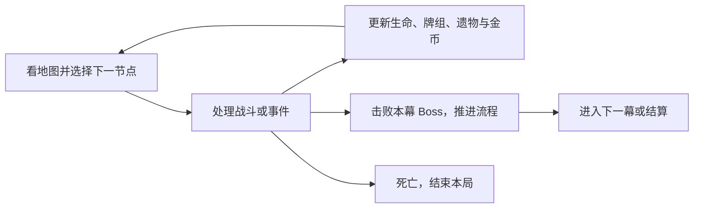

# 《杀戮尖塔》Roguelike 系统拆解

**下一场精英战，怎样改变一张牌的价值？**

**拆解范围**　《杀戮尖塔》初代 PC 版 · 铁甲战士 · 第一幕 · 基础难度（A0）  
**作品方向**　游戏策划实习 · 系统、战斗与关卡设计

## 结论摘要

《杀戮尖塔》把选路、战斗和构筑做成了同一个决策。**地图决定接下来要解决什么问题，牌组决定能用什么方式解决，战斗损失的生命值又决定还有多少选路空间。** 随机发来的牌与分岔路线每局会变，玩家始终可以根据敌方意图、地图节点和当前资源判断下一步。

以铁甲战士的第一幕为例，新增一张未升级的双重打击，在本文的首回合模型中把「可打出至少 20 点伤害」的手牌比例从 **0% 提高到 40.9%**，同时把「抽到至少两张防御」的比例从 **73.8% 降到 65.2%**。直接加牌提升了首手爆发，也降低了同时抽到两张防御的概率。精英的位置和剩余生命值决定了这笔交换是否划算。

| 阅读入口 | 核心问题 |
| --- | --- |
| [核心循环](#核心循环) | 战斗结果怎样影响下一次构筑与选路？ |
| [战斗与构筑](#战斗与构筑) | 同一张牌怎样改变输出上限与防御稳定性？ |
| [第一幕关卡与路线](#第一幕关卡与路线) | 同一个精英节点在什么时候值得走？ |
| [设计实验](#设计实验精英前保留一次改道机会) | 怎样验证玩家能理解并使用风险退出选项？ |

> 游戏规则依据公开资料核对。回合、路线和概率推演使用文中列出的假设，设计实验为待测试的提案。

## 核心循环

| 决策尺度 | 玩家能看到什么 | 玩家付出什么 | 结果传到哪里 |
| --- | --- | --- | --- |
| 回合 | 手牌、可用能量、敌人意图和状态 | 费用与出牌机会 | 斩杀进度、受伤量、下回合状态 |
| 节点 | 当前生命、牌组缺口、奖励选项 | 一次选牌机会、金币，或升级与回血之间的取舍 | 牌组质量、后续战斗能力 |
| 幕 | 地图连线、可达节点类型、当前资源 | 走上一条分支，同时放弃其他分支的可达奖励 | 后续风险、养成速度、Boss 前状态 |

普通战斗通常给出三张候选牌，玩家可以拿一张，也可以跳过。精英胜利通常额外给遗物。休息点基础选项是休息或升级一张牌，商店则可以用金币买资源或移除牌。地图明示节点类型与连线，具体战斗对象、事件结果和奖励要等进入相应流程才知道。由此，路线能做中期规划，也会随实际奖励调整。 [官方 Steam 页面][steam] · [卡牌奖励][rewards] · [地图节点][nodes] · [地图生成研究][maps]

## 战斗与构筑

### 敌人意图让攻防决策可计算

铁甲战士在基础情况下每回合有 3 点能量、抽 5 张牌。敌人头顶的意图展示即将进行的行动，攻击意图显示伤害信息。出牌的效果会改变敌人的生存、状态或当回合结算，玩家可以在结束回合前重新评估。 [官方宣传片][trailer] · [战斗规则][mechanics]

**回合推演。** 玩家剩 11 HP，面对单个无格挡目标，目标剩 15 HP、意图攻击 12。手牌为痛击、两张打击、两张防御，均未升级。无药水及其他影响伤害或格挡的效果。打击 1 费打 6，防御 1 费挡 5，痛击 2 费打 8 并施加易伤，之后的攻击伤害提高 50%。 [铁甲战士卡牌][cards] · [易伤规则][vulnerable]

| 3 费出法 | 造成伤害 | 得到格挡 | 敌方结算后 |
| --- | ---: | ---: | --- |
| 痛击 → 打击 | 8 + 9 = 17 | 0 | 目标死亡，玩家维持 11 HP |
| 打击 × 2 + 防御 | 12 | 5 | 目标剩 3 HP，玩家剩 4 HP |
| 打击 + 防御 × 2 | 6 | 10 | 目标剩 9 HP，玩家剩 9 HP |

只把目标生命改成 **18 HP**，第一种出法就会在敌人剩 1 HP 时承受 12 点反击，玩家死亡。两张进攻牌的伤害相同，**能否跨过斩杀线**改变了这回合的生死。构筑时为下一场战斗补一点即时伤害，价值可能来自少挨一个回合。

### 三选一的真实成本是下一次抽牌

铁甲战士的初始牌组包含 5 张打击、4 张防御、1 张痛击。假设一次卡牌奖励提供未升级的双重打击（1 费，造成两次 5 点伤害）。比较跳过、直接加入、加入后再在商店移除一张打击三个状态。第三个状态另需一次移除机会与金币。 [铁甲战士初始牌组][ironclad] · [双重打击数值][cards]

| 牌组状态 | 首回合伤害可达 20 | 首手至少两张防御 | 首手有痛击 |
| --- | ---: | ---: | ---: |
| 跳过，10 张 | 0 / 252 = **0%** | 186 / 252 = **73.8%** | 126 / 252 = **50.0%** |
| 加入双重打击，11 张 | 189 / 462 = **40.9%** | 301 / 462 = **65.2%** | 210 / 462 = **45.5%** |
| 加入后移除一张打击，10 张 | 109 / 252 = **43.3%** | 186 / 252 = **73.8%** | 126 / 252 = **50.0%** |

计算口径与复算方法

将每张实体卡分别编号，从 N 张牌中等概率、不放回抽 5 张，分母为 C(N, 5)。目标无格挡、无初始易伤，也无额外抽牌、能量或其他数值修正。20 点是演示用阈值。

- **伤害达标。** 初始牌组最多打出三张打击，共 18 点。加入双重打击后，达标手牌必须包含双重打击，并同时拥有痛击或至少两张打击。两套解法分别得到 8 + 7 × 2 = 22 和 10 + 6 × 2 = 22 点。易伤后的每段 5 点伤害按 7 点结算。11 张牌时，先固定双重打击，再从余下 10 张抽 4 张，减去无痛击且最多一张打击的手牌，得到 210 − 1 − 20 = 189。移除一张打击后同理，得到 126 − 1 − 16 = 109。
- **抽到至少两张防御。** 用全部手牌数减去抽到零张防御与恰好一张防御的手牌数，即 C(N, 5) − C(N − 4, 5) − 4 × C(N − 4, 4)。
- **抽到痛击。** 唯一一张痛击出现在前 5 张的概率是 5 / N。

**设计含义。** 双重打击使有费用和抽牌上限的第一回合更容易形成爆发，也会稀释现成的防御牌。移除低效打击可以同时提高两项指标，但会占用购买其他卡或药水的预算。这里的百分比只覆盖指定条件下的首手，精英战的胜负还取决于敌人特性、后续抽牌、当前生命值以及玩家是否愿意用受伤换输出。

## 第一幕关卡与路线

### 同一个精英图标，三种牌组压力

| 精英 | 实际机制 | 该机制考验什么 |
| --- | --- | --- |
| Gremlin Nob | 获得激怒后，玩家每打出一张技能牌，它就获得力量 | 技能防御能缓解眼前一击，也可能抬高后续伤害。需要早期攻击密度与斩杀预判 |
| Lagavulin | 通常以沉睡开场，醒来后连续攻击，并周期性降低玩家的力量和敏捷 | 能否把开场窗口变成铺垫或爆发，并在减益拖低数值前结束战斗 |
| 三只 Sentry | 多个目标轮换攻击或把晕眩塞入弃牌堆 | 能否先击倒一只降低压力，并应对洗牌后被晕眩占用的抽牌位 |

第一幕补攻击的价值由这些战斗具体化。对 Nob，保留费用给攻击可减少技能触发的成长。对 Sentry，集火斩杀能立即少面对一个敌人。对 Lagavulin，前置准备与后续爆发同样重要。地图只告诉玩家这里有一场精英战，准备时就要兼顾这些压力。 [Nob][nob] · [Lagavulin][lagavulin] · [Sentry][sentry]

### 路线推演：休息点放在精英前还是精英后

设铁甲战士最大生命 80，当前 24 HP，牌组仍以基础牌为主，无药水，持有初始遗物燃烧之血。遗物在战斗结束后回复 6 HP，休息点的基础休息回复最大生命的 30%，这里是 24 HP。假设两条分支于三格后汇合。 [燃烧之血][ironclad] · [休息点规则][rest]

| 路线 | 眼前取得什么 | 主要代价 | 选择条件 |
| --- | --- | --- | --- |
| A　精英 → 普通战斗 → 休息点 | 保留打完两场后再回血或升级的机会 | 两场战斗夹在起点与休息点之间，第一场还无法利用战后回血渡过致死伤害 | 牌组在首手不理想时仍能应付精英，并留下足够生命应付下一战 |
| B　休息点 → 精英 → 普通战斗 | 休息后可以用 48 HP 进精英战 | 提前用掉了回血机会，也放弃了这次升级 | 当前扛不住精英的典型损失，或牌组依赖特定首手 |

给两条路线都代入一次预计损失 26 HP 的精英战，作为压力情景。路线 A 在战后回复触发前就会死亡。路线 B 在该战存活，按假设以 48 − 26 + 6 = **28 HP** 进入普通战斗，之后还得独立评估生存。如果起始生命改为 48 HP 且近期刚拿到前置输出，路线 A 的风险下降，玩家可以把休息或升级的选择保留到打完两场之后。

两条路线的节点总量相同，真正改变决策的是**补给到达的时点**。在地图生成或手工关卡配置中，改动精英与补给的顺序，就能改变同一套战斗数值在一幕中的压力。

## 与《哈迪斯》对照

| 比较维度 | 《杀戮尖塔》 | 《哈迪斯》 |
| --- | --- | --- |
| 单局提升 | 卡牌、遗物与药水改变之后的回合解法 | 神明赐福与其他局内强化改变即时战斗方式 |
| 失败后可带走的成长 | 对路线和敌人的知识，以及账号层面的内容解锁 | 玩家经验、永久成长资源和后续可推进的角色互动 |
| 主要学习反馈 | 通过敌人意图、抽牌与本次损血回看选牌和费用决策 | 通过敌人动作、走位结果与回到冥府后的反馈学习 |

《杀戮尖塔》的主要反馈在一局之内闭合，前几层选了什么，会体现在随后几场战斗的手牌和血线上。《哈迪斯》的永久成长和冥府互动给失败后的下一局添了一层推进动力。把同一套「冒险换成长」结构迁移到动作 Roguelike 时，可优先用玩家能在实战中读到的敌人动作和房间奖励，承担卡牌游戏里敌人意图与构筑信息的职责。 [Mega Crit 官方游戏资料][press] · [Supergiant 官方 FAQ][hades]

## 设计实验：精英前保留一次改道机会

**假设。** 初次在第一幕规划路线的玩家，如果能在一场普通战斗后重新评估是否进入精英房，会更容易说明自己在承担什么风险，也更有机会根据战后状态调整选择。

| 原型配置 | 路线规则 |
| --- | --- |
| A / 对照 | 在第 4 层选择分支；进入进攻分支后，第 5 层普通战斗只连向第 6 层精英。另一条分支的第 6 层为休息点 |
| B / 实验 | 增加从进攻分支第 5 层普通战斗通往第 6 层休息点的连线，玩家可改道；保留原精英入口 |

两个分支在第 7 层汇合。两版共用同一组节点、敌人、奖励和抽牌序列，唯一变量是这条有向连线。图上从一开始就显示全部连线，改道不额外增加层数。试玩原型准备两组战后快照，分别模拟「掉血较多，仍缺爆发」与「生命健康，有即时输出」，每组均配相同的 A、B 地图。玩家先在第 4 层做路线选择。随后另给所有人同样的第 5 层进攻分支快照，以便比较他们在这个决策点的判断。

**试玩与记录。** 招募约 24 名玩过卡牌游戏、初次接触本作的玩家，按 A/B 随机分组，每人先完成同一份意图、节点与奖励教学，再体验两组快照，组内平衡呈现顺序。先记录选择，再请玩家说明理由。记录每次看到的出口、生命、选择、用时与理由，并追踪通过第 7 层的结果。

| 指标 | 定义与判断 |
| --- | --- |
| 风险理解率（主指标） | 所有有效快照作答中，能同时说出当前的精英奖励、生命或牌组风险，以及当下能否改道去休息点的比例。没有退路时，准确指出这一点同样计入。用同一份评分口径比较 A/B |
| 状态敏感度 | 高生命且有爆发时的精英选择率，减去低生命且缺爆发时的精英选择率，B 版用这个差值判断改道是否随战后状态变化。A 版在该快照只能进入精英，差值固定为零 |
| 难度护栏 | 按快照分别记录到达汇合点的生存率与剩余生命，并记录高生命快照的精英选择率。若高生命组也集中改道，回看休息收益或退出选项是否压过了精英价值 |
| 操作验收 | B 版只能从合法起点使用新连线，两条后续路径都能抵达汇合点，选中的节点只结算一次，选择后存读档能还原所在节点与已结算奖励 |

首轮看风险理解率是否提高，以及改道是否主要发生在低生命快照。小样本用于发现路线理解和选择原因。若方向一致，再用多种地图与奖励组合扩测，并按种子、牌组强度和玩家熟练度分组看第一幕死亡率。直接比较「走精英」与「没走精英」玩家的通关率会混入选择偏差，因为更强的牌组本来就更可能主动走精英。Mega Crit 在 GDC 分享了如何把数据、社区反馈和迭代结合起来做平衡。 [GDC 开发者分享][gdc]

## 资料来源

- Mega Crit 的[官方游戏资料][press]、[Steam 页面][steam]和[宣传片][trailer]用于确认产品定位及游戏中可见的信息。开发与平衡实践见 Anthony Giovannetti 的 [GDC 2019 分享][gdc]。
- 社区规则索引用于核对初代细节。见[战斗规则][mechanics]、[铁甲战士初始牌组与遗物][ironclad]、[铁甲战士卡表][cards]、[易伤][vulnerable]、[地图节点][nodes]与[铸造和休息][rest]。
- 公开拆解案例中，机核的[卡组构筑玩法系统分析][gcores-system]展示了如何从卡组系统追到其他子系统，[局内构筑设计][gcores-build]展示了如何按卡牌在协同中的职责分析卡组。本文将两个视角用于同一条选路、战斗与选牌的决策链。
- Bazzaz 等人的[程序化地图不确定性研究][maps]提供了从分支与信息可见性分析地图的视角。跨品类对照依据 Supergiant Games 的[《哈迪斯》官方 FAQ][hades]。

[steam]: https://store.steampowered.com/app/646570/Slay_the_Spire/
[press]: https://www.megacrit.com/press-kits/slay-the-spire/
[trailer]: https://www.youtube.com/watch?v=9SZUtyYSOjQ
[mechanics]: https://slaythespire.wiki.gg/wiki/Mechanics
[ironclad]: https://slay-the-spire.fandom.com/wiki/Ironclad
[cards]: https://slay-the-spire.fandom.com/wiki/Ironclad_Cards
[vulnerable]: https://slay-the-spire.fandom.com/wiki/Vulnerable
[rewards]: https://slay-the-spire.fandom.com/wiki/Card_Rewards
[nodes]: https://slay-the-spire.fandom.com/wiki/Map_locations
[rest]: https://slay-the-spire.fandom.com/wiki/Rest_Site
[nob]: https://slay-the-spire.fandom.com/wiki/Gremlin_Nob
[lagavulin]: https://slay-the-spire.fandom.com/wiki/Lagavulin
[sentry]: https://slay-the-spire.fandom.com/wiki/Sentry
[maps]: https://arxiv.org/abs/2504.03918
[hades]: https://www.supergiantgames.com/blog/hades-faq/
[gdc]: https://www.gdcvault.com/play/1025731/-Slay-the-Spire-Metrics
[gcores-system]: https://www.gcores.com/articles/212672
[gcores-build]: https://www.gcores.com/articles/212986
