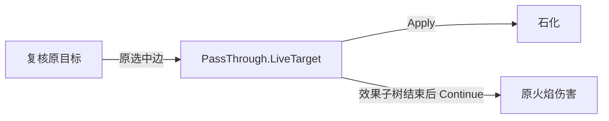

# 法师技能图工作台：免费测试版

传播原位编辑、真实并发分裂，以及新增选敌/条件节点见[玩法扩展指南](ga-graph-gameplay-expansion.md)；全部节点的登记与界面开放范围见[能力覆盖表](ga-node-capability-coverage.md)。旧配置仍保留串行兼容，新建工作台 Forked 默认并发。

本版测试真实节点/边组装和原GA施法，组装不消耗元素球、金币或背包物品。原技能耗蓝、冷却、动画与目标规则仍保留，便于验证是否重复扣费或改变时序。精英掉球、安装消耗和局内配方存档不在这一测试版内；正式版仍按用户确定的“安装成功消耗，移除不返还”开发。

人物面板第四页现在使用改装卡界面。旧图工作台的各轮报告见[验证记录](runtime-graph-workshop-validation.md)。

## 进入与基本操作

直接 PIE 的默认法师可点击**属性 → 第四页「技能组装」**。选择技能并开始测试，点击对应位置的卡片查看预览，选「应用改装」。同一位置的卡片可替换，独立位置可共存。已安装的卡片可单独拆除，也可重置本次试装。隐藏面板后，用鼠标瞄准并按 **T** 使用改装后的临时技能。关闭测试回收临时授予。

### 第二批试装

新增可选技能为种火、猎手哨塔、涟漪地雷、烈焰风暴、雷狱结界和霜冻符域。第四页按实际技能阶段择选卡片，原技能动画、冷却、耗蓝和已装备配置由原 GA 管理。

| 新卡片 | 效果 |
| --- | --- |
| 三响回流 | 每次施法在第 3 次实际造成伤害时回 12 点法力。对同一敌人的不同伤害可分别计数，每次施法最多恢复一次。 |
| 汲取 | 实际造成伤害后恢复 10 点生命，每次施法最多一次。可替换其他资源卡。 |
| 烈火溅射 | 主攻击击杀时以命中点为中心，在 2 米内对最多 6 个敌人造成基础 10 点火伤。 |
| 密集脉冲 | 领域伤害间隔设为 0.4 秒。 |
| 备用弹 | 猎手哨塔每次施法最多发射 4 次。 |
| 急速涟漪 | 涟漪地雷在触发引信 0.25 秒后发出冲击波。 |

霜冻符域可搭配「密集脉冲」和「三响回流」测试持续攻击计数。涟漪地雷可同时装「快速布防」和「急速涟漪」，分别缩短部署到可触发、触发到发出冲击波的等待。

### 第三批试装

新增可选技能为环形余震、大地震波、极寒风暴、熔日火球、陨火余烬和穿云雷球。

| 新卡片 | 效果 |
| --- | --- |
| 追击残血／越阵 | 安装逐个弹跳或同时分裂后开放。后续传播优先找当前生命比例最低或最远的合法目标。换传播方式时保留选敌卡，拆除传播方式前先拆选敌卡。 |
| 近身震环 | 将环形余震的内半径缩为 30 厘米，保留外半径。 |
| 宽幅断层 | 将支持直线塑形的技能的判定总宽度设为 2.6 米。 |
| 首击停弹 | 穿透型弹体在第一次命中敌人时停止，触发原有的飞行结束效果。 |
| 残血石化 | 主攻击结算后，仍存活且生命低于 35% 的目标石化 2 秒。 |

火焰箭可组合「同时分裂」「追击残血」和「冰霜」，在同一施法里改变传播形态、选敌和结算元素。

### 第四批试装

新增可选技能为奥术新星、奥术哨塔、寒霜寄生、雷霆烙印、三重焰印和雷链聚爆。

| 新卡片 | 效果 |
| --- | --- |
| 潮湿引雷 | 主攻击结算后，向仍潮湿的存活目标追加基础 12 点雷伤，沿用原有导电反应。 |
| 冻结回响 | 主攻击结算后，向仍被冻结的存活目标追加基础 14 点奥术伤害。与潮湿引雷共用元素联动位置。 |
| 延时雷爆 | 领域自然到期 0.5 秒后，根据敌人的当前位置重新选敌并爆裂。 |
| 扩散新星 | 奥术新星基础伤害半径扩大 30%。 |
| 远距转移 | 将附着目标死亡后的转移搜索范围设为 6 米。 |
| 两层引爆 | 标记累计两层即触发技能原有爆裂。 |

霜冻符域可同时装「冻结回响」和「延时雷爆」。前者追加伤害需要等目标进入冻结，后者在领域结束后根据当时的站位结算。

### 第五批试装

新增可选技能为引力塌缩、荆棘震退、石化凝视、叉状闪电、逐跳闪电链和奥术碎片。

| 新卡片 | 效果 |
| --- | --- |
| 集中石化 | 优先石化合法范围内生命比例最低的三个敌人，石化时长增加 50%。Actor 和 Mass 参加同一次排序。 |
| 广域凝视 | 石化凝视的基础选择半径扩大 30%，可与集中石化同装。 |
| 强力位移 | 单个目标牵引或击退距离上限设为 3 米。地形碰撞和技能原规则继续约束实际位移。 |
| 紧密聚拢 | 牵引目标时在中心保留 0.5 米，仅聚拢型技能提供此卡。 |
| 迅疾震波 | 将适用震波的波前速度设为每秒 6.5 米。 |
| 延伸电弧 | 将闪电搜索后续目标的半径扩大 35%。 |
| 扩散碎片 | 每枚奥术碎片的基础伤害半径扩大 25%。 |

石化凝视装上「集中石化」和「广域凝视」后，可以用一组近处满血、远处残血的敌人对照实际选择结果。

### 第六批试装

新增原生技能「奥术护盾」「凝滞力场」。定点爆裂、扇形冲击、脉冲领域和触发地雷四个现有范围技能也可在第四页试装。

| 技能 | 基础效果 |
| --- | --- |
| 奥术护盾 | 消耗 18 法力，冷却 8 秒。自身获得 40 点护盾，持续 4 秒。 |
| 凝滞力场 | 消耗 24 法力，冷却 9 秒。鼠标指定落点，对半径 2.8 米内最多 12 个敌人施加 1.5 秒石化，覆盖 Actor 和 Mass。 |

| 改装卡 | 效果 |
| --- | --- |
| 命中护盾 | 主攻击首次实际造成伤害后，获得 25 点护盾，持续 3 秒。每次施法最多触发一次。 |
| 厚重屏障 | 奥术护盾每次授予 60 点。 |
| 延续屏障 | 奥术护盾持续 6 秒，可与厚重屏障同装。 |
| 扩展范围 | 所选技能的主范围半径或前方扇面距离增加 25%。 |
| 延长凝滞 | 凝滞力场石化时长增加 50%，可与扩展范围同装，达到半径 3.5 米、持续 2.25 秒。 |
| 迟缓印记 | 主攻击命中后减速仍存活的目标 2 秒，与其他命中效果共用位置。 |
| 持久领域 | 有限领域时长增加 50%，脉冲间隔保持原值。 |

试装时应用卡片，隐藏第四页，按 T 施放；凝滞力场以鼠标指定落点。不同来源的护盾取最高剩余值和最迟到期时刻，吸收抗性等规则处理后的伤害。完全吸收时本次生命伤害为零，部分吸收时按溢出值处理。

### 第七批试装

四个原生法术均使用鼠标落点、一次费用提交，每次查询最多选中 8 个敌人。雨幕每次脉冲重新选敌，刚进入范围的敌人也能被润湿。

| 技能 | 默认效果 | 法力 / 冷却 |
| --- | --- | --- |
| 润泽雨幕 | 落点半径 3.2 米，立即及随后每 0.75 秒扫描一次，共 3 次。施加水元素，零伤害。 | 12 / 6 秒 |
| 炽焰涌爆 | 等待 0.45 秒后在落点半径 2.8 米内造成基础 36 点火伤。潮湿遇火产生蒸汽。 | 20 / 7 秒 |
| 雷鸣骤击 | 落点半径 3 米，造成基础 28 点雷伤。潮湿或蒸汽遇雷变为导电，本次伤害乘 1.25。 | 19 / 7 秒 |
| 寒晶爆发 | 落点半径 2.5 米，造成基础 24 点冰伤。潮湿或冻僵遇冰会冻结。 | 17 / 6 秒 |

| 新卡片 | 修改位置和效果 |
| --- | --- |
| 霜雾替换 | 雨幕脉冲改为施加冰元素。可通过连续脉冲触发冻结。 |
| 余韵 | 雨幕脉冲新增状态的时长增加 50%。已有冻结保留原到期时刻。 |
| 密雨 | 雨幕每 0.5 秒扫描一次，总次数保持 3 次。 |
| 急燃 | 涌爆等待缩至 0.2 秒。 |
| 引燃、导雷 | 将主攻击改为火伤或雷伤，与「冰霜」「潮汐」共用伤害元素位置。初始表现沿用所选技能。 |
| 导电束缚、蒸汽滞留 | 主攻击实际扣血后，视存活目标结算后留下的导电或蒸汽状态附加减速，时长分别为 1.5 秒、2 秒。两张卡占同一位置。 |

例如单独试「润泽雨幕」时，可装「霜雾替换」和「密雨」，按 T 观察首个脉冲冻僵、下一脉冲冻结。验证跨技能时，可先令敌人潮湿，再打冰伤或雷伤。原有「扩展范围」可以放大四种法术的实际范围。

### 第八批试装

| 技能 | 默认效果 | 法力 / 冷却 |
| --- | --- | --- |
| 沼蚀毒床 | 在落点铺设 4.2 × 4.2 米毒地，持续 8 秒，敌人接触时沿用原地形效果。 | 18 / 6 秒 |
| 熔沼引燃 | 搜索落点 3.6 米内最近的自有毒地，将其转为火地，保留位置、尺寸和剩余寿命。 | 12 / 5 秒 |
| 霜锋潮 | 波前从落点以每秒 9 米推进，最远 4.8 米。最多命中 12 个目标，基础冰伤 25，每个原生命最多一次。 | 22 / 8 秒 |
| 潮印放电 | 搜索落点 4.25 米内最近的最多 3 个潮湿敌人，分别造成基础雷伤 22，并走原导电反应。 | 14 / 6 秒 |

| 新卡片 | 效果 |
| --- | --- |
| 蔓生 | 地块长和宽都增加 30%。 |
| 久留 | 地块寿命从 8 秒延至 12 秒。 |
| 霜地替换 | 将毒地换成减速霜地。 |
| 远距引燃 | 毒地搜索半径提高到 5.4 米。 |
| 疾行冰锋 / 广域冰锋 | 分别将波前速度提高到每秒 15 米、最大半径提高到 6.5 米。 |
| 蒸汽导体 / 多重导体 | 分别将放电条件改为蒸汽、目标上限增至 5 个。 |

试地表连招时，先加「久留」并放置毒床，再切换「熔沼引燃」对准同一地块施放。地块会跨试装技能切换保留，直至到期或施法者生命失效。[候选来源和节点拆分](ga-elemental-terrain-wave.md)

### 第九批试装

| 技能 | 默认效果 | 法力 / 冷却 |
| --- | --- | --- |
| 涡流涤地 | 清除落点 3.6 米内最近的最多两块自有临时地表。同层地块才会参与。 | 10 / 5 秒 |
| 狭线裂霜 | 沿鼠标方向，在 7 米长、1.6 米宽的直线内寻找冻结目标，造成基础物理伤害 36。对存活目标实际扣血后消耗冻结。 | 18 / 7 秒 |
| 风压散流 | 沿鼠标方向推开 5.5 米内、50 度扇形中的潮湿目标，位移上限为 2.1 米。 | 15 / 6 秒 |
| 灼印迸火 | 等待 0.32 秒，从落点 5 米内选择最近的最多两个灼热敌人。每个目标在当前位置引发半径 1.8 米的爆裂，对最多五个敌人造成基础火伤 20。 | 22 / 8 秒 |

| 新卡片 | 效果 |
| --- | --- |
| 广域涤地 / 优先除毒 | 搜索半径增加 50%，或仅选择毒地。 |
| 宽幅裂霜 / 冻僵碎裂 | 直线完整宽度增至 3 米，或将筛选与消耗的状态一并改为冻僵。 |
| 宽角阵风 / 强风推移 / 蒸汽导流 | 分别将完整扇角提高到 80 度、位移上限提高到 3.3 米，或改为筛选蒸汽。 |
| 急速迸火 / 灼印溅射 | 分别将引信缩至 0.12 秒、将每次爆裂半径增加 30%。 |

要试冻僵碎裂，可以用冰伤先施加冻僵，随后沿准星方向释放装了「冻僵碎裂」的狭线裂霜。灼印迸火可用已有火攻为目标预置灼热，再让爆裂波及邻近敌人。[本批节点说明](ga-elemental-conversion-wave.md)

### 第十批试装

在人物属性面板第四页选择技能。放入改装卡并应用，隐藏面板后按 T。潮息复苏和霜甲净化作用于自身，其余六个技能使用地面落点。

| 技能 | 默认效果 | 法力 / 冷却 |
| --- | --- | --- |
| 潮息复苏 | 恢复自身 10 点生命，共三次，首跳即时，间隔 0.6 秒。 | 12 / 6 秒 |
| 霜甲净化 | 解除自身冻僵，授予 30 点护盾，持续 4 秒。没有冻僵时也获得护盾。 | 16 / 7 秒 |
| 寒封熔地 | 在 3.6 米内查找最近的自有临时熔岩，将其变为霜地，保留地块剩余寿命。 | 14 / 6 秒 |
| 腐化霜地 | 在 3.6 米内查找最近的自有临时霜地，将其变为毒地，保留地块剩余寿命。 | 14 / 6 秒 |
| 蒸汽冷凝 | 消耗 4.2 米内最多五名敌人的蒸汽并施加水元素。 | 12 / 6 秒 |
| 导电回充 | 消耗 4.2 米内最近一名敌人的导电，回复自身 9 点法力。 | 5 / 7 秒 |
| 雷印迟爆 | 锁定 4.5 米内最多两名感电敌人的位置，等待 0.45 秒后在原位置对 2 米内最多五个敌人结算基础雷伤 24。 | 21 / 8 秒 |
| 霜晶阵雨 | 在首个落点和附近依次触发四次冰爆，间隔 0.18 秒。单点在 1.4 米内对最多四个目标造成基础冰伤 17，范围重叠可以多次命中。 | 22 / 8 秒 |

| 新卡片 | 可改的玩法 |
| --- | --- |
| 快潮 / 深潮 | 恢复间隔缩至 0.35 秒，或每跳恢复量升至 15 点。 |
| 熄焰 | 将净化目标改成灼热。也可搭配「厚重屏障」「延续屏障」。 |
| 远域转化 / 藤地媒介 / 化为藤地 | 分别调整搜索距离、原地表和结果类别。组合时原地表和结果须不同。 |
| 扩展反应 / 凝成寒霜 / 聚导回充 | 扩大状态选择范围，或把冷凝的结果换成冰霜、把回充值提高到 15 点。 |
| 骤雷 / 搜寻导电 | 将雷印延迟缩至 0.18 秒，或改选导电敌人。 |
| 广布霜晶 / 密集霜晶 | 将落点分布半径扩到 3 米，或增加到六个落点。 |

可以先用毒床和熔沼引燃生成熔岩，再用寒封熔地和腐化霜地接续转化。等敌人出现蒸汽或导电后，再试对应的状态消耗法术。[完整移植清单](ga-elemental-porting-roadmap.md)

### 第十一批试装

这一批均用鼠标选地面，应用改装后隐藏面板，按 T 施放。

| 技能 | 默认效果 | 法力 / 冷却 |
| --- | --- | --- |
| 水纹浅滩 | 放置一块半宽、半长均为 2.4 米，持续 6 秒的潮地。敌人接触时获得水状态，已有反应按各自寿命继续。 | 13 / 6 秒 |
| 凝潮冻土 | 将落点 3.6 米内最近的同层自有潮地转为霜地。 | 12 / 6 秒 |
| 雷沼通电 | 将落点 3.6 米内最近的同层自有潮地转为通电地块。先前潮湿的敌人接触后进入导电。 | 13 / 6 秒 |
| 霜壳回收 | 回收落点 3.6 米内最近的一块同层自有霜地，成功后取得 40 点护盾，持续 5 秒。 | 14 / 7 秒 |
| 沼息回收 | 回收落点 3.6 米内最近的一块同层自有毒地，随后恢复 3 次生命，每次 8 点，首跳即时，间隔 0.6 秒。 | 12 / 6 秒 |
| 潮痕两相 | 逐个检查落点 3 米内的敌人。潮湿者受到 24 点基础雷伤，其余受到 18 点基础火伤。 | 19 / 7 秒 |
| 焰落突进 | 地面冲刺最多 6.2 米，计划时长 0.28 秒。实际移动后，在最终落点放置半宽、半长均为 1.5 米的熔岩，持续 4 秒。 | 16 / 7 秒 |

| 新卡片 | 改装位置 |
| --- | --- |
| 漫潮、留潮 | 将潮地半宽和半长改为 3.2 米，或将地表寿命延至 9 秒。 |
| 潮生毒沼、融霜成潮、潮地媒介 | 独立替换地表转化的来源或结果。来源与结果须是不同地表。 |
| 远域回收、汲潮 | 搜索半径提高 50%，或改为回收潮地。护盾与治疗仍由后续节点负责。 |
| 冻僵分流、奥术潮痕、寒潮余响 | 分别更换分流条件、匹配时的伤害元素和未匹配时的伤害元素。 |
| 长距飞焰、迅焰 | 分别改为最多冲刺 8.5 米、计划时长 0.18 秒。 |
| 霜落、焰落扩散、余焰 | 改为落地生成霜地，或将地块半宽和半长增至 2.2 米、寿命延至 6 秒。 |

试玩地表连招时，先铺「水纹浅滩」，结束该轮试装，再对同一地块施放「凝潮冻土」或「雷沼通电」。地块跨试装保留，成功转化时沿用原位置、尺寸和剩余时间。通过「潮生毒沼」改出毒地，再切到沼息回收可验证另一条连锁。 [第二轮移植清单](ga-elemental-porting-terrain-chains.md)

### 第十二批试装

| 技能 | 默认效果 | 法力 / 冷却 |
| --- | --- | --- |
| 升潮化雾 | 将落点 3.6 米内最近的同层自有潮地转成雾云。敌人身体进入雾体时触发水状态。 | 14 / 6 秒 |
| 雾凝清池 | 将落点 3.6 米内最近的同层自有雾云凝成潮地。 | 11 / 5 秒 |
| 雷雾环生 | 将落点 3.6 米内最近的同层自有雾云通电，敌人接触后触发雷状态。 | 16 / 7 秒 |
| 旋风驱雾 | 移除落点 3.6 米内最近的最多两块自有云，成功位置播放表现。 | 10 / 5 秒 |
| 雷地借势 | 首跳即时，每隔 0.6 秒共三跳。在落点 4.2 米内重新找最近的自有通电地块，每跳以地块为中心在 2.2 米内造成 12 点基础雷伤。 | 18 / 7 秒 |
| 霜地借势 | 同节拍查找自有霜地，在 2.2 米内施加冰霜与持续 1.2 秒的减速。 | 16 / 7 秒 |
| 熔印裂爆 | 寻找落点 4.5 米内最近的灼热敌人并消耗灼热。在该位置对 2.35 米内最多五人造成 32 点基础奥术伤害。 | 20 / 7 秒 |
| 雷印传递 | 寻找落点 4.5 米内最近的导电敌人并消耗导电。在锁定的位置等待 0.22 秒，对 3.3 米内最多三名其他敌人造成 21 点基础雷伤。 | 18 / 6 秒 |

| 新卡片 | 改装位置 |
| --- | --- |
| 霜地升雾、通电雾凝、沉雷 | 分别更换升雾来源、凝回地面的云类型和通电技能产物。 |
| 长风驱雾、截雷 | 扩大驱雾范围，或只清除通电云。 |
| 远域借势、潮地供能、急促借势、广域借势、久霜缠足 | 分别调整地块搜索范围、地块种类、脉冲间隔、每跳命中范围与减速时长。 |
| 蒸汽裂爆、广聚裂爆 | 将寻找与消耗同时改为蒸汽，或增大裂爆半径。 |
| 感电引渡、远距传雷、分流传雷、骤然传雷 | 同步修改传递的状态条件，或分别加大传递半径、目标上限和缩短延迟。 |

先用带「留潮」的水纹浅滩铺地，接着在同一个落点使用升潮化雾、雷雾环生，再用带「通电雾凝」的雾凝清池还原。每一步都沿用第一次铺地的剩余时间。也可在雾云生成后切到旋风驱雾，或试装「潮地供能」让借势技能直接使用潮地。 [第三轮移植清单](ga-elemental-porting-cloud-catalysts.md)

雷印传递的改装继续使用八层有限图预算。状态切换、搜索距离、目标数量和传递延迟可分别安装，超出路径上限的多级后继不会出现在玩家卡片中。

## 开发图工作台

仅在 Development/Editor 中，关闭人物窗口后执行 `RuntimeRecipe` 打开独立的图工作台。开发者可使用[带图逐步操作](runtime-graph-workshop-visual-walkthrough.md)查看旧图画布的操作。

1. 选择具体基础技能及 Actor/Mixed 等实际类版本，点击“开始测试”。
2. 画布显示服务器确认、下一次T键施法使用的节点和边。滚轮缩放，拖动画布平移；“适应窗口”重置观察范围。
3. 点击节点本体，选择实际支持的替换或参数模板；点击输出端口追加分支；点击连线选择仅这一条边的串接操作。
4. 点击“预览画布编辑”。草稿为只读比较视图，此时当前技能尚未改变。点击“应用草稿”才发布新版本；“放弃草稿”保持当前图。
5. 点击“隐藏面板 · 按T施法”，使用原鼠标目标和T键。引导技能按原语义松键，开关技能再次按键；Orbit还使用原攻击输入。
6. 再次执行 `RuntimeRecipe` 重显隐藏的图工作台。可撤销最近一次、选择历史来源移除，或重置全部测试编辑。「关闭测试」等待服务器确认并清理本次临时 Spec 和独立在途图。「隐藏面板 · 按 T 施法」保留试装。

两种界面共用同一玩家的临时施法会话。窗口销毁或地图退出时精确放弃本次租约。关闭发生基础冲突时保留可操作的工作台并显示错误，可显式放弃测试。

这是临时测试能力，原技能栏和学习状态保持原值。图编辑提交只影响下一次施法；已开始的施法保留旧版本。已结算伤害不会回滚，目标状态按原到期和生命规则处理。

临时测试Spec等级为1，原正式技能等级不变；不要把一级测试伤害与已升级的正式技能伤害直接比较。

## 建议先完整验证这一个技能

选择原生火球 `GA_FireBolt`，默认细图是：

```text
Prepare.NativeFireBolt → Distribution.Scatter → Delivery.ProjectileAwait
                                              └ Hit → Target.ResolveImpact → Effect.InputDamage
```

1. 点击 `Delivery.ProjectileAwait`，选 `Propagation.Sequential`，总目标数3、命中后等待0.3秒、下一目标半径400cm、每跳伤害保留0.8。预览、确认，再应用。图中该节点保留身份，类型变为Sequential。
2. 点击准确连线 `Target.ResolveImpact.TargetFound → Effect.InputDamage`，选 `Insert.Registered`，片段 `Target.Petrify`、时长1.25秒。预览并应用。只改变这条边，原伤害节点保留。
3. 点击新出现的 `Status.Petrify` 节点，选 `Scale.Duration=2`，预览并应用。实际配置读回应显示 `DurationSeconds:2.5`。新增节点必须可以再次选择，不能只在基础节点下拉中操作。
4. 隐藏面板，对三个彼此接近的敌人施法。每一颗都应真实飞行；上一颗命中后等待0.3秒才从该落点发出下一颗。这一例石化在原火焰伤害之前执行，角色起手动画和原费用只走一次。
5. 重显面板，先撤销时长倍率，再撤销插入，最后撤销传播或重置。依赖前一模块的新规则还存在时，移除父模块会明确失败，要求先移除后代。

插入后的局部实际关系为：



若希望伤害**之后**石化，应选 `Effect.InputDamage` 使用 `Append.Status.Petrify`，从其真实 `DamageResolved` 后接原生命解析和石化。投递Hit口追加与后伤结果追加不是同一时点。

## 可用能力及明确限制

- 节点菜单以服务器实际配置的能力为准。参数存在不代表该节点会消费它；状态节点不会列出弹体追踪和单弹目标路由。
- 可信库包括现有数值/类型化参数、Sequential/Forked、石化/区域石化/Slow、Emitter到Beam，以及准确边的有限状态插入。并非所有片段都能连接所有口。
- `Append.Registered`是给输出口并行增加后继；`Insert.Registered`是只在所选边上等待片段完成再继续。共享尾部和同口其它边不会被串接操作删除。
- 当前精确插入不支持PreparedInventory，不绕过原图投影证明，也不会取得无限派生权限。拒绝信息是合同限制，不能通过清空证明或改profile解决。
- 草稿上的节点不能当作已接受目标继续改装；先应用。相同参数的两次预览仍可能有不同节点GUID，画布按实际身份更新。
- 工作台不接管同一玩家的另一正式类版本。不同类的正式专属外部规则不能同时适配测试版本时，会明确拒绝，要求先关闭测试；真实外部基础图变更保留并通过准确“放弃”退出处理。
- 新面板只持有自己的会话。兼容旧工具先创建的预览时，仅认领带服务器身份的旧工具会话，不能认领别的新图面板。

## 源码与证据

服务端纯值图为 `AbilityRuntimeRecipeGraphView`；当前图选择、草稿和撤销在 `AbilityRuntimeRecipeWorkshop.cpp`；精确边操作在 `AbilityRuntimeRecipe.cpp`；续接节点为 `PassThrough.*`；运行时画布与面板分别为 `AbilityRuntimeGraphCanvas` 和 `AbilityRuntimeRecipePanel`。所有动作沿原GraphInstance及原伤害/状态通路执行。

测试脚本为 `Scripts/GA/RuntimeGraphWorkshop/verify_workshop_pie.py`，通过原生Slate指针事件点击真实画布，再走UMG和原T/TargetData/Notify。单机与Listen远端各写独立报告，不能用服务器单元测试替代实际界面。当前实施证据和未完成项见[实施计划](superpowers/plans/2026-11-21-runtime-graph-workshop.md)及 `Saved/GAAuthoring/RuntimeGraphWorkshop/20261121-implementation/ledger.md`；完整需求与正式球的事务伪代码见[设计分析](2026-11-21-element-orbs-and-graph-workshop.md)。
