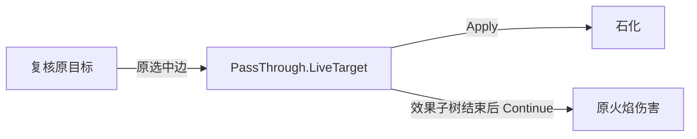

# 法师技能图工作台：免费测试版

传播原位编辑、真实并发分裂，以及新增选敌/条件节点见[玩法扩展指南](ga-graph-gameplay-expansion.md)；全部节点的登记与界面开放范围见[能力覆盖表](ga-node-capability-coverage.md)。旧配置仍保留串行兼容，新建工作台 Forked 默认并发。

本版测试真实节点/边组装和原GA施法，组装不消耗元素球、金币或背包物品。原技能耗蓝、冷却、动画与目标规则仍保留，便于验证是否重复扣费或改变时序。精英掉球、安装消耗和局内配方存档不在这一测试版内；正式版仍按用户确定的“安装成功消耗，移除不返还”开发。

第四页接入已完成：相关自动化66项、单机102项和远端110项真实界面/施法检查均通过，另有远端宿主移除清理4项通过；报告和已知基线见[验证记录](runtime-graph-workshop-validation.md)。最终表现和手感仍由用户确认。

## 进入与基本操作

直接 PIE 未通过存档选职业时，默认法师也可使用工作台；资格由真实玩家 Avatar 和战斗类型核验，职业值继续保持 `Unselected`。此前“已选择法师 GA 却仍提示仅法师可用”的入口 bug 已修复。[带图逐步操作](runtime-graph-workshop-visual-walkthrough.md)展示基础图、节点选择、参数、草稿和应用后的真实界面。

1. 使用法师角色进入游戏，点击原有的**属性按钮**，再点人物窗口第四页 **“技能组装”**。完整工作台直接显示在这一页，不需要控制台。选择具体基础技能及Actor/Mixed等实际类版本，点击“开始测试”。
2. 画布显示服务器确认、下一次T键施法使用的节点和边。滚轮缩放，拖动画布平移；“适应窗口”重置观察范围。
3. 点击节点本体，选择实际支持的替换或参数模板；点击输出端口追加分支；点击连线选择仅这一条边的串接操作。
4. 点击“预览画布编辑”。草稿为只读比较视图，此时当前技能尚未改变。点击“应用草稿”才发布新版本；“放弃草稿”保持当前图。
5. 点击“隐藏面板 · 按T施法”，使用原鼠标目标和T键。引导技能按原语义松键，开关技能再次按键；Orbit还使用原攻击输入。
6. 再次点击属性按钮并切到“技能组装”即可重显同一个工作台。可撤销最近一次、选择历史来源移除，或重置全部测试编辑。切换属性/装备/技能页保留本次组装；“关闭测试”或人物窗口右上的“关闭”会等待服务器确认并清理本次临时Spec和独立在途图；“隐藏面板 · 按T施法”保留测试能力。

`RuntimeRecipe` 保留为 Development/Editor 调试快捷入口，也指向同一个第四页。工作台仍是法师免费测试功能；其他职业、正式元素球获取和存档的范围没有扩大。整个窗口销毁或地图退出时精确放弃本窗口租约，不回滚别的系统对基础图的更新。关闭发生基础冲突时保留可操作的工作台并显示错误，可显式放弃测试。

这是临时测试能力，原技能栏和学习状态保持原值。图编辑提交只影响下一次施法；已开始的施法保留旧版本。已结算伤害不会回滚，目标状态按原到期和生命规则处理。

临时测试Spec等级为1，原正式技能等级不变；不要把一级测试伤害与已升级的正式技能伤害直接比较。

## 建议先完整验证这一个技能

选择原生火球 `GA_FireBolt`，默认细图是：

```text
Prepare.NativeFireBolt → Distribution.Scatter → Delivery.ProjectileAwait
                                              └ Hit → Target.ResolveImpact → Effect.InputDamage
```

1. 点击 `Delivery.ProjectileAwait`，选 `Propagation.Sequential`，总目标数3、命中后等待0.3秒、下一目标半径400cm、每跳伤害保留0.8。预览、确认，再应用。图中该节点保留身份，类型变为Sequential。
2. 点击准确连线 `Target.ResolveImpact.TargetFound → Effect.InputDamage`，选 `Insert.Registered`，片段 `Target.Petrify`、时长1.25秒。预览并应用。只改变这条边，原伤害节点保留。
3. 点击新出现的 `Status.Petrify` 节点，选 `Scale.Duration=2`，预览并应用。实际配置读回应显示 `DurationSeconds:2.5`。新增节点必须可以再次选择，不能只在基础节点下拉中操作。
4. 隐藏面板，对三个彼此接近的敌人施法。每一颗都应真实飞行；上一颗命中后等待0.3秒才从该落点发出下一颗。这一例石化在原火焰伤害之前执行，角色起手动画和原费用只走一次。
5. 重显面板，先撤销时长倍率，再撤销插入，最后撤销传播或重置。依赖前一模块的新规则还存在时，移除父模块会明确失败，要求先移除后代。

插入后的局部实际关系为：



若希望伤害**之后**石化，应选 `Effect.InputDamage` 使用 `Append.Status.Petrify`，从其真实 `DamageResolved` 后接原生命解析和石化。投递Hit口追加与后伤结果追加不是同一时点。

## 可用能力及明确限制

- 节点菜单以服务器实际配置的能力为准。参数存在不代表该节点会消费它；状态节点不会列出弹体追踪和单弹目标路由。
- 可信库包括现有数值/类型化参数、Sequential/Forked、石化/区域石化/Slow、Emitter到Beam，以及准确边的有限状态插入。并非所有片段都能连接所有口。
- `Append.Registered`是给输出口并行增加后继；`Insert.Registered`是只在所选边上等待片段完成再继续。共享尾部和同口其它边不会被串接操作删除。
- 当前精确插入不支持PreparedInventory，不绕过原图投影证明，也不会取得无限派生权限。拒绝信息是合同限制，不能通过清空证明或改profile解决。
- 草稿上的节点不能当作已接受目标继续改装；先应用。相同参数的两次预览仍可能有不同节点GUID，画布按实际身份更新。
- 工作台不接管同一玩家的另一正式类版本。不同类的正式专属外部规则不能同时适配测试版本时，会明确拒绝，要求先关闭测试；真实外部基础图变更保留并通过准确“放弃”退出处理。
- 新面板只持有自己的会话。兼容旧工具先创建的预览时，仅认领带服务器身份的旧工具会话，不能认领别的新图面板。

## 源码与证据

服务端纯值图为 `AbilityRuntimeRecipeGraphView`；当前图选择、草稿和撤销在 `AbilityRuntimeRecipeWorkshop.cpp`；精确边操作在 `AbilityRuntimeRecipe.cpp`；续接节点为 `PassThrough.*`；运行时画布与面板分别为 `AbilityRuntimeGraphCanvas` 和 `AbilityRuntimeRecipePanel`。所有动作沿原GraphInstance及原伤害/状态通路执行。

测试脚本为 `Scripts/GA/RuntimeGraphWorkshop/verify_workshop_pie.py`，通过原生Slate指针事件点击真实画布，再走UMG和原T/TargetData/Notify。单机与Listen远端各写独立报告，不能用服务器单元测试替代实际界面。当前实施证据和未完成项见[实施计划](superpowers/plans/2026-11-21-runtime-graph-workshop.md)及 `Saved/GAAuthoring/RuntimeGraphWorkshop/20261121-implementation/ledger.md`；完整需求与正式球的事务伪代码见[设计分析](2026-11-21-element-orbs-and-graph-workshop.md)。
